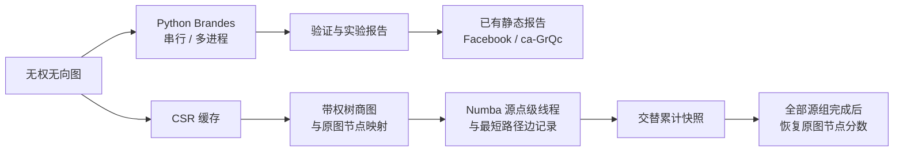

# LinkRadar

面向无权无向网络的精确介数中心性计算、并行实验与交互式探索工具。

[](pyproject.toml)
[](pyproject.toml)

[项目概览](#项目概览) · [快速开始](#快速开始) · [使用指南](#使用指南) · [项目架构](#项目架构) · [性能实验](#性能实验) · [详细文档](#详细文档)

## 项目概览

LinkRadar 分析**无权无向图**中节点在最短路径上的中转作用。项目实现了精确的 Brandes 介数中心性算法，并提供可复现的串行与并行对比实验。本地静态报告可用于探索已有的 Facebook 和 ca-GrQc 计算结果。

项目还提供独立的大图处理链路，包括 CSR 存储、可选的 Numba 编译内核、源点级线程并行、无损树商图和断点续算。YouTube 数据集已用于部分源组实验，**全量全源结果尚未完成**。

## 功能特性

- **精确中心性计算**：使用全源 Brandes 算法计算原始值和归一化值，并在支持的验证案例中与 NetworkX 对照。
- **并行实验**：比较串行、静态分批和动态分批多进程执行，分别记录执行、启动和归并耗时。
- **大图处理**：构建 CSR 和带权树商图缓存，使用编译版源点并行内核与最短路径边记录优化。
- **断点续算**：交替保存累计快照，中断后可恢复已完成的工作；全部源组处理完成后才发布原图节点的最终分数。
- **网络探索**：在静态报告中查看节点排名、搜索 ID、下载 CSV，并探索局部邻域与固定排名节点移除结果。
- **实验记录**：在运行目录中保存配置、环境、图指纹、耗时、验证结果和报告。

## 快速开始

需要 **Python 3.11 或更高版本**。在本地项目根目录的 Windows PowerShell 中执行：

```powershell
python -m venv .venv
.\.venv\Scripts\Activate.ps1
python -m pip install -e ".[dev,compiled]"
python -m parallel_bc demo --profile smoke
```

离线 smoke 配置会使用种子 42 生成一张 80 节点的图，运行串行和并行案例，并与 NetworkX 比较。完成后终端会输出 `实验状态：complete；报告：results/.../report.md`。运行目录还包含解析后的配置、环境信息和验证记录。`compiled` 可选依赖用于安装大图处理所需的 Numba；smoke 示例本身不依赖 Numba。已记录的依赖快照见 [requirements-lock.txt](requirements-lock.txt)。

其他 Shell 请使用对应平台的方式激活虚拟环境。本地示例不需要 API 密钥或用户自行配置的环境变量。

## 使用指南

### 查看现有报告

访问 [LinkRadar 在线报告](https://lyx0902.github.io/LinkRadar/)，探索已有的 Facebook 和 ca-GrQc 结果。该静态报告不会在打开时重新运行算法，也不会自动导入新的 YouTube 结果。详见 [Web 使用说明](web/linkradar/README.md)。

### 运行有限规模的 YouTube 实验

单独下载并解压 [YouTube 数据集压缩包](https://github.com/dange-academic/real_network_datasets/blob/main/PRE2020/youtube.zip)，将其中 KONECT 格式的 `youtube.txt` 放在 `data/raw/youtube/youtube.txt`，并查看上游来源的数据使用条款。数据集和生成的缓存不包含在 Git 仓库中。安装 `compiled` 可选依赖后，可按以下步骤准备缓存，并运行一个包含 64 个核心源组的分块：

```powershell
python -m parallel_bc data prepare-csr --dataset youtube --path data/raw/youtube/youtube.txt --format konect
python -m parallel_bc data prepare-quotient --dataset youtube_csr
python -m parallel_bc quotient-run --dataset youtube_csr --run-dir results/youtube_example --threads 4 --batch-size 4 --chunk-size 64 --seed 45 --max-chunks 1 --timeout 1800 --reserve-gib 1
```

请使用新的运行目录，并为预处理和线程工作区预留足够内存。每提交一个分块，终端会输出 `committed <completed>/<total> core groups`；分块计算期间不会逐源输出进度。这个示例只计算**部分源组**，不是全源结果。

如需继续同一任务，重复执行 `quotient-run` 命令并添加 `--resume`，同时保持数据集、内核、线程数、批次大小、分块大小、种子和 CPU 亲和性设置一致。去掉 `--max-chunks 1` 后，任务会继续运行至完成或本次会话超时；超时限制针对单次会话。可通过 `manifest.json` 查看进度和 `exact_all_sources` 状态。只有全部源组计算及最终恢复完成后，才会发布 `bc_raw.npy` 和 `bc_normalized.npy`；节点顺序与商图缓存中的 `original_ids.npy` 一致。启动长任务前，特别是在恢复旧版内核检查点时，请先阅读[检查点与恢复说明](docs/Pipeline_and_Checkpoints.md)。

```powershell
python -m parallel_bc --help
python -m parallel_bc quotient-run --help
python -m pytest -q
```

## 项目架构



商图保留外围树及其映射，通过源点权重和结果恢复计入原图节点，而不是将它们直接丢弃。未完成的检查点保存的是核心累计贡献，并非最终中心性结果。静态报告独立展示已有结果，不会由商图任务自动生成。

## 性能实验

一次有限规模实验在**相同的 64 个 YouTube 核心源组**上比较了原版反向扫描与最短路径边记录；这 64 组代表 122 个原始源点。实验在项目使用的 Windows 11 / Python 3.12.6 机器上进行，使用 4 个线程、批次大小 4、CPU 亲和性 `[0, 2, 4, 6]`，内核预热后进行三轮配对测量。计时覆盖线程执行与归并，不含加载、编译、结果恢复和进程启动。

| 轮次 | 原版（秒） | 边记录（秒） | 配对加速比 |
| --- | ---: | ---: | ---: |
| 1 | 6.395 | 4.156 | 1.539× |
| 2 | 5.873 | 4.091 | 1.436× |
| 3 | 5.375 | 4.074 | 1.319× |

三轮配对加速比的中位数为 **1.436×**。恢复后的全部 1,134,890 个原图节点的部分贡献，在文档记录的容差范围内与基线一致。这是小样本内核对比，不能作为端到端或全图加速保证；实验没有控制机器负载和 CPU 频率。实验方法与限制详见[边记录实验](docs/Graph_Optimization.md#dag-recording)、[实验结果](docs/RESULTS.md)和[全量耗时估算](docs/提速历程与全量耗时估算.md)。原始 `results/` 文件保存在本地，并被 Git 忽略。

## 详细文档

| 文档 | 内容 |
| --- | --- |
| [文档入口](docs/README.md) | 项目介绍与阅读路径 |
| [算法](docs/Algorithm.md) | Brandes 推导与中心性定义 |
| [CSR 与 Numba](docs/CSR_and_Numba.md) | 数据表示、编译与并行处理 |
| [图结构优化](docs/Graph_Optimization.md) | 树商图、结果恢复与边记录 |
| [处理链路与检查点](docs/Pipeline_and_Checkpoints.md) | 运行、输出、恢复与兼容性 |
| [运行与演示](docs/Run_and_Demo.md) | 命令与展示流程 |
| [实验结果](docs/RESULTS.md) | 实验、验证与限制 |
| [全量耗时估算](docs/提速历程与全量耗时估算.md) | 提速历程与有限条件下的外推 |

图缓存保存在 `data/processed/`，运行结果和生成的报告保存在 `results/`；两者均被 Git 忽略。网络排名反映节点在所给图中的位置，不代表已核实的现实身份或因果重要性。
