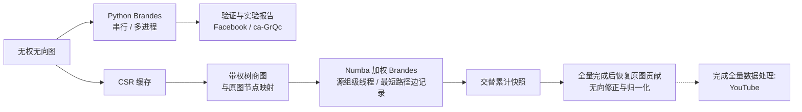

# LinkRadar

面向无权无向网络的精确介数中心性计算、并行实验与交互式探索工具。

[](pyproject.toml)
[](pyproject.toml)

[项目概览](#项目概览) · [快速开始](#快速开始) · [使用指南](#使用指南) · [项目架构](#项目架构) · [实战处理](#实战处理) · [详细文档](#详细文档)

## 项目概览

LinkRadar 分析**无权无向图**中节点在最短路径上的中转作用。项目实现了精确的 Brandes 介数中心性算法，并提供可复现的串行与并行对比实验。本地静态报告可用于探索已有的 Facebook、ca-GrQc 和 YouTube 计算结果。

项目还提供独立的大图处理链路，包括 CSR 存储、可选的 Numba 编译内核、源点级线程并行、无损树商图和断点续算。YouTube 的全源精确计算已于 2026-11-06 完成：470,164 个核心源组覆盖全部 1,134,890 个原始源点，两次会话监督墙钟合计约 2 小时 30 分 37 秒；核验范围与限制见[全量汇总报告](docs/Youtube全量处理报告.md)。

## 功能特性

- **精确中心性计算**：使用全源 Brandes 算法计算原始值和归一化值，并在支持的验证案例中与 NetworkX 对照。
- **并行实验**：比较串行、静态分批和动态分批多进程执行，分别记录执行、启动和归并耗时。
- **大图处理**：构建 CSR 和带权树商图缓存，使用编译版源点并行内核与最短路径边记录优化。
- **断点续算**：交替保存累计快照，中断后可恢复已完成的工作；全部源组处理完成后才发布原图节点的最终分数。
- **网络探索**：在静态报告中查看节点排名、搜索 ID、下载 CSV，并探索局部邻域与固定排名节点移除结果。
- **实验记录**：在运行目录中保存配置、环境、图指纹、耗时、验证结果和报告。

## 项目架构



两条计算分支都基于 Brandes 算法：一条直接在原图上使用 Python 串行或多进程计算，另一条在商图上使用加权 Brandes，并以 Numba 编译、线程并行和边记录加速。商图保留外围树及其映射，通过源点权重和结果恢复计入原图节点。未完成的检查点保存的是核心累计贡献，并非最终中心性结果。静态报告独立展示已有结果，不会由商图任务自动生成。

## 实际性能

以下三张无权无向图均已完成全源介数计算，节点数与边数按项目实际处理后的图统计。

| 图名 | 节点数 / 边数 | 采用链路方式 | 实际处理时间 | 原链路处理时间 | 加速比 |
| --- | ---: | --- | ---: | ---: | ---: |
| Facebook | 4,039 / 88,234 | Python Brandes，4 进程动态分批 | 77.31 秒 | — | — |
| ca-GrQc | 5,242 / 14,484 | Python Brandes，4 进程动态分批 | 20.95 秒 | — | — |
| YouTube | 1,134,890 / 2,987,624 | CSR + 树商图 + Numba 编译加权 Brandes，8 线程、边记录和双快照 | 2 小时 30 分 37 秒 | 约 165 天（外推） | 约 1,577×（估算比） |

Facebook 和 ca-GrQc 的时间是各自 3 次全源复测的总时间中位数，包含进程启动与清理；其中 ca-GrQc 复测的基线可比性筛查未通过，不能据此作可靠的并行加速结论。YouTube 是一次分两次会话完成的监督墙钟之和，不含会话间停顿。两种计时口径不同，不能直接用于跨图性能比较。

YouTube 的“原链路”是 **CSR 接入后的 Python 单核 Brandes**：由 8 个源点的内核时间外推全源约 165 天，未实际跑完全量。表中约 1,577× 是该外推值除以本次全量墙钟的粗略数量级比；两者运行日期、配置和计时口径不同，**并非受控实验测得的全量加速比**。详见[实验结果](docs/RESULTS.md)、[YouTube 提速历程](docs/Youtube提速历程.md)和[全量处理报告](docs/Youtube全量处理报告.md)。

## 快速开始

需要 **Python 3.11 或更高版本**。在本地项目根目录的 Windows PowerShell 中执行：

```powershell
python -m venv .venv
.\.venv\Scripts\Activate.ps1
python -m pip install -e ".[dev,compiled]"
python -m parallel_bc demo --profile smoke
```

离线 smoke 配置会使用种子 42 生成一张 80 节点的图，运行串行和并行案例，并与 NetworkX 比较。完成后终端会输出 `实验状态：complete；报告：results/.../report.md`。运行目录还包含解析后的配置、环境信息和验证记录。`compiled` 可选依赖用于安装大图处理所需的 Numba；smoke 示例本身不依赖 Numba。已记录的依赖快照见 [requirements-lock.txt](requirements-lock.txt)。

其他 Shell 请使用对应平台的方式激活虚拟环境。本地示例不需要 API 密钥或用户自行配置的环境变量。

## 使用指南

### 查看现有报告

访问 [LinkRadar 在线报告](https://lyx0902.github.io/LinkRadar/)，探索已有的 Facebook、ca-GrQc 与 YouTube 全源结果。该静态报告不会在打开时重新运行算法，也不会自动导入新的计算结果；YouTube 资源由 `scripts/export_youtube_web.py` 从已核验的全源运行中手工导出。详见 [Web 使用说明](web/linkradar/README.md)。

### 运行有限规模的 YouTube 实验

单独下载并解压 [YouTube 数据集压缩包](https://github.com/dange-academic/real_network_datasets/blob/main/PRE2020/youtube.zip)，将其中 KONECT 格式的 `youtube.txt` 放在 `data/raw/youtube/youtube.txt`，并查看上游来源的数据使用条款。数据集和生成的缓存不包含在 Git 仓库中。安装 `compiled` 可选依赖后，可按以下步骤准备缓存，并运行一个包含 64 个核心源组的分块：

```powershell
python -m parallel_bc data prepare-csr --dataset youtube --path data/raw/youtube/youtube.txt --format konect
python -m parallel_bc data prepare-quotient --dataset youtube_csr
python -m parallel_bc quotient-run --dataset youtube_csr --run-dir results/youtube_example --threads 4 --batch-size 4 --chunk-size 64 --seed 45 --max-chunks 1 --timeout 1800 --reserve-gib 1
```

请使用新的运行目录，并为预处理和线程工作区预留足够内存。每提交一个分块，终端会输出 `committed <completed>/<total> core groups`；分块计算期间不会逐源输出进度。这个示例只计算**部分源组**，不是全源结果。

如需继续同一任务，重复执行 `quotient-run` 命令并添加 `--resume`，同时保持数据集、内核、线程数、批次大小、分块大小、种子和 CPU 亲和性设置一致。去掉 `--max-chunks 1` 后，任务会继续运行至完成或本次会话超时；超时限制针对单次会话。可通过 `manifest.json` 查看进度和 `exact_all_sources` 状态。只有全部源组计算及最终恢复完成后，才会发布 `bc_raw.npy` 和 `bc_normalized.npy`；节点顺序与商图缓存中的 `original_ids.npy` 一致。启动长任务前，特别是在恢复旧版内核检查点时，请先阅读[检查点与恢复说明](docs/Pipeline_and_Checkpoints.md)。

```powershell
python -m parallel_bc --help
python -m parallel_bc quotient-run --help
python -m pytest -q
```

## 详细文档

| 文档 | 内容 |
| --- | --- |
| [文档入口](docs/README.md) | 项目介绍与阅读路径 |
| [算法](docs/Algorithm.md) | Brandes 推导与中心性定义 |
| [CSR 与 Numba](docs/CSR_and_Numba.md) | 数据表示、编译与并行处理 |
| [图结构优化](docs/Graph_Optimization.md) | 树商图、结果恢复与边记录 |
| [处理链路与检查点](docs/Pipeline_and_Checkpoints.md) | 运行、输出、恢复与兼容性 |
| [运行与演示](docs/Run_and_Demo.md) | 命令与展示流程 |
| [实验结果](docs/RESULTS.md) | 实验、验证与限制 |
| [YouTube 全量汇总报告](docs/Youtube全量处理报告.md) | 全源结果、两次会话、正确性核验与限制 |
| [全量耗时估算](docs/Youtube提速历程.md) | 提速历程与有限条件下的外推 |
