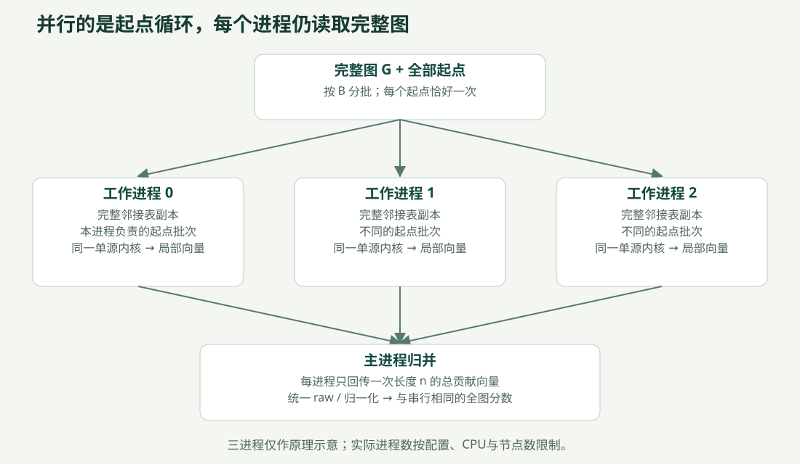

# CSR、Numba 编译与 CPU 并行

本篇沿用原单核与并行实现说明。基础 Brandes 数学见 [Algorithm.md](Algorithm.md)；树商图和边记录见 [Graph_Optimization.md](Graph_Optimization.md)。

<a id="youtube-csr"></a>

### 输入与来源

本地文件：data/raw/youtube/youtube.txt，使用KONECT的% sym unweighted头部。
用户提供：https://github.com/dange-academic/real_network_datasets/blob/main/PRE2020/youtube.zip 。
该仓库README将YouTube条目指向KONECT。它不是本项目从SNAP成功下载的文件。
原文件审计：data/raw/youtube/local_audit.json；参考规模1134890节点、2987624唯一无向边。

### 生成独立CSR缓存

在仓库根目录运行：

~~~powershell
.\.venv\Scripts\python.exe -m parallel_bc data prepare-csr --dataset youtube --path data/raw/youtube/youtube.txt --format konect --provenance data/raw/youtube/local_audit.json --timeout 300 --reserve-gib 3
~~~

输出data/processed/youtube_csr/，已有目录时拒绝覆盖。
- original_ids.npy：int64，原始ID完整保留。
- indptr.npy：int64行偏移。
- indices.npy：int32双向邻接，行内有序无重复。
- metadata.json：图/文件哈希、来源、清洗统计、连通分量、数组字节数及准备计时。
- 同级youtube_csr.preparation.json：硬预算执行状态、墙钟与子进程峰值内存。

格式是显式选择的：
- snap：默认只识别#注释；两列整数，坏行报错。
- konect：要求% sym unweighted、% 边行数 n n，检查1..n ID与行数，保留头部声明的孤立点。
不在旧load_graph中无条件跳过任意%行，避免改变原数据契约。

数据路径使用整数数组去重、构建邻接，不创建NetworkX大图或边tuple/set/dict的多份副本。
图哈希沿用旧GraphData规范编码，包含节点ID与孤立点；新缓存用独立格式LinkRadar-csr-v1。
读取时验证文件SHA、CSR对称性/有序性/索引和规范图哈希；通过只读内存映射打开数组。

### 固定起点Python短试算

~~~powershell
.\.venv\Scripts\python.exe -m parallel_bc large-pilot --dataset youtube_csr --backend python_tuple --counts 1 4 8 --seed 42 --timeout 120 --total-timeout 1800 --reserve-gib 3
~~~

- 每个案例为独立spawn子进程，父进程监控硬墙钟和系统可用内存。
- 默认给系统预留3GiB，资源不足则记录resource_not_run或resource_limit。
- 超时回收仅本次子进程，退出后保留源完成日志和失败记录，不把未完成向量当成功。
- 某案例触及资源线后，后续更大案例记为resource_not_run，不继续重复启动。
- 固定种子生成排列的嵌套前缀；相同图/种子在不同最大k下仍选到同样前缀。
- python_tuple：从CSR构造一次Python邻接tuple，调用原single_source_accumulate。
- python_csr：原single_source_accumulate直接通过CSR邻接适配器运行。可用--counts 1与上面的k=1做同源对照。
- 两个后端均保留原Python任意精度路径计数；没有静默改成int64路径数。
- numba_csr：单核本机数组内核，int64路径数溢出前回退原Python；JIT预热与计算分开记录。用`--backend numba_csr`启用。

输出results/<RUN_ID>_youtube_pilot/：
- manifest.json与report.md：逐案例状态、计时、环境与代码/图/源顺序标识。
- source_order.npy：主源集合。
- k*/sources.json：索引、原始ID、顺序哈希。
- k*/sources_completed.jsonl：每个已完成源的耗时；未完成case中也可读取。
- k*/contributions.npy：只有完成整个案例后才以原子重命名发布。
- k*/case.json：状态、范围、内存、时间、完成源数。

### 输出语义与计时边界

结果是完整图上选定S的未缩放有序贡献：
A_S(v) = sum_{s in S} delta_s(v)。

k<n时exact_all_sources=False，result_kind=source_subset_contribution、scaled=False。
不会输出全图精确介数、归一化估计或伪造的全节点Top10，也不能导入旧精确失效接口。
k=n时这里仍保存有序贡献，尚需使用原finalize_scores统一/2和按全图n归一化。

t_kernel仅原单源核心之和；t_adapter、t_load_validate、t_child_total、t_supervised_total分别列出。
硬预算包含子进程启动、缓存校验、适配、计算和I/O。
child_peak_rss_bytes覆盖子进程整个生命周期，不能当作kernel-only内存或父子唯一物理内存总量。
Windows还采样private bytes；系统最小可用内存和采样间隔单列。

这些是短pilot的单次观察；两个后端可能按顺序运行，不用于宣称统计显著加速。
复测协议与后续优化见[计算计划](RESULTS.md#dataset-plan)。

### 验证

~~~powershell
.\.venv\Scripts\python.exe -m pytest -q
~~~

新增测试覆盖：KONECT严格解析、孤立点/自环/重复、原始ID与旧图哈希等价、
非连通随机图的全源/子集数值对照、NetworkX参照、缓存篡改、真实spawn、
硬超时回收和内存不足拒绝启动。

<a id="numba-background"></a>

## 编译版单核 Brandes：实现原理、运行与验证

本轮实现 `numba_csr` 可选后端，处理完整的无权无向 CSR 图。这里的“编译”指把数值循环转换为 CPU 机器码；不是 GPU 计算，也没有开启多线程、结构压缩或近似采样。旧 Python 任意精度内核和旧全源计算/失效实验接口保留。

本说明描述单核后端；随后新增的源级线程并行和同后端1/2/4线程比较见[多核实现说明](CSR_and_Numba.md#compiled-parallel)。

### 从数据到执行的完整路线

`原始图 → 已校验的只读 CSR → Numba 预热 → 分配复用工作数组 → 逐源 BFS → 反向依赖累积 → 汇总贡献 → 数值核对与计时报告`。

实现位置：

- `src/parallel_bc/compiled.py`：编译循环、工作数组、溢出检测与 Python 回退。
- `src/parallel_bc/large_benchmark.py`：后端接入、逐源日志、预算监督与结果原子发布。
- `src/parallel_bc/compiled_benchmark.py`：同源、交替顺序、多次配对比较。
- `tests/test_compiled.py`：逐源/全源、NetworkX、溢出和真实 spawn 验证。

### 为什么原来的 Python 实现慢

对每个源点，原实现遍历全图，创建前驱 `list[list[int]]`，保存距离、任意精度路径数和依赖值。逐边操作会反复执行 Python 字节码、对象访问、整数对象分配和动态类型处理。CSR 只改变了图的存储方式，不能自动消除这些执行开销。

新内核对数值函数使用：

```python
@numba.njit(cache=True, nogil=True, fastmath=False)
```

Numba 根据输入的数组类型生成专用的本机代码，通过 LLVM 编译执行。`njit` 要求 nopython 模式，无法编译时直接报错；不会悄悄降级为带 Python 对象的执行方式。`nogil=True` 允许该函数执行时释放 GIL，但本轮仍逐源、单线程运行；没有使用 `parallel=True` 或 `prange`。`fastmath=False` 不允许宽松浮点重排，但结果仍受 float64 舍入影响，不能承诺与 Python 逐位一致。

本轮加速还包含数组化和前驱表消除，因此对照结果代表整个新后端的效果，不能把全部差异归因于 JIT 本身。

### 数学含义没有改变

对一个源点 $s$，BFS 得到距离 $d_s(v)$ 和最短路径条数 $\sigma_s(v)$。初始条件为 $\sigma_s(s)=1$，其余为 0。

若边 $(v,w)$ 满足 $d_s(w)=d_s(v)+1$，则它位于从源点向外的最短路径有向无环图中：

$$\sigma_s(w)\mathrel{+}=\sigma_s(v).$$

从 BFS 队列的末尾向前处理，可以保证后继节点的依赖值先算好：

$$\delta_s(v)=\sum_{w\in N(v),\ d_s(w)=d_s(v)+1}
\frac{\sigma_s(v)}{\sigma_s(w)}\bigl(1+\delta_s(w)\bigr).$$

比例表示“到达后继的最短路径中，有多少经过当前节点”；1 表示后继自身作为终点的贡献；$\delta_s(w)$ 表示更远终点经过后继的贡献。

原版把前驱存下来，再向前驱推送贡献。编译版重新扫描 CSR 邻居，用距离差判断最短路径后继，再从后继拉取贡献。对每条无向边反向遍历至多做常数次检查，数学上求的是同一个和。这样无需为百万节点创建百万个前驱列表。

完整 BFS 队列同时充当反向栈。所有源点均计算后，才按原 `finalize_scores` 进行一次无向图除以 2，以及全图规模归一化。仅算源集合 $S$ 时，输出仍为：

$$A_S(v)=\sum_{s\in S,\ s\ne v}\delta_s(v).$$

它是未缩放的源子集贡献，不是全图精确介数，也不是自动换算的近似介数估计。

#### 一个能手算的例子

边为 `S-A, S-B, A-T, B-T, T-U`，从S出发。BFS得到：

| 节点 | S | A | B | T | U |
|---|---:|---:|---:|---:|---:|
| 距离 | 0 | 1 | 1 | 2 | 3 |
| 最短路径数 | 1 | 1 | 1 | 2 | 2 |

反向计算时，U没有后继，所以依赖为0；T得到 `(2/2)*(1+0)=1`；A和B分别得到 `(1/2)*(1+1)=1`。S自身不计入该源贡献。最终这一源给出的向量是 `S=0, A=1, B=1, T=1, U=0`。

原版通过保存的前驱把T的贡献分给A和B；编译版处理A时查看后继T，再处理B时查看后继T。两者用同一个分配比例，变化在数据结构和执行方式。

### 工作数组与整数安全

| 数组 | 类型 | 用途 | 每节点字节 |
|---|---|---|---:|
| dist | int32 | 距离；-1 表示不可达 | 4 |
| sigma | int64 | 最短路径条数 | 8 |
| delta | float64 | 单源依赖 | 8 |
| queue | int32 | BFS 队列/反向顺序 | 4 |

工作区共 `24n` 字节；另有 `8n` 字节的贡献累加向量，以及 CSR、原始 ID 和运行库。工作区每次运行分配一次，每个源点清空后复用；分配时间和逐源计算时间分别记录。工作区大小不等于整个子进程峰值内存。

Python 整数可以任意精度增长，Numba 的 int64 不可以。因此在每次路径数相加前检查：

$$\sigma_s(v)>\operatorname{INT64\_MAX}-\sigma_s(w).$$

若条件成立，停止该源的编译计算，并用原 `single_source_accumulate` 从头重算该源；记录 `python_bigint_fallback`。编译阶段先把依赖存入临时数组，成功后才提交到总向量，因此回退不会重复累加半个源的结果。不会用浮点路径数或溢出后的整数继续计算。

CSR 缓存读取仍进行文件 SHA、结构和图指纹验证。编译入口另外检查偏移、索引范围和类型，避免向默认不做边界检查的本机循环传入错误索引。

### 安装与执行

在项目根目录执行：

```powershell
.\.venv\Scripts\python.exe -m pip install -e ".[dev,compiled]"
.\.venv\Scripts\python.exe -m parallel_bc large-pilot --dataset youtube_csr --backend numba_csr --counts 1 4 8 --seed 42 --timeout 240 --total-timeout 1000 --reserve-gib 2
```

配对比较：

```powershell
.\.venv\Scripts\python.exe -m parallel_bc compiled-compare --dataset youtube_csr --sources 8 --repeats 3 --seed 42 --timeout 240 --total-timeout 1000 --reserve-gib 2
```

每个案例独立 spawn 一个子进程；这用于硬预算监督，不是多核计算。Python 与编译后端使用完全相同的完整图、源点及顺序。奇数轮先 Python，偶数轮先编译版，以减小固定执行顺序的影响。

每次比较新建独立 JIT 缓存：第一轮编译版使用空缓存，后续轮从该缓存加载。Windows 使用扩展长度缓存路径，避免 Numba 原子写入的临时文件名超过 MAX_PATH。

### 怎样看时间

- `t_load_validate`：读取并验证 CSR；不算进内核。
- `t_backend_import`：导入可选编译后端和 Numba。
- `t_jit_warmup`：同类型的两节点小图首次调用，包括编译或缓存加载、分发及小图执行；不声称是纯编译时间。
- `t_workspace`：检查编译入口及分配工作区。
- `t_kernel`：所有所选源点的计算调用之和，包含清空数组、BFS、依赖回传、提交和必要的溢出回退。
- `t_supervised_total`：父进程看到的整例墙钟，包含启动、加载、校验、预热、计算、日志、结果保存和回收。

因此需要同时报告“内核加速比”和“整例墙钟加速比”。小规模工作量中，缓存校验、Numba 导入和编译可能占很大比例，不能用内核加速比替代用户实际等待时间。

结果位于 `results/<RUN_ID>_compiled_compare/`。`manifest.json` 保存环境、代码/图/源指纹、每轮指标与逐轮验证；案例子目录保存 `case.json`、源点日志和贡献向量。比较全节点贡献向量，默认 `atol=1e-8, rtol=1e-10`，只有正确且完成的配对进入统计。

### 验证边界与讲解方式

测试覆盖手算图、孤立点、多个连通分量、环、星形、完全图和随机图。逐源对照原 Python，完整遍历所有源后对照 NetworkX 的 raw 和归一化值。分层图构造超过 int64 的最短路径条数，检查回退发生且只累加一次。

YouTube 固定源点的配对验证覆盖每个节点的贡献值；它验证这些源点，不代表完成了百万个源点的全源验证。重复相同源点的中位数只描述该源集合的性能，外推全源耗时仍有源点差异、长时间负载和回退概率的不确定性。

可以这样向老师解释：**“保留 Brandes 的数学定义，把逐边操作转换为机器码，并用连续数组和隐式最短路径 DAG 降低对象开销。先验证相同输入得到相同贡献，再将首次编译与稳定计算分开计时；本轮不改变 $O(n+m)$ 的单源复杂度和 $O(n(n+m))$ 的全源复杂度。”**

### 官方参考

- [Numba 入门：nopython、JIT 与测量方法](https://numba.readthedocs.io/en/stable/user/5minguide.html)
- [Numba 与 Python 语义差异：固定宽度整数与边界检查](https://numba.readthedocs.io/en/stable/reference/pysemantics.html)
- [Numba 版本兼容表](https://numba.readthedocs.io/en/stable/user/installing.html#version-support-information)

本轮实测与解释见 [编译版首轮实测报告](RESULTS.md#compiled-single)。

<a id="compiled-parallel"></a>

## 编译版 Brandes 的多核线程实现

本说明对应 `numba_threads`：同一张完整CSR图上，把源点分配给多个CPU线程；每个源点仍用已验证的单核编译内核。当前提供1/2/4线程的同源扩展实验。原Python串行与spawn多进程接口继续保留。

### 为什么这次用线程

原Python数值循环受GIL约束，原项目使用spawn多进程。现在最耗时的函数已经通过Numba以 `nopython + nogil=True` 编译：进入本机循环时释放GIL，允许不同线程同时执行数值代码。

这使同一进程中的线程能直接读取同一份CSR，而不用向多个spawn计算进程传递图，也不用另外管理共享内存的生命周期。线程各自拥有可写工作区，避免数据竞争。外层仍用一个spawn子进程隔离每个实验案例，让监督进程可以在硬超时或系统内存不足时结束整个计算子进程及其线程。

实际结构：`监督进程 → 一个计算子进程 → p个本机计算线程 → 按worker编号归并`。p=1在计算子进程主线程内联运行，避免把多线程启动开销强加给单核基线。

这是从原计划V3/spawn方案调整出的线程路线；依据是已验证的nogil内核和现有内存条件。没有实现或测量“编译版spawn vs线程”的独立消融，不能据此声称线程普遍快于进程。

### 工作量怎么分，为什么结果相同

固定源点有序集合为S，分给各worker的源点集合为 $S_0,\ldots,S_{p-1}$，满足互不重复、合起来恰好覆盖S。第j个worker只累加自己的向量：

$$A_j(v)=\sum_{s\in S_j,\ s\ne v}\delta_s(v).$$

全部worker成功后，按编号相加：

$$A_S(v)=\sum_{j=0}^{p-1} A_j(v).$$

数学上改变了求和分组，没有减少源点，也没有切掉图节点。float64的加法次序会变化，因此逐节点容差比较，不要求逐位一致。动态调度在不同运行中可能改变源点归属，日志保存实际分配。

调度方法：先把有序源点分成长度B的批次，给每个worker预留一批；后续批次通过线程安全队列领取。预留首批保证每个计入active_workers的worker实际处理过源点。有效worker数为 `min(请求线程数, 批次数)`。扩展实验要求足够多的批次，不能把只处理一个批次的案例说成4线程扩展。

线程启动后在屏障汇合，再计算源点。所有数值函数在创建线程前完成预热，防止多个线程并发触发JIT。共享对象只有只读图和任务队列；工作区、依赖数组及局部贡献向量不共享写入。

### 内存与异常边界

每worker：`24n`字节工作区 + `8n`字节局部向量。YouTube每worker约34.63MiB，4个约138.54MiB，另有共享CSR、ID、运行库和图校验开销。归并复用worker0的局部向量，不额外复制所有worker总和。

源计数溢出仍回退原Python任意精度内核；回退发生在对应worker的私有向量上。Python回退受GIL约束，发生频繁时会影响扩展效率，必须报告回退源数。

worker异常或协作超时会设置取消标志；其他worker在源边界停止。正常异常路径会join本次线程，成功前不发布贡献向量。外层硬墙钟监督负责处理无法在单源循环中立即退出的情况，并保留已完成源日志。未完成向量不能用于排名或失效实验。

### 运行

```powershell
.\.venv\Scripts\python.exe -m parallel_bc compiled-scale --dataset youtube_csr --sources 64 --threads 1 2 4 --batch-size 4 --repeats 3 --seed 42 --timeout 120 --total-timeout 900 --reserve-gib 2
```

`--reserve-gib`是实验期间必须保留的系统可用内存。资源不足时记录拒绝启动/资源中止，不将该案例混入性能统计。本轮机器可用内存较低，实际运行如调整预留值，会在实测报告中列明。

`--cpu-affinity`可限定计算子进程的逻辑CPU集合，所有线程配置使用同一集合，监督进程和用户其他应用不变。不要在其他机器照抄CPU编号：本机经Windows `GetSystemCpuSetInformation`核对，逻辑CPU0/2/4/6分别对应四个不同CoreIndex，EfficiencyClass均为1；8—15的类别为0。本轮主实验使用 `--cpu-affinity 0 2 4 6`，让1/2/4线程都在同一组高性能核心范围内运行，每个物理核只选一个逻辑线程。API字段含义见[微软官方说明](https://learn.microsoft.com/en-us/windows/win32/api/winnt/ns-winnt-system_cpu_set_information)。

比较入口：`src/parallel_bc/compiled_scaling.py`。计算实现：`src/parallel_bc/compiled_threads.py`。线程编号、原生OS线程ID、PID、源点归属、每源开始/结束时间、worker CPU时间均保存到JSON/JSONL中。

输出 `results/<RUN_ID>_compiled_scaling/`：

- `source_order.npy`：源点有序集合；各案例的sources.json保存原始ID与哈希。
- `warmup/`：单独的一源编译预热，不计入性能统计。
- `repeat*_t*/`：案例状态、逐源日志、完整贡献向量、逐worker证据与validation.json。
- `manifest.json`：参数、代码/图/源指纹、环境、每轮原始值、正确性和汇总。
- `report.md`：按线程数汇总的执行、墙钟、加速比、效率、CPU利用证据与内存。

每轮线程配置轮换顺序。例如三轮为1→2→4、2→4→1、4→1→2。同一轮以1线程为参照，对全部节点贡献向量检查。只将数值、源覆盖和worker证据均通过的案例纳入统计。

### 计时与HPC指标

- `t_execute_wall`：线程创建、同步、逐源计算、任务领取、日志和join的墙钟。p=1对应内联执行。
- `t_reduce`：归并局部向量与最终有限性检查。
- `t_execute_reduce`：完整执行/归并阶段的墙钟，用于同后端并行加速比较。
- `t_worker_busy_sum`：各源耗时求和；并行时会重叠，不能把它当总等待时间。
- `t_supervised_total`：包含spawn、导入、CSR校验、缓存加载、数组准备、执行、归并、保存和回收的整例墙钟。

加速比与效率：

$$S_p=T_1/T_p,\qquad E_p=S_p/p.$$

每轮先计算配对比值，再对重复取中位数。执行加速与整例墙钟加速分别报告，不能与上一轮不同源数的Python/编译比值直接相乘。

`average_worker_cpu_cores = sum(worker_cpu_seconds) / t_execute_wall` 表示执行阶段平均消耗的CPU时间并行度。它结合不同原生线程ID和重叠时间段，提供实际并行证据；不证明固定占用了多少个同规格物理核心。本机混合P/E核及用户其他负载均可能影响结果。

线程增多后，加速可能低于线程数：所有线程争用内存带宽和缓存，单源执行可能变慢；末尾批次可能分配不均；启动、同步、日志和归并也需要时间。Numba先消除了大量解释开销后，这些成本更容易成为限制。

### 验证与结果边界

测试覆盖随机、非连通和手算图的全源NetworkX对照、相同源子集对照、实际线程ID与源点覆盖、输入图不变、并发溢出回退、异常join、硬超时子进程回收，以及真实spawn扩展实验。

YouTube基准输出仍是完整图上固定源集合的未缩放贡献。64源不等于全源介数，不能导入现有要求全源精确分数的失效接口。全源耗时只能在同后端吞吐基础上粗估，需要另行设计检查点，不能直接启动多日任务。

实测见[多核首轮结果](RESULTS.md#compiled-thread)。

参考：[Numba nogil官方说明](https://numba.readthedocs.io/en/stable/user/jit.html#nogil)、[Python线程共享内存与GIL说明](https://docs.python.org/3/library/threading.html)。

<a id="process-parallel"></a>

## 早期 Python spawn 多进程实现：历史功能与对照

## LinkRadar 的并行计算怎么体现

阅读入口：[文档导航](README.md)；还不了解节点和介数时先读[项目整体说明](README.md#project-guide)。

### 1. 先说最关键的一句话

**对同一张完整图，从不同起点出发的Brandes计算可以独立进行；项目把“遍历全部起点”的循环分给多个工作进程，而不是把图的边切成几块分别算。**

假设有4039个节点，完整精确计算就有4039次单源任务。“单源”表示固定一个起点，计算它对全体节点中转贡献的影响。不同起点不需要先等别的起点算完，最后把贡献相加即可。每个工作进程依然读取全图，能沿跨群体的边走到任何可达节点。



### 2. 串行和并行到底改了哪一层

实际共同内核是 [brandes.py](../src/parallel_bc/brandes.py) 的 `single_source_accumulate(adj, source, accumulator)`。

```text
串行：
  对全部起点s逐个执行同一单源内核，贡献加进一个向量

并行：
  把全部起点分成互不重叠的批次
  多个进程同时执行同一单源内核，各自累计到自己的向量
  主进程把所有局部向量相加，再做一次最终缩放
```

改变的是外层起点循环的执行方式。单源内部依然先做广度优先搜索，再从远到近累计依赖；有前后依赖的部分没有被随意打散。三种模式的图、数据类型、邻居顺序、起点总集合与核心公式一致，才能把比较重点放在调度与进程开销上。

每个局部向量长度都是n，不只是该进程负责的起点数。例如进程甲负责起点S，仍可能给进程乙负责的起点T所对应节点增加中转贡献。这就是为什么不能把“分起点”理解成“各自只计算一块子图”。

### 3. 一个八起点的分工例子

以下是教学示例，不是性能测量。起点为0…7，批次大小B=2，工作进程数p=2：

| 批次ID | 包含起点 | 静态模式固定交给 |
|---|---|---|
| 0 | 0、1 | 进程0 |
| 1 | 2、3 | 进程1 |
| 2 | 4、5 | 进程0 |
| 3 | 6、7 | 进程1 |

- `serial`：一个进程依次完成0、1、2、3、4、5、6、7。
- `static_batches`：按 `batch_id % p` 固定分配，使用各进程自己的任务队列。即使另一个进程空闲，也不会改派已固定的批次。
- `dynamic_batches`：同样的四个批次进入公共队列，谁先空闲谁领取下一批。某次运行可能是进程0拿0、3，进程1拿1、2，但这不是预设结果。

B控制任务粒度，不改变计算问题。B太小可能增加排队开销；B太大可能使可调度任务太少。动态调度有额外管理成本，也不保证比静态快，必须同图、同p、同B、同日志开关比较。

### 4. 进程实际怎样工作

实现见 [parallel.py](../src/parallel_bc/parallel.py) 的 `brandes_parallel` 与模块顶层 `_worker`：

1. 检查起点排列，确保每个节点恰好一次；使用 `multiprocessing.get_context("spawn")` 创建独立进程。
2. 图在初始化时传给每个进程一次。每个进程分配自己的长度n局部向量，报告 `READY(worker_id, pid)`。
3. 主进程收到全部不同PID的READY之后，开始派发批次。后续任务带批次ID与起点列表，不反复发送整张图。
4. 工作进程对领取到的每个起点调用共同内核，在本地累加。不使用共享可写中心性数组，也不逐节点高频更新Manager。
5. 一个工作进程完成自己全部任务后，通过一次DONE消息回传一个长度n的局部总向量及统计。不是每个起点或每个批次都回传一整套分数。
6. 主进程边接收边归并，检查批次覆盖和实际起点计数；全部归并后统一产生raw与normalized分数。
7. 正常退出时join并关闭队列；异常、超时或中断时终止并回收子进程，不能返回全零冒充成功。

本项目用普通Python内核配合独立进程，为多个CPU核同时执行提供条件，实际调度由操作系统负责。spawn适用于本项目Windows环境，但会为每个进程复制图；没有实现共享内存零复制，进程越多会增加内存与启动成本。

`p=4`指四个**计算工作进程**。CLI/benchmark还可能有主进程、案例预算监管进程和系统辅助进程，不能把操作系统中所有相关PID都当成四份有效算力。serial的“一个计算进程”也不等于整个程序只存在一个系统进程。

### 5. 用真实日志证明已经这样运行

下面来自 Facebook 配对复测的一个完整动态四进程案例，B=128：

| worker_id | 实际PID | 起点数 | 批次数 |
|---|---:|---:|---:|
| 0 | 23032 | 1024 | 8 |
| 1 | 9144 | 1024 | 8 |
| 2 | 25596 | 967 | 8 |
| 3 | 6788 | 1024 | 8 |
| 合计 | 4个不同PID | **4039** | **32** |

4039个起点分成32批，最后一批只有71个起点。`processed_sources`合计等于节点数，批次ID的并集还要严格等于0…31且没有重复；实现会同时检查这些条件。

原始证据：[workers_0_2.json](../results/20261023T061912_984947Z_facebook_paired/workers_0_2.json)。PID只属于当次历史运行，重新执行会变化。不同PID本身不能证明每个时刻都在同时使用CPU；当前保留的真实图记录提供PID、批次覆盖和起点数，不能仅凭“创建了进程”就宣称理想并行。

正式真实图主计时关闭了逐批任务日志。早期合成诊断时间线已清理；当前以保留的真实图worker记录解释分工，不把它冒充逐时CPU利用率或批次时间线。详细任务日志功能仍可按需单独运行。

### 6. 为什么分开计算后还能得到同一个答案

用c_s(v)表示“固定起点s时，对节点v的未缩放贡献”。每个进程负责的起点集合S_j互不重叠，全部集合合起来恰好是全体节点。因此：

```text
局部贡献_j(v) = 对s属于S_j的c_s(v)求和
ordered_total(v) = 对全部进程的局部贡献_j(v)求和
raw(v) = ordered_total(v) / 2
normalized(v) = raw(v) / ((n-1)(n-2)/2)   （n>2）
```

无向图中端点对{s,t}会从s、t两个方向计算，所以全局最后除以2。若各批次先缩放、最后又缩放，就会算错。本实现仅在 `finalize_scores` 中做一次无向修正和全图归一化；n≤2时返回零。非连通图依然使用全图n，不单独把每个分量归一化。

不同归并顺序会造成浮点末位误差，因此允许预先声明容差内差异，不要求逐位完全相同。实际验收比较**所有节点的raw和normalized**，不只比较前十排名；同时检查有限值、分数覆盖与起点覆盖。

### 7. 单源内核稍微深入一点

读源码时只需抓住两步：

| 阶段 | 保存什么 | 为什么需要 |
|---|---|---|
| 向外BFS | dist最短距离、Python整数sigma路径数量、全部最短路径前驱pred、访问顺序 | 保留所有等长最短路径，避免只选一条 |
| 逆序累计 | delta依赖，把远端贡献按 `sigma[v]/sigma[w]` 分给前驱 | 复用路径计数，不枚举所有完整路径 |

将 `delta[w]` 加进分数时排除当前起点自己，端点不作为中转节点。单源时间通常为O(n+m)，全起点一般写作O(n(n+m))；连通无权图常简写为O(nm)。这些是复杂度描述，不是运行时间保证。每进程另需图副本、前驱和工作数组，多进程也要考虑内存。

对应源码路线：`brandes_serial` → `single_source_accumulate` → `finalize_scores`；并行路线：`brandes_parallel` → `_worker` → 同一个 `single_source_accumulate` → 主进程 `total += local` → 同一个 `finalize_scores`。

### 8. 怎样公平测量加速

定义总加速比 `S_total = 串行total中位数 / 并行total中位数`，并行效率 `E_total = S_total / p_used`。同样计算S_steady，但必须分开标注。

| 时间字段 | 包含什么 |
|---|---|
| t_startup | 创建工作进程到全部READY |
| t_execute_reduce | 派发、计算、等待、局部向量传输和主进程归并 |
| t_finalize | 统一生成raw与normalized |
| t_cleanup | join、关闭队列等收尾 |
| t_total | 一次完整算法调用及必要调度开销，包含以上阶段 |
| t_steady | execute_reduce + finalize，排除启动与清理 |
| t_supervised_wall | 案例外层监管墙钟，还包含监管器spawn等；不混称算法total |

下载、清洗、NetworkX参照和画图不计入算法total。串行也使用同一内核、同一数据类型，不能一边纯Python一边换加速后端，再把差别全部归因于多核。

一般案例顺序按固定种子交错/打乱，每轮重新建进程；热身单独标记，失败与超时不计入正常中位数。汇总保留中位数、Q1/Q3、min/max及每次原始值。不同图种子和不同协议不混成一组。busy_fraction只是批次墙钟诊断，不能称作操作系统CPU利用率。

当前真实图证据显示：ca-GrQc初测有总耗时加速；Facebook首轮连单工作进程也出现异常比值，必须诊断后复测。具体数值与局限见[当前结果报告](RESULTS.md#results)。

### 9. 控制执行和避免无效结果

[benchmark.py](../src/parallel_bc/benchmark.py) 在受控案例子进程中运行算法，按墙钟预算监管。超时会终止并回收案例进程树，已经完成的结果保留。串行公共函数自身在起点边界协作检查；CLI/benchmark外层再提供硬截止。回收与最终出图可能额外耗时，最终总墙钟也记录，不能把预算当成绝对零残差的整体运行时限。

续跑键含图指纹、源码、模式、进程数、批次、起点顺序、日志设置与重复编号等；只复用匹配的成功案例。输入或源码变化拒绝错误复用。PID/任务证据先持久化，再写成功检查点，避免中断后只剩一句“成功”而无底层证据。

初学者展示时不必背每个字段，只要能说明：**任务独立在哪里、如何确保不重不漏、为何归并不改变答案，以及启动和通信为什么会影响加速。**
