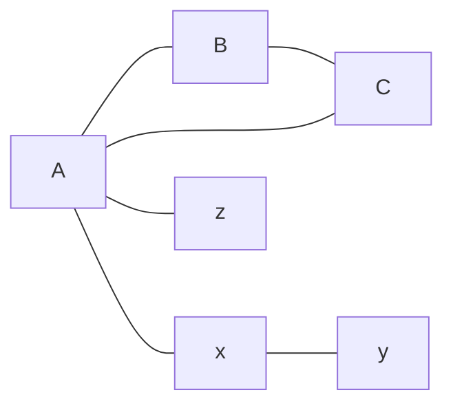
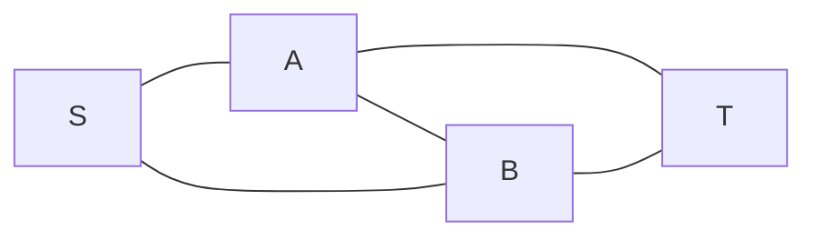

# 树商图与最短路径边记录优化

这篇文档解释两件事：如何减少重复的源点遍历，以及一次遍历中如何减少反向阶段的边扫描。两种方法都用于本项目的无权无向图介数计算。

| 方法 | 想解决的问题 | 主要做法 |
| --- | --- | --- |
| 树商图 | 很多源点进入核心后，需要反复计算相同的核心路径 | 把外围树与锚点合成带数量信息的核心节点，计算后恢复每个原图节点 |
| 最短路径边记录 | 反向累积时，再次扫描了很多不参与最短路径计算的边 | BFS 时记录有效后继边，反向阶段直接读取 |

它们可以同时使用：先构建树商图，再在商图核心上执行带边记录的 Brandes。两者的作用不同：树商图减少**要遍历多少次、每次遍历的图有多大**；边记录减少**每次遍历的反向阶段要检查哪些边**。

阅读前只需知道：Brandes 对每个源点先用 BFS 找最短距离和路径条数，再从远到近累积依赖。基础定义见 [Algorithm.md](Algorithm.md)。

<a id="tree-quotient"></a>

## 一、树商图：把重复的核心计算合并

### 1. 先认识核心、外围树和锚点

看下面这张无向图。`A、B、C` 构成一个三角形；`x、y、z` 在连接到 `A` 的外围树上。



- **核心**：图中经过外围树分解后保留下来的部分，这里是三角形 `A—B—C—A`。
- **外围树**：只通过一个入口连接核心的树形部分，这里有 `A—x—y` 和 `A—z` 两条分支。
- **锚点**：外围树接入核心的节点，这里是 `A`。
- **节点块**：一个锚点及归属于它的外围节点。这里 `A` 对应的块是 `{A, x, y, z}`，包含 4 个原始节点。

`y` 和 `z` 是叶节点，`x` 不是叶节点，但它仍属于外围树。所以**外围节点不等于叶节点**。实际图中也可能有多层外围树，不能把所有外围节点直接当作叶子删除。

### 2. 为什么可以合并源点计算

考虑从 `y` 出发前往核心中的 `B`：

```text
y → x → A → B
```

从 `z` 出发前往 `B` 则是：

```text
z → A → B
```

两个源点在外围树走过的路不同，但**进入核心后都从 `A` 出发**。只要目标属于其他核心节点对应的块，源点在外围树里的那段路就是唯一的；核心部分的最短路线选择和路径份额相同。

因此，计算这些源点对**核心部分**的贡献时，不必分别从 `A、x、y、z` 再做 4 次相同的核心遍历。可以只从锚点 `A` 做一次核心 BFS，并记住本次代表了几个原始源点。完整全源计算时，这个数量是 **4**；如果指定的源集合只有 `x、y`，则是 **2**。

> 合并的是重复的核心计算。`A、x、y、z` 并没有被当成同一个原始节点，外围路径及每个节点的贡献还要单独恢复。

### 3. 程序实际保存了什么

项目从外围度为 1 的节点开始逐层识别树结构，保存节点到父节点的关系；核心以 CSR 数组存储。可将结果想成两份相互配合的数据：

```text
核心计算用：核心节点与边 + 每个锚点代表多少原始节点
恢复结果用：原始节点 ID + 外围树的父子关系 + 节点归属 + 子树大小
```

对上面的图，`A` 在核心中仍然是节点 `A`，但附带数量 `M_A = 4`；`x、y、z` 的父子关系仍被保存。`B、C` 未连接外围树，各自的数量为 1。

这里的 `M` 是**原始端点的数量**，不是边权，也不是距离。核心边仍按一条边长度为 1 计算，最短路径条数 `sigma` 也仍然表示路线条数，不能直接乘上 `M`。

原图中的边可以由“核心边 + 已保存的外围父子边”重建。读取缓存时，程序还校验映射、文件哈希和重建后的图指纹；无损指原图结构和计算所需信息都被保留，并不承诺派生缓存一定更小。

### 4. 为什么最短路径不会被算错

假设源点 `s` 和终点 `t` 分属不同节点块，它们的锚点分别是 `r` 和 `u`。一条最短路径可分为三段：

```text
s ──外围树──> r ──核心──> u ──外围树──> t
```

两端的外围树各只有一条进出核心的路径，对确定的 `s、t` 来说，这两段长度是固定的。因此，哪条完整路径最短，取决于 `r` 到 `u` 在核心中的最短路径；核心中的多条最短路也会一一对应到原图中。

这解释了为什么跨块路径的**核心部分**可以合并计算。两个端点都在同一块内，或者要计算外围树节点本身的贡献时，还必须使用保存的树结构恢复，不能只看核心结果。

### 5. 核心里的带权 Brandes 在算什么

普通 Brandes 中，一个后继节点 `w` 可以作为一个终点。现在核心节点 `w` 代表一整块原始节点，因此它可以代表 `M_w` 个终点。反向依赖公式中，原来“后继自身的 1 份终点贡献”替换成 `M_w`：

$$
D_r(v)=\sum_{w:\ d_r(w)=d_r(v)+1}
\frac{\sigma_r(v)}{\sigma_r(w)}\left(M_w+D_r(w)\right).
$$

逐项理解：

- `r`：本次核心 BFS 的源锚点；`v` 是正在累积贡献的核心节点。
- `w`：比 `v` 离 `r` 远一层、并通过边与 `v` 相连的核心后继。
- `sigma_r(v) / sigma_r(w)`：到达 `w` 的最短路径中，经由 `v` 的份额。
- `M_w`：`w` 的节点块中，有多少原始节点可作为终点。
- `D_r(w)`：更远处终点经过 `w` 带来的依赖。

算完一个源锚点后，还要考虑它代表几个原始源。记 `C_r` 为本次选中的、属于 `r` 块的源点数，则对其他核心节点 `v`，加上 `C_r × D_r(v)`。例如全源时从上图的 `A` 启动一次核心遍历，`C_A = M_A = 4`。

**源数量和目标数量分别起作用**：`C_r` 表示这次遍历代替多少个原始源；`M_w` 表示后继块有多少个可能的终点。它们不改变 BFS 的距离和路线条数。

### 6. 外围节点怎么恢复：用删点后的分支理解

计算一个外围树节点的介数时，可以暂时想象把它从原图移除。如果两个端点落在移除后不同的分支中，它们之间的路径必定经过这个节点；若落在同一分支，就不必经过它。节点自己作为端点的情况不计入介数。

还是看上面的 `x`。移除 `x` 后，原连通分量分成两侧：

```text
{y}       {A, B, C, z}
 1 个节点       4 个节点
```

每一对跨两侧的端点都必须经过 `x`，所以在这个完整全源、无向的小例子中，`x` 的原始介数是 `1 × 4 = 4`。`y` 和 `z` 是叶节点，不能作为其他两个节点之间的中间点，其介数为 0。

锚点 `A` 也需要补算：移除它后，上例分为 `{x,y}`、`{z}`、`{B,C}` 三侧。跨侧的无序端点对共有 `2×1 + 2×2 + 1×2 = 8`，所以 `A` 的原始介数是 8。这个例子刻意选择了 `B—C` 直接相连；一般核心中的路径还可能贡献额外的、并非整数的最短路径份额。

程序使用保存的子树大小、源点数量和分量大小，按父子边一次扫描完成树相关贡献，而不是对每个外围节点再跑一次 BFS。对纯树连通分量，程序保留一个代表锚点，相关分数通过树结构恢复；不可达的其他连通分量不参与端点对贡献。

### 7. 数学对应：核心贡献与原图恢复

上面的分支计数是全源例子。代码还支持明确指定原始源集合 `S`，因此恢复公式需要同时统计**节点数量**和**被选中的源数量**。以下所有 `N、C` 都按当前原始连通分量计算：

- `N`：该分量的原始节点数；`C`：其中属于源集合 `S` 的节点数。
- `M_r`：锚点 `r` 的节点块大小；`C_r`：该块中选中的源点数。
- `a_v`：节点 `v` 被选作源点时为 1，否则为 0。
- `s_v`：以外围节点 `v` 为根的子树节点数；`t_v`：其中选中的源点数。

对于核心节点 `v`，先把各个其他源锚点的带权依赖相加：

$$K(v)=\sum_{r\ne v} C_rD_r(v).$$

`K(v)` 还不包含端点位于 `v` 自己外围树中的所有情况。设 `v` 各条外围分支的大小为 `s_j`，对应的选中源数为 `c_j`，恢复后的**有序贡献**为：

$$
A_S(v)=K(v)+(M_v-1)(C-C_v)
+(C_v-a_v)(N-M_v)+\sum_j c_j(M_v-1-s_j).
$$

四部分依次是：核心遍历已经算到的贡献；源在其他块、终点在本外围树；源在本外围树、终点在其他块；源和终点位于本外围树的不同分支。分类时排除 `v` 自己作为端点，避免重复或多算。

对于外围节点 `v`，去掉它后，一侧是父节点方向，其余各侧是子节点 `u` 的子树。程序按这些分支恢复有序贡献：

$$
A_S(v)=(C-t_v)(s_v-1)
+\sum_{u\in children(v)}t_u(N-1-s_u).
$$

第一项统计父侧源到 `v` 子树中其他终点的贡献；第二项统计每条子树分支中的源到其他侧终点的贡献。上面的 `x` 例子取全源时，`N=C=6`、`s_x=t_x=2`，唯一子节点 `y` 满足 `s_y=t_y=1`，代入得到 `A_S(x)=8`。这是**有序**贡献：`y→B` 和 `B→y` 分别算一次。全源无向结果最后除以 2，所以原始介数是 `8 / 2 = 4`。

完整全源时 `C_r=M_r`；若只选择部分源，则使用实际的 `C_r`，不会把部分结果直接称作全源介数。所有源组完成、原图节点恢复后，程序统一做无向 `/2`，归一化时使用**原图总节点数**。使用 `float64` 会有舍入误差；路径数将超出 `int64` 范围时，内核在提交该源之前回退到 Python 大整数计算。

### 8. 两张大图上的压缩规模

| 项目 | 原图 | 树商图核心 |
| --- | ---: | ---: |
| 节点数 | 1,134,890 | 470,164 |
| 无向边数 | 2,987,624 | 2,322,898 |
| 全源时需执行的核心源组 | 原图逐源需处理 1,134,890 个源 | 470,164 组 |

其余 **664,726** 个原始节点属于外围树，仍保存映射并参与最终恢复；它们不是都为叶节点。不同图的效果由结构决定：外围树越少，可合并的源和可缩小的核心图通常越少。

同一批 YouTube 原始源的树商图实验及验证详见[商图实测](RESULTS.md#quotient-results)。2026-11-06 的独立全量任务最终覆盖全部原始源，外围节点通过树结构公式核对；核心节点没有使用另一套算法对全源结果逐点重算，验证范围见 [YouTube 全量报告](Youtube全量处理报告.md)。

as-skitter 的结构不同：原图有 1,696,415 个节点、11,095,298 条边，核心仍有 1,464,757 个节点、10,863,640 条边，外围为 231,658 个节点；其中需要遍历的核心源组为 1,464,020，另有 737 个无核心边锚点由纯树分量解析处理。该图外围压缩比例比 YouTube 小，不能把 YouTube 的提速或比例直接套用到 as-skitter。该图的全源任务和核验范围见 [as-skitter 全量报告](as-skitter全量处理报告.md)。

<a id="dag-recording"></a>

## 二、最短路径边记录：反向累积少检查无关边

### 1. 原来的反向阶段为什么会重复看边

对一个源点执行 Brandes 时，BFS 会读取节点的邻居，算出每个节点的最短距离 `dist` 和路径条数 `sigma`。反向阶段按距离从远到近计算依赖。

对于当前节点 `v`，只有满足下面条件的邻居 `w` 才是需要累积的**最短路径后继**：

```text
dist[w] == dist[v] + 1
```

旧的编译内核在反向阶段再次扫描 `v` 的所有 CSR 邻居，并逐个用这个条件筛选。靠近源点或与 `v` 在同一层的邻居也会被读到，但不会参与 `v` 的依赖累积。

### 2. 一个带两条最短路的例子

假设从 `S` 出发，图中有 `S—A—T` 和 `S—B—T` 两条路径，并且 `A` 与 `B` 之间还有一条边：



BFS 得到的层次与最短路径条数为：

| 节点 | 到 `S` 的距离 | 从 `S` 出发的最短路径数 |
| --- | ---: | ---: |
| S | 0 | 1 |
| A | 1 | 1 |
| B | 1 | 1 |
| T | 2 | 2 |

从 `S` 向外看，满足“距离增加 1”的边是 `S→A`、`S→B`、`A→T`、`B→T`。`A—B` 的两端在同一层，不符合条件；各边指向源点的反方向也不符合。

新内核在 BFS 本来就要查看邻居时，把满足条件的后继顺手记下来。反向计算 `A` 时直接读取 `T`，不用再次检查 `S` 和 `B`。`A→T`、`B→T` **都会被记录**，不会因为 `T` 已经被发现就丢掉第二条最短路径。例如终点为 `T` 时，经过 `A` 和 `B` 的最短路径份额各是 `1/2`。

### 3. `successors` 和 `offsets` 两个数组

项目使用两个线程私有数组保存记录，不为每个节点单独创建 Python 列表：

- `successors`：顺序保存 BFS 发现的有效后继节点。
- `offsets`：记录 BFS 队列中每个节点在 `successors` 里对应的起止位置。

假设上例的 BFS 队列是 `[S, A, B, T]`，且扫描顺序先 `A` 后 `B`，一种记录结果是：

```text
队列位置：       0   1   2   3
节点：           S   A   B   T
successors：    [A,  B,  T,  T]
offsets：       [0,  2,  3,  4,  4]
                 └S┘ └A┘ └B┘ └T┘
```

例如 `A` 位于队列位置 1，它的后继位于 `successors[offsets[1]:offsets[2]]`，也就是 `[T]`；`T` 的起止位置都是 4，说明没有后继。偏移对应的是**BFS 队列位置**，不是原始节点 ID。实际记录顺序随邻居顺序而定，上表只是一个示例。

反向时从队列末尾往前处理，后继的依赖已经算好。对于记录的每个后继，仍使用前面相同的带权 Brandes 递推；改变的是**查找后继的方式**，不是最短路径或中心性的定义。

### 4. 省了什么，又付出了什么

上面的小图有 5 条无向边，也就是 10 个有向邻接项。旧反向阶段会重新读取这些邻接项并筛选；边记录版读取其中记录下来的 4 个有效后继。前向 BFS 两版仍需检查图的邻接关系，边记录版还要多写入数组。

因此，“反向少读了多少边”**不等于**“整个程序快了多少”：实际时间还包括 BFS、记录边、路径数计算、内存访问、线程调度和结果归并。

作为交换，当前实现为每个工作线程预分配可容纳全部核心有向邻接项的后继数组，并额外保存偏移。在 YouTube 核心图上，这两部分约 **21.31 MiB/线程**，4 线程约 **85.24 MiB**；共享图、其他工作区和累加向量另计。预分配容量不是实测驻留内存。

<a id="edge-statistics"></a>

### 5. YouTube 上的有效边统计

在 YouTube 商图中，固定 **64 个核心源组**逐源统计：每源扫描 **4,645,796** 个有向邻接项，其中满足下一层条件的有效项中位数为 **1,273,079**，约占 **27.40%**；64 个源组的比例范围为 **26.15%～29.44%**。

按这次样本中位数，反向阶段有机会从约 464.6 万次邻接项读取降到约 127.3 万次。但这只是**反向阶段的结构统计**：不等于整个算法节约 72.6% 时间，也不是全源实测。

### 6. 实际试跑快了多少

在相同的 YouTube 核心图、64 个源组、4 线程和同一 CPU 允许集合下，原版与边记录版各运行三轮。计时为线程执行与归并，**不含**加载商图、编译、工作区分配、原图恢复和进程启动：

| 轮次 | 原版反向扫描 | 边记录版 | 原版时间 ÷ 边记录时间 |
| --- | ---: | ---: | ---: |
| 1 | 6.395 秒 | 4.156 秒 | 1.539× |
| 2 | 5.873 秒 | 4.091 秒 | 1.436× |
| 3 | 5.375 秒 | 4.074 秒 | 1.319× |

三轮配对加速比的中位数为 **1.436×**。这 64 组代表 122 个原始源；三轮恢复后的全部原图节点**部分贡献**均在 `atol=1e-8, rtol=1e-10` 下与原版通过对照，最大绝对差约 `7.45e-9`。它是有限样本的内核比较，不是全量提速保证；运行时也没有隔离系统负载或 CPU 频率变化。

随后，边记录内核接入正式检查点入口。另用种子 45 的 64 组比较 `dag` 与 `legacy`：两版核心向量通过容差核对，最大绝对差约 `9.31e-10`，并验证了加载检查点。新建 `quotient-run` 任务默认使用 `dag` 与双累计快照；旧任务需按原有内核和配置恢复，不能把不同内核的检查点混用。详见[检查点与续算](Pipeline_and_Checkpoints.md#checkpoint)。

## 三、把两项优化放回完整链路


源组之间通过线程并行，每个线程使用自己的工作区和边记录数组，最后归并贡献。动态调度可能改变浮点求和顺序，因此结果以容差校验，不要求逐位完全相同。尚未完成的快照只保存核心累计贡献，不能当作全图介数结果。

相关实现：`src/parallel_bc/tree_quotient.py` 负责分解与缓存，`quotient_brandes.py` 负责带权依赖和恢复，`quotient_dag_experiment.py` 中的 DAG 内核负责边记录，`quotient_snapshot.py` 负责双快照及全源结果发布。

进一步阅读：[Brandes 数学基础](Algorithm.md) · [运行与检查点](Pipeline_and_Checkpoints.md) · [YouTube 提速历程](Youtube提速历程.md) · [as-skitter 全量报告](as-skitter全量处理报告.md) · [实验结果](RESULTS.md)。外围结构压缩的研究背景可参考 Sarıyüce 等人的 [BADIOS 论文](https://sariyuce.com/papers/sdm13.pdf)；本文介绍本项目的端点数量与恢复实现，不宣称发明了新的介数算法。
