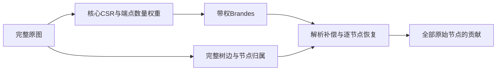

# 树商图与最短路径边记录优化

这两种优化分别减少需要遍历的核心源组与反向阶段重复扫描；均保留原始节点的输出语义。

<a id="tree-quotient"></a>

## 用带权商图与解析恢复计算原图介数

这是一种**无损图分解与计算压缩**：将原图表示为“较小的核心CSR + 完整外围树边 + 节点归属与端点数量”，在核心上执行带顶点端点权重的Brandes，再恢复每个原始节点的贡献。原图文件和原CSR不改动，任何原节点都没有从最终结果中消失。

压缩的对象是昂贵BFS中的状态数和可合并的源遍历，不是强行减小磁盘文件。完整映射和恢复信息可能让派生缓存比原CSR更大。



### 一个直观例子

假设核心连接点u外接10个叶节点。商图中的u带有目标端点数量 `M[u]=11`，并保存10条原始树边。计算其他节点到这11个端点的依赖时，必须计入11份终点贡献。

如果选了其中3个叶节点作源，核心只需从u遍历一次，但源数量权重为 `C[u]=3`。u本身作为这些路径的中间节点时，仍要加回贡献；10个叶节点最终分数全部恢复为0。若外围是多层树，内部节点可能有很高介数，也必须逐个恢复。

这里的权重是**端点数量**，不表示距离、关系强弱或边长。核心边仍保持单位长度，BFS的最短路定义不变。路径数sigma只计算路线条数，不能将端点数量误乘到sigma上。

### 无损表示与数据校验

从度为1的外围逐层识别树边，将其记录为 `parent[v]`，累计子树大小。核心节点保留原始ID。纯树连通分量保留一个代表锚点，孤立点也保留；它们的分数可完全解析恢复，不需要核心BFS。

保留的数据包括：

- 原始所有节点ID；每个外围节点的parent；有效的叶到根处理顺序。
- 每个原始节点属于哪个锚点、每个子树的大小、每个锚点所代表的节点数量。
- 核心CSR、连通分量标签和每个分量的原始节点数。

**原图的边恰好等于：核心边映射回原始节点后，加上每个外围节点与parent之间的一条边。** 因而有：

$$m=m_{core}+(n-n_{core}).$$

缓存校验不仅检查数量，还从这套表示重新生成原始边的规范编码，计算包含全部原始ID与边的SHA256，要求与原图指纹相同。读取时还检查文件哈希、森林顺序/归属/子树质量、核心结构和分量数量，避免错误恢复信息进入本机内核。

### 为什么跨树最短路可以在核心上计算

令B_r是由核心锚点r及其外围树组成的节点块。对属于不同块的端点s、t，锚点分别为r、u：

$$d_G(s,t)=d_{tree}(s,r)+d_{core}(r,u)+d_{tree}(u,t).$$

外围树到核心只有唯一入口，树路径也是唯一的。两端的树距离对这个端点对是常数，因此最短路选择与核心中的最短路选择一一对应，最短路条数和经过核心节点的比例得以保留。同块端点之间的最短路留在树内，单独解析处理。

### 带权核心递推

本实现支持任意明确给定的原始源集合S，输出与旧接口一致的有序、未缩放贡献A_S。不是采样估计，也没有按n/k放大。

对同一个原始连通分量，记：

- N：分量原始节点数；C：S在该分量中的源数。
- M_r=|B_r|：锚点r的目标端点数量。
- C_r=|S∩B_r|：这个块被选择的源数量。
- a_v：原节点v是否在S中，是则1，否则0。

从锚点r做一次BFS，仍求核心距离和最短路径数。反向依赖改为：

$$D_r(v)=\sum_{w:\ d_r(w)=d_r(v)+1}
\frac{\sigma_r(v)}{\sigma_r(w)}\bigl(M_w+D_r(w)\bigr).$$

原来的“1”对应后继自身一个终点；这里M_w对应后继块所代表的所有终点。对v≠r，累加：

$$K(v)=\sum_{r\ne v} C_rD_r(v).$$

源块内每个源对其他块的核心路径依赖相同，因此只遍历一次并乘C_r。完整全源时C_r=M_r；只算少量原始源时C_r是实际选择数，不伪装为全源。

### 核心锚点分数恢复

K(v)尚未包括端点处在v自身树块内的路径。令v的各条外围分支大小为s_j，其中选择的源数为c_j，则：

$$\boxed{A_S(v)=K(v)+(M_v-1)(C-C_v)
+(C_v-a_v)(N-M_v)+\sum_j c_j(M_v-1-s_j).}$$

四项分别表示：

1. 两个端点都位于其他块、经核心最短路通过v的贡献。
2. 源在其他块，终点在v自己的外围树中的贡献；终点v自身排除。
3. 源在v自己的外围树，终点在其他块的贡献；源v自身排除。
4. 源和终点处在v的两条不同外围分支，树路径必经v的贡献。

同一条分支内的端点不会通过v，因为走到v后再返回会重复经过树边。源或目标本身为v时，也不能把v作为中间点计算。以上互斥分类覆盖所有允许端点对。

### 每个外围节点的分数恢复

对外围节点v，令s_v为以v为根的子树大小，t_v为其中选择的源数；其子节点为u。去掉v后，一侧是parent方向，其余各侧是子树。不同侧之间的最短路全部经过v，同侧之间不经过v，所以：

$$\boxed{A_S(v)=(C-t_v)(s_v-1)
+\sum_{u\in children(v)}t_u(N-1-s_u).}$$

第一项对应parent侧源到v子树中的终点，第二项对应每个子树侧的源到其他侧的终点。公式只需一次树边扫描，不需要为每个外围节点重跑BFS。

叶节点的s_v=1且无子节点，结果自然为0；外围内部节点的结果通常不为0。纯树分量只用这套恢复与锚点分支公式即可计算所有节点。

不同原始连通分量分别用自己的N和C，不计入不可达端点。只有S包含所有原始节点后，才调用旧 `finalize_scores(total, original_n)`：统一除以2，并按**原图总节点数**归一化，不能改用核心规模。

### 类型和并行边界

sigma仍为逐次检测溢出的int64，可能超界时回退到核心上的Python任意精度带权递推；计算成功后才提交该源，避免半个源重复累加。依赖和结果为float64，关闭fastmath。选中源计数与子树大小为整数。

核心源组复用已验证的线程调度，每个worker独占工作区与累加向量；末尾固定worker顺序归并。原始源文件保留原始索引/ID，核心任务日志另标识锚点、源数量权重和实际遍历数。动态调度会改变浮点求和分组，验证使用容差而非逐位相等。

### 安装与运行

需要已安装可选compiled依赖。原图为已有的CSR缓存，例如youtube_csr。

```powershell
.\.venv\Scripts\python.exe -m parallel_bc data prepare-quotient --dataset youtube_csr --timeout 300 --reserve-gib 1.5
.\.venv\Scripts\python.exe -m parallel_bc quotient-compare --dataset youtube_csr --sources 256 --threads 4 --batch-size 4 --repeats 3 --seed 42 --cpu-affinity 0 2 4 6 --timeout 120 --total-timeout 900 --reserve-gib 1.5
```

默认派生缓存为 `data/processed/youtube_csr_treeq/`，已有目录拒绝覆盖。CPU编号取自本机上一轮审计，其他机器须按自身拓扑选择。

数学实现：`tree_quotient.py`（无损分解和缓存）、`quotient_brandes.py`（带权递推与原始节点恢复）。同问题比较入口：`quotient_benchmark.py`。

### 实验应比较什么

两版使用同一个原始图、相同原始源点和顺序，最终都输出长度为原图n的向量。原版按源逐次BFS；商图版合并同块源、使用端点数量权重，并恢复外围路径贡献。不能拿不带权、没有恢复的核心介数来比较。

工作时间分别为：原版执行/归并；商图版源分组 + 带权核心执行/归并 + 全原图恢复。JIT/缓存加载、验证和整例墙钟另列。压缩准备为一次性成本，不能隐藏；同一商图缓存可供多次计算使用。

商图加载需要额外校验恢复映射和重建原图指纹，小源数时即使核心计算更快，整例墙钟也可能没有收益。对这种情况保留原始结果，不能只报最快的内核。

全源时间应按“需要遍历的核心锚点数 × 带权核心单组吞吐”估计，加上准备和恢复；不能再按原图n逐源相乘，也不能把少量源结果称为已完成全源计算。

长任务入口见[全源分组检查点与恢复](Pipeline_and_Checkpoints.md#checkpoint)：各组只提交核心贡献，全部组完成后统一恢复，保留崩溃前已提交的计算。

### 验证与研究来源

测试逐节点比较原始Python贡献和NetworkX全源结果，覆盖多层树、多个分支、多个源落在同块、非连通分量、纯树和孤立点、零压缩的环/完全图、缓存篡改、路径计数溢出及真实受监督CLI。另核对重建图指纹，证明数据没有因外围树分解而丢失。

本实现利用已有精确结构分解思想，不宣称发明新的介数算法。参考Sarıyüce等的[SDM 2013 BADIOS论文](https://sariyuce.com/papers/sdm13.pdf)。本页给出本项目所采用的“端点数量商图 + 任意源子集恢复”公式与实现约定。

本轮规模、完整验证、性能及限制见[无损商图实测报告](RESULTS.md#quotient-results)。

<a id="dag-recording"></a>

## 最短路径边记录优化：实现与 64 源组实测

2026-11-02。独立原型在 YouTube 商图相同 64 个源组上三轮均快于原版，配对加速比为 1.539、1.436、1.319，中位数 **1.436 倍**。这是小样本内核初筛，不是全源结果。2026-11-06 起新建正式检查点任务默认采用该内核；旧检查点仍使用旧内核，不能跨内核续算，详见[检查点使用说明](Pipeline_and_Checkpoints.md#checkpoint)。

### 实现方法

原内核的正向 BFS 扫描 CSR 邻接项，计算距离 `dist` 与最短路径数 `sigma`；反向从远到近再次扫描邻接项，利用 `dist[w] == dist[v] + 1` 筛选依赖累积所需的后继。

实验内核 `src/parallel_bc/quotient_dag_experiment.py` 在 BFS 中遇到满足下一层条件的邻接项时，顺序将目标 `w` 写入私有 `successors` 数组，并以 BFS 队列位置记录每个节点的边界 `offsets`。BFS 顺序确定后，反向遍历队列，通过两个偏移直接读取该节点的所有后继，不再扫描其他邻接项或重新判断距离。所有符合条件的边都被记录，包括同一节点不同前驱产生的多条最短路径；反向依赖公式及其运算顺序与原版相同。

每个线程保留独立 BFS 工作区和边数组，复用相同空间处理后续源组。计算成功后才把依赖乘上源数量并提交；路径计数将溢出 int64 时，放弃当前结果并用原实现的 Python 大整数路径完整重算该源。预分配的边数组容量等于全部 CSR 有向邻接项数量，偏移使用 int64，可容纳最坏情况下所有邻接项。

### 真实数据配对结果

固定 YouTube 核心图的 64 个源组（种子46），代表122个原始源，目标质量覆盖完整原图；自然编号，4线程、批大小4，进程亲和性 `[0,2,4,6]`。两版均预热后交替次序各测3次。计时为线程执行与归约；不含商图加载、编译、数据恢复和进程启动。

| 轮次 | 原版（秒） | 边记录（秒） | 原版 / 边记录 |
|---|---:|---:|---:|
| 1 | 6.395 | 4.156 | 1.539 |
| 2 | 5.873 | 4.091 | 1.436 |
| 3 | 5.375 | 4.074 | 1.319 |

每轮匹配全部源和图权重；计时覆盖记录有效边的写入，但不含工作区分配。仅从这三次观测不能证明长期稳定或推断全量耗时。没有控制其他进程、功率或 CPU 频率，不能将全部收益归因于某一种硬件事件。之前的 27.4% 有效边统计只是解释潜在工作量下降，不能直接推导运行加速比。

每轮恢复后的全部 1,134,890 个原图节点贡献都与基线按 `atol=1e-8, rtol=1e-10` 比较通过；最大绝对差 7.45e-9，源级动态调度导致累加顺序可不同。该输出对应所选源组，是部分贡献。正式入口的检查点和真实图核验见下文；长期速度仍需持续测试。

### 内存与核验

本实现为避免扩容，按全核心有向邻接项预分配，实际每线程额外分配 22,344,504 字节（约 **21.31 MiB**），4线程约 **85.24 MiB**；包含 int32 目标和 int64 偏移。旧线程调度器的 `workspace_bytes` 只记录基础工作区，不包含额外边数组，上述数值须单独加入。物理驻留量取决于操作系统分配和触页，不把预分配值当作实测峰值。与先前基于实际有效边数的约 26.6 MiB／4线程估计不同，此版本为容量上限预分配。

小图测试 5 项通过，涵盖菱形多路径、不同源和数量权重、非连通图、重复使用工作区及构造的路径数溢出回退。YouTube 测试没有发生溢出；实验结束前后旧检查点 manifest 哈希一致且状态暂停。脚本在每个测量前检查系统可用内存，调用设180秒协作超时，但没有独立进程硬超时和连续内存监督。

复现：

```powershell
.\.venv\Scripts\python.exe -m pytest tests/test_quotient_dag_experiment.py -q
.\.venv\Scripts\python.exe scripts/benchmark_quotient_dag.py
```

机器记录：`results/20261102T064304_773513Z_dag_64/summary.json`。实验总计 64 个源组，未运行全源计算或更大样本。

### 正式检查点集成验证（2026-11-06）

使用种子45的前64个核心源组，独立目录中通过正式 `quotient-run` 分别运行dag与legacy。两份源计划一致、各代表104个原始源，核心向量 `atol=1e-8, rtol=1e-10` 逐点通过，最大绝对差9.31e-10。新方案完成一个检查点并以 `--resume --max-chunks 0` 重新验证加载，未增加计算进度。这是一次真实数据正确性核验，单次耗时不能作为新的稳定加速比。

新检查点采用独立格式 `LinkRadar-quotient-dag-checkpoint-v1`，指纹覆盖检查点执行代码和边记录内核，格式/内核不一致时拒绝续算。新旧完整小图、崩溃恢复、意外退出、数据篡改、溢出回退、CLI 与跨内核拒绝测试共54项通过，全项目回归337项通过。原有 YouTube 检查点数值代码指纹仍匹配，原任务没有被修改或继续。新执行器克隆旧执行器以保持旧代码指纹稳定，未来修改恢复逻辑时应同时维护并分别测试两套执行器。

<a id="edge-statistics"></a>

## YouTube 核心图最短路径有效边统计

2026-11-02。统计范围为与 `20261102T062858_343786Z_coeff_64` 相同的 64 个核心源组（种子 46，源顺序哈希 `cb37cd40634e79be9c3f4c84285bc64f8ef6fb081c62fecb2bf07a1b1914668a`），代表 122 个原始源，核心图完整加载。不是全源介数计算。

### 结果

对于一个源组，从每个已访问节点扫描 CSR 邻接项，将 `dist[w] == dist[v]+1` 的有向邻接项记为有效边。这些边形成该源的最短路径有向无环结构；在现有反向累积中，也正是满足这个判断的项参与计算。

| 指标 | 64 源组结果 |
|---|---:|
| 每源扫描邻接项 | 4,645,796 |
| 每源有效邻接项中位数 | 1,273,079 |
| 有效比例中位数 / 均值 | 27.40% / 27.52% |
| 有效比例范围 | 26.15%～29.44% |
| 每源同层邻接项中位数 | 2,099,638 |
| 每源反向邻接项中位数 | 1,273,079 |

64 个源均覆盖全部 470,164 个核心节点，因此扫描数均为核心无向边数的两倍。图为无向图，每个跨层有效正向邻接项都有一个反向邻接项；同层边也按两个邻接项计数。每源独立检查正向、反向、同层计数之和等于扫描数，正向与反向数相等。

### 这意味着什么

若能在 BFS 时准确记录所有有效边，反向阶段读取的邻接项数量按本样本中位数有机会由约 464.6 万降到约 127.3 万，即少读约 72.6% 的邻接项。这个比例**不是加速比或运行时间节省比例**：记录时需要额外写边，反向访问方式、内存分配与缓存也会改变，且 BFS 仍须扫描全图。

按中位有效边数，仅保存 int32 目标索引约 4.86 MiB／线程；若再采用每个节点一个 int32 偏移项，约增加 1.79 MiB／线程，合计约 6.65 MiB／线程、4 线程约 26.6 MiB。实际峰值取决于实现和预分配方式；例如按全部 4,645,796 个邻接项预分配时索引数组就需要约 17.72 MiB／线程，以上不含其他临时开销。

统计结果支持做一次独立原型测试，但不证明该原型能提速；实现时必须记录所有满足下一层条件的边，包含指向同一节点的多个前驱。保持逐源路径数溢出回退和每线程私有存储。

### 校验和复现

统计脚本 `scripts/count_shortest_path_edges.py` 逐源与原 `_weighted_dependencies` 比较完整距离数组和最短路径数量数组，64 组全部一致，且独立按最终距离重新统计边分类；没有遇到 int64 路径数溢出。测试 `tests/test_count_shortest_path_edges.py` 覆盖菱形多条最短路、同层边与孤立点，1 项通过。

本次没有实现或运行边记录候选。旧检查点 manifest 前后 SHA256 一致。脚本在加载前检查 1 GiB 可用内存，但没有连续内存监督或进程级硬超时；输出的诊断时间包含 JIT、重复核对与统计，不能用于性能比较。

机器记录：`results/20261102T063736_765941Z_dag_edge_count_64/summary.json`。重新统计使用：

```powershell
.\.venv\Scripts\python.exe -m pytest tests/test_count_shortest_path_edges.py -q
.\.venv\Scripts\python.exe scripts/count_shortest_path_edges.py
```
