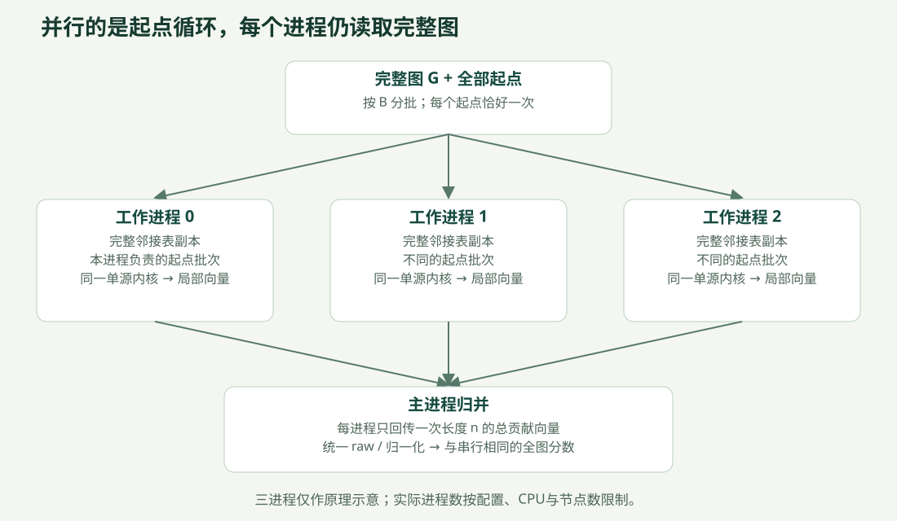

# LinkRadar 的并行计算怎么体现

阅读入口：[文档导航](README.md)；还不了解节点和介数时先读[项目整体说明](PROJECT_GUIDE.md)。

## 1. 先说最关键的一句话

**对同一张完整图，从不同起点出发的Brandes计算可以独立进行；项目把“遍历全部起点”的循环分给多个工作进程，而不是把图的边切成几块分别算。**

假设有4039个节点，完整精确计算就有4039次单源任务。“单源”表示固定一个起点，计算它对全体节点中转贡献的影响。不同起点不需要先等别的起点算完，最后把贡献相加即可。每个工作进程依然读取全图，能沿跨群体的边走到任何可达节点。



## 2. 串行和并行到底改了哪一层

实际共同内核是 [brandes.py](../src/parallel_bc/brandes.py) 的 `single_source_accumulate(adj, source, accumulator)`。

```text
串行：
  对全部起点s逐个执行同一单源内核，贡献加进一个向量

并行：
  把全部起点分成互不重叠的批次
  多个进程同时执行同一单源内核，各自累计到自己的向量
  主进程把所有局部向量相加，再做一次最终缩放
```

改变的是外层起点循环的执行方式。单源内部依然先做广度优先搜索，再从远到近累计依赖；有前后依赖的部分没有被随意打散。三种模式的图、数据类型、邻居顺序、起点总集合与核心公式一致，才能把比较重点放在调度与进程开销上。

每个局部向量长度都是n，不只是该进程负责的起点数。例如进程甲负责起点S，仍可能给进程乙负责的起点T所对应节点增加中转贡献。这就是为什么不能把“分起点”理解成“各自只计算一块子图”。

## 3. 一个八起点的分工例子

以下是教学示例，不是性能测量。起点为0…7，批次大小B=2，工作进程数p=2：

| 批次ID | 包含起点 | 静态模式固定交给 |
|---|---|---|
| 0 | 0、1 | 进程0 |
| 1 | 2、3 | 进程1 |
| 2 | 4、5 | 进程0 |
| 3 | 6、7 | 进程1 |

- `serial`：一个进程依次完成0、1、2、3、4、5、6、7。
- `static_batches`：按 `batch_id % p` 固定分配，使用各进程自己的任务队列。即使另一个进程空闲，也不会改派已固定的批次。
- `dynamic_batches`：同样的四个批次进入公共队列，谁先空闲谁领取下一批。某次运行可能是进程0拿0、3，进程1拿1、2，但这不是预设结果。

B控制任务粒度，不改变计算问题。B太小可能增加排队开销；B太大可能使可调度任务太少。动态调度有额外管理成本，也不保证比静态快，必须同图、同p、同B、同日志开关比较。

## 4. 进程实际怎样工作

实现见 [parallel.py](../src/parallel_bc/parallel.py) 的 `brandes_parallel` 与模块顶层 `_worker`：

1. 检查起点排列，确保每个节点恰好一次；使用 `multiprocessing.get_context("spawn")` 创建独立进程。
2. 图在初始化时传给每个进程一次。每个进程分配自己的长度n局部向量，报告 `READY(worker_id, pid)`。
3. 主进程收到全部不同PID的READY之后，开始派发批次。后续任务带批次ID与起点列表，不反复发送整张图。
4. 工作进程对领取到的每个起点调用共同内核，在本地累加。不使用共享可写中心性数组，也不逐节点高频更新Manager。
5. 一个工作进程完成自己全部任务后，通过一次DONE消息回传一个长度n的局部总向量及统计。不是每个起点或每个批次都回传一整套分数。
6. 主进程边接收边归并，检查批次覆盖和实际起点计数；全部归并后统一产生raw与normalized分数。
7. 正常退出时join并关闭队列；异常、超时或中断时终止并回收子进程，不能返回全零冒充成功。

本项目用普通Python内核配合独立进程，为多个CPU核同时执行提供条件，实际调度由操作系统负责。spawn适用于本项目Windows环境，但会为每个进程复制图；没有实现共享内存零复制，进程越多会增加内存与启动成本。

`p=4`指四个**计算工作进程**。CLI/benchmark还可能有主进程、案例预算监管进程和系统辅助进程，不能把操作系统中所有相关PID都当成四份有效算力。serial的“一个计算进程”也不等于整个程序只存在一个系统进程。

## 5. 用真实日志证明已经这样运行

下面来自 Facebook 配对复测的一个完整动态四进程案例，B=128：

| worker_id | 实际PID | 起点数 | 批次数 |
|---|---:|---:|---:|
| 0 | 23032 | 1024 | 8 |
| 1 | 9144 | 1024 | 8 |
| 2 | 25596 | 967 | 8 |
| 3 | 6788 | 1024 | 8 |
| 合计 | 4个不同PID | **4039** | **32** |

4039个起点分成32批，最后一批只有71个起点。`processed_sources`合计等于节点数，批次ID的并集还要严格等于0…31且没有重复；实现会同时检查这些条件。

原始证据：[workers_0_2.json](../results/20261023T061912_984947Z_facebook_paired/workers_0_2.json)。PID只属于当次历史运行，重新执行会变化。不同PID本身不能证明每个时刻都在同时使用CPU；本项目还保留实际任务时段和批次覆盖，避免仅凭“创建了进程”就宣称理想并行。

下面的时间线来自独立的SBM200诊断运行，标明真实PID和批次起止时间；不是Facebook的任务时间线。详细日志会影响开销，因此正式主计时关闭任务日志，诊断另跑。


## 6. 为什么分开计算后还能得到同一个答案

用c_s(v)表示“固定起点s时，对节点v的未缩放贡献”。每个进程负责的起点集合S_j互不重叠，全部集合合起来恰好是全体节点。因此：

```text
局部贡献_j(v) = 对s属于S_j的c_s(v)求和
ordered_total(v) = 对全部进程的局部贡献_j(v)求和
raw(v) = ordered_total(v) / 2
normalized(v) = raw(v) / ((n-1)(n-2)/2)   （n>2）
```

无向图中端点对{s,t}会从s、t两个方向计算，所以全局最后除以2。若各批次先缩放、最后又缩放，就会算错。本实现仅在 `finalize_scores` 中做一次无向修正和全图归一化；n≤2时返回零。非连通图依然使用全图n，不单独把每个分量归一化。

不同归并顺序会造成浮点末位误差，因此允许预先声明容差内差异，不要求逐位完全相同。实际验收比较**所有节点的raw和normalized**，不只比较前十排名；同时检查有限值、分数覆盖与起点覆盖。

## 7. 单源内核稍微深入一点

读源码时只需抓住两步：

| 阶段 | 保存什么 | 为什么需要 |
|---|---|---|
| 向外BFS | dist最短距离、Python整数sigma路径数量、全部最短路径前驱pred、访问顺序 | 保留所有等长最短路径，避免只选一条 |
| 逆序累计 | delta依赖，把远端贡献按 `sigma[v]/sigma[w]` 分给前驱 | 复用路径计数，不枚举所有完整路径 |

将 `delta[w]` 加进分数时排除当前起点自己，端点不作为中转节点。单源时间通常为O(n+m)，全起点一般写作O(n(n+m))；连通无权图常简写为O(nm)。这些是复杂度描述，不是运行时间保证。每进程另需图副本、前驱和工作数组，多进程也要考虑内存。

对应源码路线：`brandes_serial` → `single_source_accumulate` → `finalize_scores`；并行路线：`brandes_parallel` → `_worker` → 同一个 `single_source_accumulate` → 主进程 `total += local` → 同一个 `finalize_scores`。

## 8. 怎样公平测量加速

定义总加速比 `S_total = 串行total中位数 / 并行total中位数`，并行效率 `E_total = S_total / p_used`。同样计算S_steady，但必须分开标注。

| 时间字段 | 包含什么 |
|---|---|
| t_startup | 创建工作进程到全部READY |
| t_execute_reduce | 派发、计算、等待、局部向量传输和主进程归并 |
| t_finalize | 统一生成raw与normalized |
| t_cleanup | join、关闭队列等收尾 |
| t_total | 一次完整算法调用及必要调度开销，包含以上阶段 |
| t_steady | execute_reduce + finalize，排除启动与清理 |
| t_supervised_wall | 案例外层监管墙钟，还包含监管器spawn等；不混称算法total |

下载、清洗、NetworkX参照和画图不计入算法total。串行也使用同一内核、同一数据类型，不能一边纯Python一边换加速后端，再把差别全部归因于多核。

一般案例顺序按固定种子交错/打乱，每轮重新建进程；热身单独标记，失败与超时不计入正常中位数。汇总保留中位数、Q1/Q3、min/max及每次原始值。不同图种子和不同协议不混成一组。busy_fraction只是批次墙钟诊断，不能称作操作系统CPU利用率。

实际经验有三点：小合成图中启动成本可能超过收益；ca-GrQc初测有总耗时加速；Facebook首轮连单工作进程也出现异常比值，必须诊断后复测。具体数值与局限见[当前结果报告](RESULTS.md)。

## 9. 控制执行和避免无效结果

[benchmark.py](../src/parallel_bc/benchmark.py) 在受控案例子进程中运行算法，按墙钟预算监管。超时会终止并回收案例进程树，已经完成的结果保留。串行公共函数自身在起点边界协作检查；CLI/benchmark外层再提供硬截止。回收与最终出图可能额外耗时，最终总墙钟也记录，不能把预算当成绝对零残差的整体运行时限。

续跑键含图指纹、源码、模式、进程数、批次、起点顺序、日志设置与重复编号等；只复用匹配的成功案例。输入或源码变化拒绝错误复用。PID/任务证据先持久化，再写成功检查点，避免中断后只剩一句“成功”而无底层证据。

初学者展示时不必背每个字段，只要能说明：**任务独立在哪里、如何确保不重不漏、为何归并不改变答案，以及启动和通信为什么会影响加速。**
