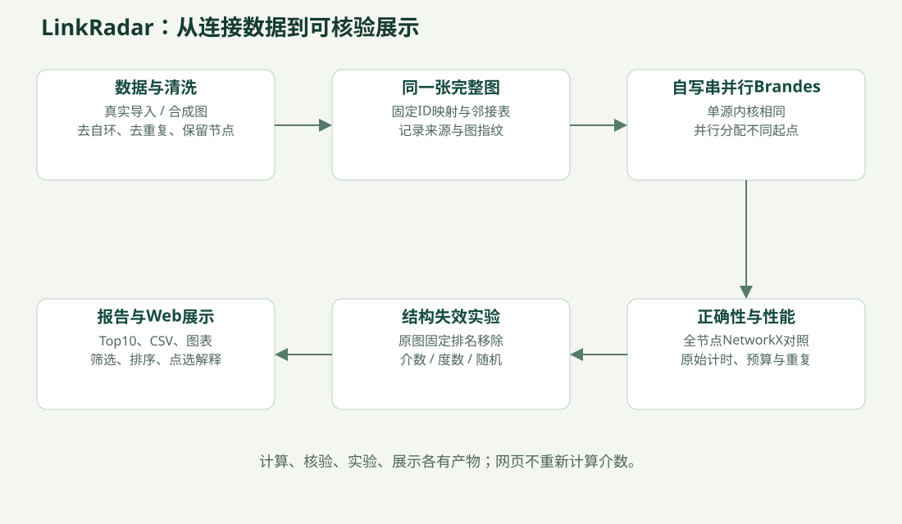

# LinkRadar：项目整体说明

阅读入口：[文档导航](README.md)。本篇先解释完整项目，不要求读者先会图算法或Python多进程。

## 1. 用一个问题理解项目

假设一张网络记录“谁和谁相连”。有些节点连接很多邻居，有些节点连接不多，却位于不同群体之间。我们希望找到**承担较强最短路径中转作用的节点**，并研究计算这些分数时，多核CPU能否缩短耗时。

本项目回答两类问题：一是结构问题——哪些节点承担中转、移除它们后网络怎样变化；二是并行计算问题——同一份正确的计算，怎样分给多个进程做、什么时候值得这样做。

它是一套可验证的图计算与实验系统。Web页面是展示出口，算法、正确性核对和实验记录才是计算主体。

## 2. 先认识五个词

| 词 | 不用专业背景的解释 | 本项目里的例子 |
|---|---|---|
| 节点 | 网络中的一个位置 | Facebook中的匿名用户编号107 |
| 边 | 两个位置之间的一条连接 | 文本行`107 1085`表示二者相连；这里只是格式举例，不是在声称原文件有这条边 |
| 路径 | 沿连接从一个位置走到另一个位置 | S→A→T |
| 最短路径 | 经过边数最少的路径；可能不止一条 | S→A→T与S→B→T都用两条边 |
| 连通分量 | 能沿边互相到达的一组节点 | ca-GrQc清洗后有355个分量 |

“无向”表示边可以双向走；“无权”表示每条边长度都算1；“简单图”表示不保留自己连自己的自环，也不重复保存同一条无向边。这些是假设和数据处理协议，不代表真实关系强弱完全一样。

## 3. 三种“重要”不能混为一谈

| 指标 | 在问什么 | 容易误解之处 |
|---|---|---|
| 度数 | 这个节点直接连了多少邻居？ | 邻居多，不保证位于群体之间 |
| 介数中心性 | 不以它为端点的节点对之间，有多少最短路径份额经过它？ | 高介数不是现实人物地位、贡献或故障概率 |
| 割点 | 单独删掉它，会不会使连通分量数量增加？ | 高介数不一定是割点，割点也不等于所有任务的最佳目标 |

本项目默认用**全图精确介数**给“关键节点”排序。Facebook的58号节点只有12个邻居，度排名第2918，但介数第9；1085号介数第5，却不是割点。二者是展示“连接多”与“中转作用强”不同的具体例子。

“精确”表示所有节点都作为起点参与计算，没有抽样起点；贡献仍用float64，允许浮点舍入误差，不能说任意精度完全无误差。

## 4. 系统从输入走到输出



| 步骤 | 实际做了什么 | 留下的可检查产物 |
|---|---|---|
| 获取数据 | 注册的官方URL下载、用户手工导入，或固定种子生成合成图 | 原文件来源、实际SHA256与清洗元数据 |
| 确定图结构 | 去自环、无向去重、保留全部已知节点和分量，整数ID升序映射，邻居排序 | 安全NPZ缓存、JSON元数据、ID映射 |
| 算介数 | 自写Brandes，得到每个节点的raw和normalized分数 | 全节点中心性CSV，不只输出前十 |
| 做并行 | 多个进程读取同一完整图，各自负责不同起点 | 实际PID、起点数、批次数、分阶段时间 |
| 验证与计时 | 全节点对照NetworkX，串并行相互核对，再重复计时 | validation.json、原始计时CSV、汇总CSV |
| 检验结构意义 | 按固定原图介数、度数和多次随机顺序删除节点 | 最大连通分量曲线、随机经验分位带 |
| 展示 | 导出Top10图、散点图、局部图及中文交互页面 | [当前结果](RESULTS.md)、参数报告、可筛选网页 |

输入最终是一份无权无向邻接表：每个连续索引对应一个节点，它的列表中是邻居索引。**连续索引是计算位置，原始ID是对外编号**；例如ca-GrQc原始ID13801在缓存中是索引2714，输出仍保留13801。

## 5. 为什么介数计算比较费时

考虑这个已写入测试的五节点小图：

```text
    A
   / \
  S   T──U
   \ /
    B
```

S到T有两条等长最短路径：经过A或B。因此，对于端点对{S,T}，A和B各拿到1/2份中转贡献。S到U也有两条最短路径，A和B仍各拿到1/2，而T拿到完整的1份。不能只挑一条最短路径，否则会偏向其中一个分支。

项目对所有起点重复这种统计，最后得到全图介数。Brandes不把每一条完整路径都列出来，而是用一次广度优先搜索记录“最短距离、最短路径数量、前驱”，再反向累积中转贡献，复用前面的计算。

| 节点 | 全图raw介数 | 归一化介数 |
|---|---:|---:|
| S | 0.5 | 1/12 |
| A | 1 | 1/6 |
| B | 1 | 1/6 |
| T | 3.5 | 7/12 |
| U | 0 | 0 |

T的邻居数不是唯一判断依据，但它位于U与其余节点之间，因此中转贡献较高。图中不存在的现实行为或关系强弱不在这个模型里。

几千个节点的文件并不大；耗时主要来自“从每一个起点都遍历并累计一次”的重复计算。不同起点之间可独立得到贡献，这正是本项目的并行机会。接着读[并行计算说明](PARALLEL_COMPUTING.md)。

## 6. 两张真实图是什么，现在是否已经拿到

**当前两份真实数据已手工导入，并已完成全图正确性、性能与失效实验。** 早期自动下载TLS失败只是历史记录，不再是当前的数据缺口。

| 数据 | 节点含义 | 清洗后节点/边 | 分量 / 最大分量 | 边界 |
|---|---|---|---|---|
| Facebook | 采样自我网络中的匿名用户与好友连接 | 4039 / 88234 | 1 / 4039 | 不代表完整Facebook平台 |
| ca-GrQc | 相关领域论文作者及合作关系 | 5242 / 14484 | 355 / 4158 | 不是作者学术贡献排名 |

本地原文件审计显示：Facebook没有自环与重复边；ca-GrQc每条非自环无向边正反各出现一次，另有12个不同自环。14484条普通无向边加12个自环为14496，与元数据保留的官方统计一致；按简单图协议移除自环后得到14484条边，所有5242个节点保留。审计见 [real_data_audit.json](real_data_audit.json)。

清洗会先收集自环涉及节点再去自环，避免误删节点；显式节点列表还可补充从未出现在边列表中的孤立点。默认不只取最大分量。图指纹包含节点映射和孤立点信息，不能仅用边数认定两次输入相同。

除真实图外，项目支持ER随机图、BA优先连接图和SBM社区图，用于离线演示、控制规模及任务粒度。它们与真实图分开命名、保存和解释。

## 7. 项目实现与依赖各负责什么

| 部分 | 位置 | 作用 |
|---|---|---|
| 命令入口 | [cli.py](../src/parallel_bc/cli.py) | data、centrality、validate、benchmark、robustness、report、demo |
| 输入与缓存 | [data.py](../src/parallel_bc/data.py)、[generators.py](../src/parallel_bc/generators.py) | 清洗、来源、确定性映射、缓存和生成器 |
| 自写计算 | [brandes.py](../src/parallel_bc/brandes.py) | 单源内核、串行循环、最终缩放 |
| 并行执行 | [parallel.py](../src/parallel_bc/parallel.py) | spawn、队列、静态/动态批次、局部向量归并与回收 |
| 实验控制 | [benchmark.py](../src/parallel_bc/benchmark.py) | 正确性预检、案例预算、重复计时、记录与续跑 |
| 外部正确性参照 | [validation.py](../src/parallel_bc/validation.py) | 用NetworkX公共API比较所有节点的raw和normalized |
| 结构实验 | [robustness.py](../src/parallel_bc/robustness.py) | 固定原始排名删除，统计剩余连通性 |
| 输出 | [plotting.py](../src/parallel_bc/plotting.py)、[reporting.py](../src/parallel_bc/reporting.py) | CSV汇总、真实图表和中文实验报告 |
| 展示附件 | [export_node_insights.py](../scripts/export_node_insights.py)、[本地Web](../web/linkradar/README.md) | 前十参数、全图割点、局部解释图及交互页面 |

NumPy用于分数向量，NetworkX用于参照、合成图及部分结构分析，Matplotlib用于画图。**全图介数主体不是简单调用NetworkX包装出来的**：serial与两个并行版本都执行自己的同一单源内核。浏览器不重新计算介数，打开几个网页也不等于并行计算。

## 8. 完成程度与展示责任

已经实现：数据获取与导入、确定性清洗、同核心精确串并行、真实spawn、全节点正确性、预算与回收、重复计时、固定排名失效、参数CSV、真实图表、中文本地交互页面。实际结果见[统一报告](RESULTS.md)。

尚未执行或尚未实现：完整full五次重复与最高8进程矩阵、真实图批次大小扫描、独立粗粒度静态补充模式、CSR/Numba/共享内存、加权/有向/近似介数、公开部署或网页实时提交计算服务。不能把配置存在当作实验已执行。

讲解时可以说“本项目实现并验证了这些机制”。个人贡献应按实际协作交代：方案、数据准备、AI辅助编码、审查与实验各有什么参与，不能凭当前文件反推“全部代码均独立手写”。

## 9. 参考与来源

- 算法：Ulrik Brandes, *A Faster Algorithm for Betweenness Centrality*, 2001，[DOI](https://doi.org/10.1080/0022250X.2001.9990249)。
- 对照语义：[NetworkX betweenness_centrality 公共API](https://networkx.org/documentation/stable/reference/algorithms/generated/networkx.algorithms.centrality.betweenness_centrality.html)。
- Facebook：[官方说明](https://snap.stanford.edu/data/ego-Facebook.html)、[合并边列表](https://snap.stanford.edu/data/facebook_combined.txt.gz)。引用 McAuley & Leskovec, *Learning to Discover Social Circles in Ego Networks*, NIPS 2012。
- ca-GrQc：[官方说明](https://snap.stanford.edu/data/ca-GrQc.html)、[边列表](https://snap.stanford.edu/data/ca-GrQc.txt.gz)。引用 Leskovec, Kleinberg & Faloutsos, *Graphs over Time: Densification Laws, Shrinking Diameters and Possible Explanations*, KDD 2005。

官方统计、来源描述与本地实际清洗统计分别保留。原文件SHA用于本地一致性核对，没有声称已独立核验官方发布哈希；公开下载也不等于任意再分发许可，使用时保留来源与引用并查看官方说明。
