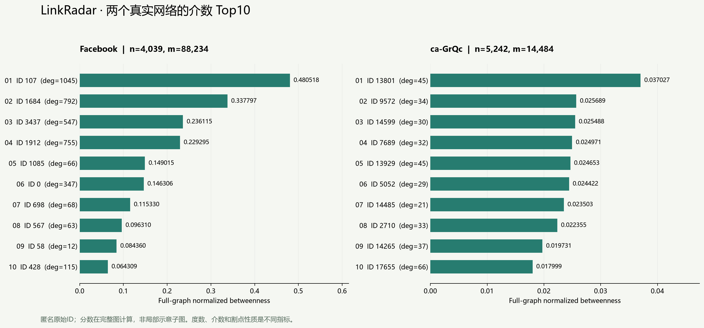
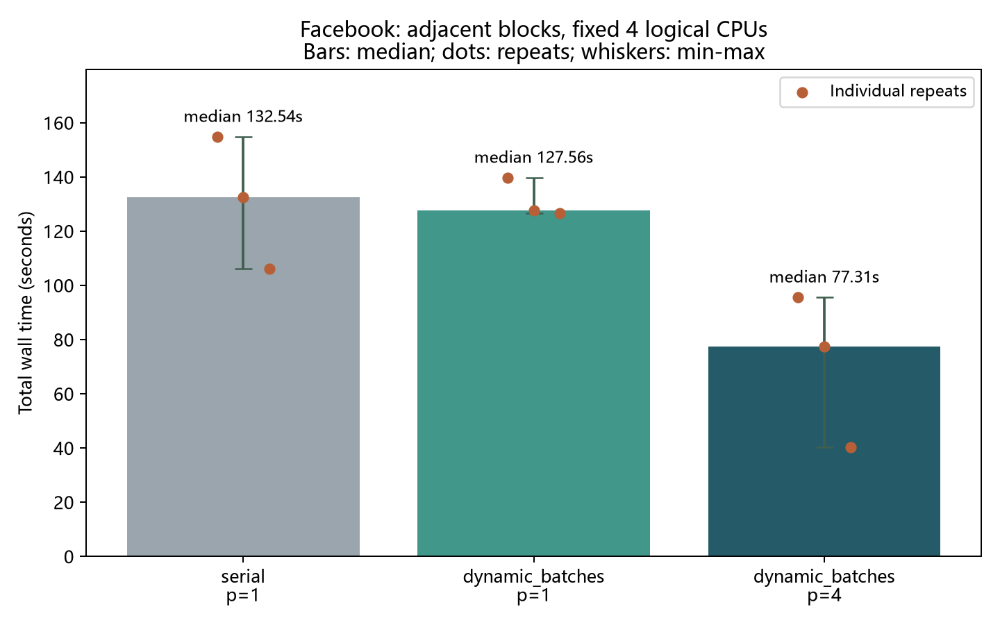
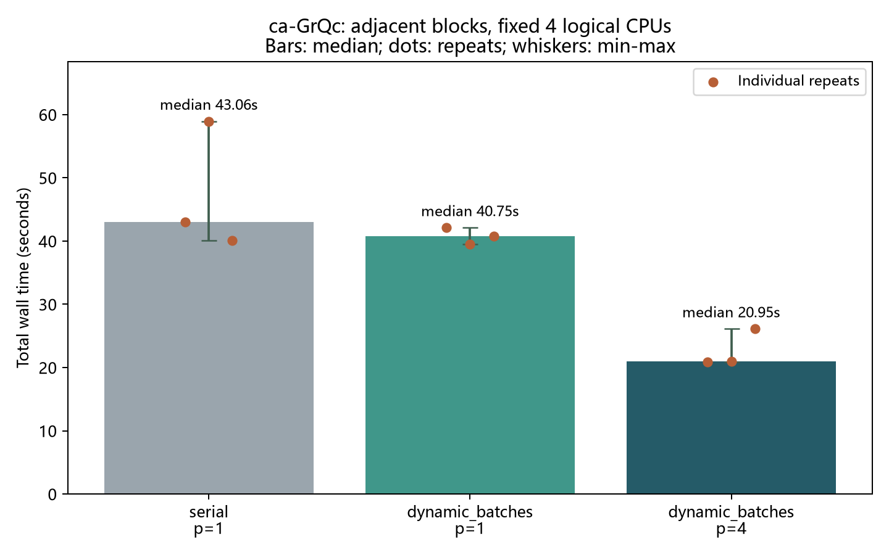

<a id="results"></a>

# LinkRadar 当前结果与证据

阅读入口：[文档导航](README.md)。前半部分以 2026-10-23 的 Facebook 与 ca-GrQc 结果为基准，后半部分记录 YouTube 大图与后续优化；不同日期和条件的结果不直接混合比较。

**2026-11-06 全量更新：** YouTube 新建的 8 线程双快照任务已完成全部 470,164 个核心源组、覆盖 1,134,890 个原始源点；两次监督墙钟合计 9,037.049 秒，约 2 小时 30 分 37 秒，不含中间停顿。第一次因系统可用内存低于 1 GiB 预留线中止，第二次续算完成。最终数组和源计划的完整性核验通过，全部外围节点通过树结构公式核对；核心节点尚未用独立算法进行全图逐点对照。结果和核验详见[本次全量汇总报告](Youtube全量处理报告.md)。下文旧实验的“未完成”和进度均指各自历史阶段或特定旧任务。

快速定位：[Facebook 与 ca-GrQc 结果](#1-当前保留的研究结果) · [YouTube 初次接入](#dataset-first) · [编译单核](#compiled-single) · [编译多线程](#compiled-thread) · [树商图](#quotient-results) · [检查点](#checkpoint-evidence) · [核心结构](#core-structure) · [BFS 重排](#layout-results) · [阶段剖析](#stage-profile) · [有效边统计](#edge-count) · [系数复用实验](#coefficient) · [原始调研](#survey)。边记录的算法和实测见[树商图与边记录](Graph_Optimization.md#dag-recording)。

## 1. 当前保留的研究结果

| 阶段 | 实际范围 | 已保存的正式案例 | 当前用途 |
|---|---|---:|---|
| 真实图初测 | ca-GrQc、Facebook全图，B=128，p=1/2/4，各3次 | 42 | 全节点参照、串并行核对、固定排名失效 |
| Facebook配对复测 | 固定4个逻辑CPU，serial/dynamic p=1/p=4，三个区组 | 9 | 诊断首轮异常基线；另1次热身不计统计 |
| ca-GrQc配对补测 | 同样的4逻辑CPU与3×3轮换协议，B=128 | 9 | 为任务03补充独立复测图；另1次热身不计统计 |

以下三次 Facebook / ca-GrQc 运行的状态均为 complete；它们与上文另行完成的 YouTube 全源任务是独立实验。原始数据、清洗缓存、全节点分数、计时、验证和图表均保留；早期合成图试跑、冒烟测试输出及连接探测记录已清理。合成生成器、配置和测试代码仍可按需重跑，新运行会生成新的产物。

正确性证据来自两张真实图各自的validation.json与逐案例分数对照。ca-GrQc配对补测已实际执行，新增9个正式案例与1次热身；此前临时测试输出不再作为当前可读取证据。保留完整full配置不代表已执行其五次重复与最高8进程矩阵。

## 2. 数据与正确性

两图保留完整节点集合与所有分量；ca-GrQc移除12个自环、正反去重后14484条边。首轮两图均逐节点比较raw、normalized、有限值，NetworkX使用k=None、weight=None、endpoints=False。真实图参照容差为atol=1e-8、rtol=1e-7。

| 图 | 节点 | 边 | 分量 | 最大分量 | raw最大误差 | normalized最大误差 | 全节点通过 |
| --- | --- | --- | --- | --- | --- | --- | --- |
| facebook | 4039 | 88234 | 1 | 4039 | 2.91038e-11 | 5.55112e-17 | 通过 |
| ca_grqc | 5242 | 14484 | 355 | 4158 | 2.91038e-11 | 3.46945e-18 | 通过 |

[原文件审计](node_insights/real_data_audit.json)保存SHA、行数、自环与重复统计。全节点对照通过表示结果在声明容差内一致，不表示浮点任意精度，也不只是在检查前十名相同。

## 3. 前十关键节点及具体解释

排名依据是各自完整原图的精确介数。表中“度排名”按度降序、原始整数ID升序打破并列；“割点”在完整原图求得。raw保留六位小数用于阅读，CSV保留更充分的浮点值。两图分数不作为跨网络的统一重要程度评分。



### Facebook

| 介数排名 | 匿名原始ID | 度 | 度排名 | raw | normalized | 分量大小 | 割点 |
| --- | --- | --- | --- | --- | --- | --- | --- |
| 1 | 107 | 1045 | 1 | 3916560.144441 | 0.480518079 | 4039 | 是 |
| 2 | 1684 | 792 | 2 | 2753286.686908 | 0.337797450 | 4039 | 是 |
| 3 | 3437 | 547 | 4 | 1924506.151571 | 0.236115357 | 4039 | 是 |
| 4 | 1912 | 755 | 3 | 1868918.212257 | 0.229295340 | 4039 | 是 |
| 5 | 1085 | 66 | 853 | 1214577.758360 | 0.149015092 | 4039 | 否 |
| 6 | 0 | 347 | 5 | 1192496.113079 | 0.146305921 | 4039 | 是 |
| 7 | 698 | 68 | 821 | 940024.246482 | 0.115330450 | 4039 | 是 |
| 8 | 567 | 63 | 904 | 784996.905594 | 0.096310331 | 4039 | 否 |
| 9 | 58 | 12 | 2918 | 687594.983375 | 0.084360206 | 4039 | 否 |
| 10 | 428 | 115 | 383 | 524164.067776 | 0.064309062 | 4039 | 否 |

### ca-GrQc

| 介数排名 | 匿名原始ID | 度 | 度排名 | raw | normalized | 分量大小 | 割点 |
| --- | --- | --- | --- | --- | --- | --- | --- |
| 1 | 13801 | 45 | 42 | 508435.354011 | 0.037027150 | 4158 | 是 |
| 2 | 9572 | 34 | 100 | 352746.524917 | 0.025689006 | 4158 | 是 |
| 3 | 14599 | 30 | 147 | 349992.173442 | 0.025488418 | 4158 | 是 |
| 4 | 7689 | 32 | 131 | 342881.133418 | 0.024970552 | 4158 | 是 |
| 5 | 13929 | 45 | 43 | 338516.368096 | 0.024652685 | 4158 | 是 |
| 6 | 5052 | 29 | 151 | 335351.919635 | 0.024422232 | 4158 | 是 |
| 7 | 14485 | 21 | 245 | 322725.945605 | 0.023502736 | 4158 | 否 |
| 8 | 2710 | 33 | 121 | 306964.800129 | 0.022354920 | 4158 | 是 |
| 9 | 14265 | 37 | 78 | 270935.454568 | 0.019731059 | 4158 | 是 |
| 10 | 17655 | 66 | 8 | 247145.822128 | 0.017998563 | 4158 | 否 |

Facebook的58号度数12、度排名2918，但介数排名第9；1085号介数第5、度排名853，却不是割点。ca-GrQc的13801号度排名42、介数第一。可以据此解释：直接连接数、中转作用、单点断裂性质是三个不同问题。

原始精度下载：[Facebook CSV](node_insights/facebook_top10.csv)、[ca-GrQc CSV](node_insights/ca_grqc_top10.csv)。[自动节点参数附件](node_insights/report.md)还保留散点图、局部结构图和详细来源。

局部展示只抽取前十及部分邻居，最多120节点；所有颜色、大小和排名来自全图分数，没有在局部图重算介数。布局距离不是地理距离，也不是实际最短路长度。

## 4. 并行性能：按协议分别解释

### 4.1 ca-GrQc真实图初测

同一张图、同一单源内核、B=128、每配置三次，total包含启动和清理。如下中位数取自原始汇总，不挑最好一次。

| 模式 | 实际p | 次数 | total中位数(s) | steady中位数(s) | S_total | S_steady |
| --- | --- | --- | --- | --- | --- | --- |
| dynamic_batches | 1 | 3 | 15.364321 | 15.183963 | 1.057805 | 1.070311 |
| dynamic_batches | 2 | 3 | 8.650206 | 8.340162 | 1.878852 | 1.948591 |
| dynamic_batches | 4 | 3 | 6.478889 | 5.887441 | 2.508525 | 2.760378 |
| serial | 1 | 3 | 16.252458 | 16.251564 | 1.000000 | 1.000000 |
| static_batches | 1 | 3 | 15.262085 | 15.083468 | 1.064891 | 1.077442 |
| static_batches | 2 | 3 | 9.248984 | 8.920964 | 1.757215 | 1.821727 |
| static_batches | 4 | 3 | 6.223733 | 5.601045 | 2.611368 | 2.901524 |

本轮四进程静态总加速观察值约2.61，四进程动态约2.51。static与dynamic差异不大，不能据三次样本宣称统计显著或动态调度必胜。p=1约1.06，也说明小差异可能来自运行波动。

### 4.2 Facebook首轮：作为异常诊断，不作主加速结论

首轮serial中位数约95.28s，dynamic(p=4)约28.38s，表面比值约3.36；但static(p=1)与dynamic(p=1)相对serial也分别出现约2.26与2.02。一个工作进程并没有多核算力，不能把这当成正常的多核收益。

原始记录保留，不删除快值或慢值。可确认运行时段的性能条件存在明显差异，但不能仅凭这些记录确定是温度、CPU频率、调度还是其他后台任务所致。因此首轮3.36不作为可靠多核加速结论，后续单独复测。

### 4.3 Facebook配对复测：当前应引用这一组

同一完整图、同一内核、B=128，固定逻辑CPU亲和性为[0,1,2,3]；这不是确认使用了四个物理核心。先执行一次全图串行热身，正式阶段用三个相邻区组轮换顺序，让三种条件各处于每个位置一次。

| 模式 | 实际p | 次数 | total中位数(s) | min–max(s) | 观察S_total |
| --- | --- | --- | --- | --- | --- |
| serial | 1 | 3 | 132.538355 | 106.061–154.807 | 1.000000 |
| dynamic_batches | 1 | 3 | 127.562846 | 126.671–139.722 | 1.039004 |
| dynamic_batches | 4 | 3 | 77.309161 | 40.325–95.576 | 1.714394 |

三个区组中serial_total / dynamic(p=1)_total比值都落在预先声明的[0.8,1.25]诊断范围内，筛查通过；它只是启发式检查，不是显著性检验或环境完全一致的证明。四进程观察比值约1.71；其单次范围40.33–95.58s仍较宽，需要连同波动一起报告。



首轮与复测的CPU亲和性、顺序协议不同，**不能混合中位数或用首轮串行当复测分母**。本机环境记录为Windows 11、Python3.12.6、16个逻辑CPU与12个物理核、约16.7GB内存；具体CPU拓扑映射和CPU quota未确认。包版本以各实验environment.json为准。

### 4.4 ca-GrQc配对补测：独立图表与基线诊断

使用与Facebook复测相同的3×3轮换顺序、B=128、4个逻辑CPU亲和性[0,1,2,3]；一次全起点串行热身不进入统计。计算预算600秒，本次测量阶段记录墙钟为432.983秒。不是把首轮结果重新画成配对实验。

| 模式 | 实际p | 次数 | total中位数(s) | min–max(s) | 观察S_total |
|---|---:|---:|---:|---:|---:|
| serial | 1 | 3 | 43.056132 | 40.113–58.923 | 1.000000 |
| dynamic_batches | 1 | 3 | 40.753431 | 39.503–42.095 | 1.056503 |
| dynamic_batches | 4 | 3 | 20.946103 | 20.896–26.099 | 2.055568 |

三个区组的serial / dynamic(p=1)比值依次为1.022823、1.491606、0.984297。其中第二个区组约1.492，超出预设[0.8,1.25]，所以**基线筛查未通过**。总体四进程比值约2.056仅为本轮描述，不作为可靠多核加速结论；不删除异常重复值，也不与首轮或Facebook合并统计。

全部9个正式案例及一次热身均完成全节点raw/normalized对照；与保存的参照分数比较，最大raw差异为3.40515e-09，最大normalized差异为2.48065e-16，通过atol=1e-8、rtol=1e-7的检查。计算正确性与计时基线可比性分别判断。



原始证据：manifest、逐次耗时、区组比值。网页任务03随当前网络切换标题、表格与图，并核对配对记录的数据集及图指纹。

### 4.5 当前性能结论的范围

本报告只引用现保留的两张真实图实验。启动、传图、通信和清理都计入total；steady单独报告。进程增加能否抵消这些成本，仍需按图和配置实测，当前没有通用盈亏平衡规模结论。

## 5. 节点移除：排名是否有结构意义

每个策略从原图重新开始，按原图固定介数、度数或随机排列逐步移除；不每删一个点重算排名。随机采用20个独立可复现排列，每条曲线是同一排列的嵌套前缀。主指标为剩余最大连通分量节点数 / 原始节点数，比例用floor(q*n)得到实际移除数。

ca-GrQc原本有355个分量，所以起点LCC/n=4158/5242≈0.7932，而Facebook起点为1。这种初始差异不能算作节点移除造成的损失。

| 图 | 实际移除k | 实际比例 | 介数策略LCC/n | 度数策略LCC/n | 随机均值LCC/n |
| --- | --- | --- | --- | --- | --- |
| facebook | 807 | 19.980% | 0.178262 | 0.658084 | 0.786321 |
| ca_grqc | 1048 | 19.992% | 0.007631 | 0.006677 | 0.565986 |

Facebook在约20%这一点上，介数策略后的最大分量明显小于度数和随机策略；ca-GrQc在这一末点上反而是度数略强。完整曲线还显示不同删除比例可能有不同差异。因此结论应限定到网络、策略和比例，不能说“介数任何时候都更有效”。随机阴影是10%–90%经验分位范围，不是置信区间。

## 6. 哪些东西还不能声称已完成

- 没有执行完整full的五次重复与最高8进程矩阵，也没有完成真实图B扫描。
- 没有独立实现P1粗粒度静态补充模式；已有P0静态round-robin批次与动态领取、P1时间线记录能力与起点顺序配置；旧合成时间线产物已清理。
- 2026-10-23 该报告形成时尚无 CSR/Numba 后端；现已支持 CSR、Numba 与线程共享只读图。仍没有 GPU、有权/有向图或近似介数后端。
- 网页展示已完成的结果；没有公开部署、从网页实时提交长计算的后端服务。
- 性能只对应本机本轮条件，未锁定温度或后台负载，不能跨机器承诺同样加速。
- 本地原文件有实际SHA并已验证缓存一致性，但没有独立核验官方发布文件的哈希；匿名编号不能还原现实人物身份。

## 7. 原始证据索引

部分原始证据仅保存在本地的 `results/`，未随仓库发布；下表保留证据名称供查阅本地记录。

| 证据 | 入口 |
|---|---|
| 两张真实图42案例、验证、失效、环境和配置 | 真实图manifest / 原始报告 |
| Facebook相邻区组复测、九个正式案例与一次热身 | manifest、原始计时、区组比值 |
| ca-GrQc新增配对补测 | manifest / 原始计时 |
| 实际工作进程与起点分工 | workers_0_2.json |
| 全部参数与展示附件 | [node_insights/report.md](node_insights/report.md) |
| 原文件审计 | [real_data_audit.json](node_insights/real_data_audit.json) |

每条性能结论都应能回到对应CSV，不能把本篇表格当作新一轮测量。需要重新生成阶段性表格时使用[展示讲稿中的命令](Run_and_Demo.md#demo)，自动摘要放在results/summaries目录，当前主说明由人工按证据维护。


# YouTube 大图与优化实验记录

以下条目保留原始实验的工作量、成功和失败情况及复现入口。历史阶段的“当前”和预算均以其原日期为准；现行链路与检查点状态见 [当前链路](Pipeline_and_Checkpoints.md)。

<a id="dataset-first"></a>

## YOUTUBE FIRST LOOP RESULT

## YouTube 首轮实施与实测结果

日期：2026-10-23。首轮范围已完成：KONECT格式适配、独立CSR缓存与结构校验、原Python内核的1/4/8固定起点短试算。未安装Numba，未新增多核内核，未运行全起点介数。

### 数据与缓存

- 节点：1134890；唯一无向边：2987624；连通分量：1；孤立点：0。
- 原文件：data/raw/youtube/youtube.txt；未改写。来源是用户提供的GitHub文件，仓库README引用KONECT。
- 原文件SHA256：59ab3149098060fa98ae60f30228b03ff9a096c06e4e55652d806a604390c0e9。
- 图SHA256：60ed332c38411ee837d983f0b23f1245e32b914215b379075ea733161d62364c。
- 邻接数组：31.452MiB；原始ID映射另占8.659MiB（不含运行库和临时工作区）。
- 准备墙钟：29.520秒；准备子进程峰值RSS：467.47MiB。
- 图元数据、准备过程及资源记录。

### 完整成功案例

所有案例使用同一个旧single_source_accumulate核心，通过CSR邻接适配器运行；路径计数仍为Python任意精度整数。每个源遍历完整图。

| 起点k | 核心计算秒 | 缓存加载校验秒 | 受监控端到端秒 | 子进程峰值RSS MiB | 系统预留GiB | 单case上限秒 |
|---|---|---|---|---|---|---|
| 1 | 19.516 | 6.487 | 26.739 | 303.01 | 3 | 120 |
| 4 | 79.101 | 6.729 | 86.571 | 302.98 | 3 | 120 |
| 8 | 83.715 | 3.393 | 87.654 | 302.81 | 2 | 240 |

这些是按顺序取得的单次pilot观察，不是重复计时中位数。8起点来自单独重试，内存预留和硬时限不同；不将三行合并为受控加速比或线性规模结论。每源吞吐有明显波动，具体原因尚未测量。
端到端包含spawn、缓存校验、适配、计算与I/O。RSS覆盖子进程整个生命周期；Windows private bytes另列原始JSON，不与RSS相加当作物理内存总量。

### 中止与调整，全部保留

1. 原Python tuple尝试：k=1在系统可用内存跌破3GiB预留线时中止，完成源数0；后续tuple尝试被停止，未声称有成功贡献向量。
2. CSR初次试算：k=1/4成功；k=8完成5个源后，系统可用内存约2.968GiB触发保护线，该案例未完成。
3. CSR的8起点重试：依据已测约303MiB峰值RSS，将这一次重试的预留线设为2GiB、硬上限240秒，实际完成8源。没有降低计算量、改变图或改变内核。
4. 驱动器已增加资源保护：某案例触及资源线，后续更大案例自动记为resource_not_run，不再重复启动。默认预留仍为3GiB。

### 正确性与证据范围

- 最终测试命令：.venv/Scripts/python.exe -m pytest -q；144项通过。
- 新测试覆盖严格格式、孤立点/重复/自环、旧图哈希等价、随机非连通图全节点数值与NetworkX参照、缓存篡改、真实spawn、超时回收、资源不足跳过。
- 实际大图的1/4/8源集合已核对为相同排列的嵌套前缀，向量长度等于n，所有值有限非负，增加起点后逐节点贡献不减。
- 单源原始ID 734676可达全部1134890节点。独立全图BFS验证恒等式：sum_v delta_s(v)=sum_{t!=s,reachable}(dist(s,t)-1)。
- 距离给出的期望总贡献：4384391；实际：4384391.000000004；绝对误差：3.725290298461914e-9。
- 这是全图单源聚合恒等式验证，加上小图逐节点参照，不是百万节点全起点NetworkX对照。
- 大图验证JSON。

### 输出与当前结论

结果是未缩放的A_S(v)=sum_{s in S}delta_s(v)，exact_all_sources=False、scaled=False。不是全图精确介数、近似估计或全图Top10，不导入旧精确失效接口。完整npy与来源索引在各运行的k*/目录。
目前已经证明该真实图可以通过紧凑缓存接入，并在原Python核上完成受预算短试算；尚未证明JIT或多核加速幅度。Python核心计算仍占主要墙钟，下一轮优先评估编译内核。
下一轮建议：增加可选Numba后端，验证路径计数范围与数值一致性，再固定同一源集合进行轮换重复计时。全起点预算待优化后重新评估，不直接启动多日计算。

### 代码与复现

- [CSR模块](../src/parallel_bc/csr.py)、[受预算试算](../src/parallel_bc/large_benchmark.py)、[测试](../tests/test_csr.py)。
- [运行说明](CSR_and_Numba.md#youtube-csr)、[实验计划与后续](#experiment-plan)。
- 原有全起点接口、旧NPZ缓存、并行调度器和失效实验未改。未提交或推送。

<a id="compiled-single"></a>

## COMPILED FIRST LOOP RESULT

### 性能协议

完整YouTube：n=1,134,890，m=2,987,624。种子42，固定同一8个源，按相同顺序计算。图指纹 `60ed332c38411ee837d983f0b23f1245e32b914215b379075ea733161d62364c`；源顺序SHA256 `303e58fa37156ce73227bfcdad004ec8511d149a2648dc478a5503bf149a1c99`。

三个配对重复，第一、三轮Python在前，第二轮编译版在前。每例一个受监督spawn子进程；每例硬上限240秒、总上限1000秒、可用内存预留2GiB。每次比较单独创建空JIT缓存，首次本机案例编译，后续子进程复用该次缓存。内核、JIT/缓存加载、图验证与整例墙钟分别记录。

先进行筛查运行 `results/20261023T124017_976228Z_compiled_compare/`：三对均完成且全部节点贡献在容差内一致，但期间有测试和旧图回归进程并发，不能用这批数字作为最终性能比较。本批记录保留，不丢弃失败或不利信息。

随后在项目测试和回归结束后独立复测，最终结果在下节记录。这里“独立”只表示没有同时运行本项目测试/其他计算；没有控制用户其他应用、操作系统负载或P/E核亲和性，不作为严格实验室结论。

### 独立复测结果

运行目录：`results/20261023T124824_837111Z_compiled_compare/`。机器记录与自动报告保存全部原始指标。

三对均完成；每例8个源，每个编译源均可达全部1,134,890节点，均为nopython本机执行，未触发整数回退。代码SHA256与交付源文件重算匹配。

| 重复 | Python内核秒 | 编译内核秒 | 内核加速比 | Python整例秒 | 编译整例秒 | 整例加速比 |
|---|---:|---:|---:|---:|---:|---:|
| 1 | 111.1621 | 1.4686 | 75.69 | 118.8558 | 8.0187 | 14.82 |
| 2 | 100.4611 | 1.7274 | 58.16 | 105.3452 | 6.7631 | 15.58 |
| 3 | 99.9107 | 2.0582 | 48.54 | 104.1228 | 9.7347 | 10.70 |

- 内核耗时中位数：Python **100.4611秒**，编译版 **1.7274秒**；逐配对加速比中位数 **58.16倍**，范围48.54—75.69。
- 整例墙钟中位数：Python **105.3452秒**，编译版 **8.0187秒**；逐配对加速比中位数 **14.82倍**，范围10.70—15.58。逐配对比值的中位数与两个墙钟中位数之比不是同一个统计量。
- 新空缓存的首次预热 **1.0885秒**；后两轮从该次缓存预热/加载分别 **0.2802秒、0.4100秒**。这包含分发及小图执行，不等同于纯编译时间；预热已计入整例墙钟。
- 所有配对的1,134,890个节点贡献均满足 `abs(error) <= 1e-8 + 1e-10*abs(reference)`。最大绝对误差 **5.9605e-8**；首对按分母 `max(abs(reference),1)` 的最大相对误差约 **5.11e-14**。大数值处绝对误差可超过atol，需与相对项一起判断，不能仅看atol。
- 整个子进程峰值RSS均约 **303MiB**。共同的CSR校验和导入阶段也在该峰值范围内，本轮峰值RSS没有证明整体内存明显下降，不能将理论工作区节省当作整例RSS实测下降。

完整命令：

```powershell
.\.venv\Scripts\python.exe -m parallel_bc compiled-compare --dataset youtube_csr --sources 8 --repeats 3 --seed 42 --timeout 240 --total-timeout 1000 --reserve-gib 2
```

每源计算耗时中位尺度约 **0.216秒**。用同样吞吐乘1,134,890个源得到约 **2.84天**的纯内核线性外推；三个案例均值对应约2.4—3.4天。实际单源观测范围约0.158—0.295秒，源点差异、P/E核迁移、系统负载和长期运行均会改变吞吐。这个换算不含检查点等后续成本，不是全源完成承诺，也没有启动全源计算。

本轮完成的是编译单核的首轮验证。原计划中的5次正式比较、独立源集合和多核扩展仍未完成；不能把这三次固定源重复包装为对所有网络、所有起点或所有机器的普遍加速保证。

### 当前边界

YouTube部分源贡献验证覆盖每一个节点，但不是百万源全量计算。原始结果中的 `exact_all_sources=False`、`scaled=False` 不变。

实测加速属于同图、同8源、同顺序的组合实现优化，不能称为多核加速，也不能声称纯JIT单因素收益。内核加速比与整例墙钟加速比必须分别报告。首次编译或缓存加载包含在墙钟里，不藏在未计时阶段。

后续多核扩展、外围树精确压缩和独立源集合确认仍待实施。任何全源耗时换算都是粗估，不能替代长期运行结果；本轮不自动启动过夜/多日全源任务。

<a id="compiled-thread"></a>

## COMPILED PARALLEL RESULT

### 主实验协议

完整图n=1,134,890，m=2,987,624；保持源级计算在整个图上执行。源集合为种子42排列前64个，B=4，共16批；线程数1/2/4，三轮顺序1→2→4、2→4→1、4→1→2。一次一案例运行，测试和其他本项目计算已结束。

Numba预热单独记录且不计入扩展统计。每个测量案例仍包括缓存加载和图校验，并分别报告执行/归并与整例墙钟。单例上限120秒，总上限600秒，系统可用内存预留1.5GiB；父进程每50毫秒采样资源，低于预留时中止并保留状态。

命令：

```powershell
.\.venv\Scripts\python.exe -m parallel_bc compiled-scale --dataset youtube_csr --sources 64 --threads 1 2 4 --batch-size 4 --repeats 3 --seed 42 --timeout 120 --total-timeout 600 --reserve-gib 1.5 --cpu-affinity 0 2 4 6
```

### 主实验结果

原始运行：`results/20261023T143837_298760Z_compiled_scaling/`，含manifest.json、自动报告、交付核验。九个测量案例均完成、验证通过；每例64个源，均遍历全部1,134,890节点，零整数回退。

| 线程数 | 执行+归并中位数秒 | 整例墙钟中位数秒 | 配对执行加速比中位数 | 配对墙钟加速比中位数 | CPU时间并行度中位数 |
|---|---:|---:|---:|---:|---:|
| 1 | 13.9366 | 18.0572 | 1.000 | 1.000 | 0.985 |
| 2 | 6.5634 | 10.8620 | 2.123 | 1.662 | 1.957 |
| 4 | 3.2492 | 7.0343 | 4.148 | 2.567 | 3.685 |

| 重复 | 1线程执行秒 | 2线程执行秒 | 4线程执行秒 | 4线程配对执行比 |
|---|---:|---:|---:|---:|
| 1 | 13.1508 | 6.4874 | 3.1707 | 4.148 |
| 2 | 13.9366 | 6.5634 | 3.5260 | 3.953 |
| 3 | 14.4741 | 6.5722 | 3.2492 | 4.455 |

4线程执行阶段平均CPU并行度为3.32—3.79，原生线程ID各不相同且每个worker实际处理源点；源点时间段存在明确重叠。每个案例实际亲和性均核对为0/2/4/6。程序和本轮记录的代码指纹重算匹配。

所有113万节点贡献均通过容差检查，多线程相对同轮单线程的最大绝对误差 **3.7253e-9**。8源小试算还与上一轮原Python完整贡献向量直接对照，三种线程配置均通过，最大绝对误差约 **5.96e-8**；保存在交付核验JSON中。

部分配对执行比略高于线程数，2线程效率中位数1.062、4线程1.037。这是本次观测值，不能解释为普遍成立的超线性加速规律。亲和性约束减少了P/E核类别混淆，但未控制共享缓存、频率和用户其他负载；没有性能计数器证据来分别归因。对外使用“约4倍的执行加速”这一有限结论，并保留逐次值。

整个案例子进程峰值RSS约303MiB，包含共同的图校验与导入阶段，不等于内核工作区峰值。虽每个worker新增私有数组，本次生命周期峰值没有显示明显增长；不能据此声称增线程不消耗内存。所有测量案例的系统可用内存最低约2.98GiB，未触及本轮1.5GiB预留线。

本地原始运行目录中的图，左侧为三次原始值、中位数及范围；右侧为第一轮4线程案例中各源的真实开始/结束区间，不是根据请求线程数画出的示意图。可复现作图脚本和SVG保留在原始运行目录。

### 独立源集合确认

已用种子43、相同64源规模、B=4和亲和性集合进行一次额外确认。此集合独立生成，不挑选有利源点；没有并入种子42三轮主表。源顺序SHA256为 `20f51c715c39ad1e09dec00ca075ace49c8c58e2599dbf590ed671f0f1d4a67e`。

原始运行：`results/20261023T144037_545319Z_compiled_scaling/`。

| 线程数 | 执行+归并秒 | 整例墙钟秒 | 相对本集合单线程执行比 |
|---|---:|---:|---:|
| 1 | 13.6687 | 17.5257 | 1.000 |
| 2 | 5.7920 | 9.9914 | 2.360 |
| 4 | 3.1579 | 7.7422 | 4.328 |

所有节点贡献、源点覆盖和实际worker证据均通过，最大绝对误差3.7253e-9，零回退。该结果支持本次约4倍的线程执行加速趋势；只有一次确认，不能当成另一套充分重复的正式统计。

### 全源预算更新

按本轮相同后端的执行/归并吞吐，以 `n/64` 线性换算：

| 线程数 | 全源执行时间粗估 |
|---|---:|
| 1 | 68.65小时 |
| 2 | 32.33小时 |
| 4 | 16.00小时 |

4线程三次测量分别对应约15.62—17.37小时；独立集合对应约15.55小时。这不是长期全源实测，未计入未来检查点和恢复开销，源点差异、缓存、系统负载、温度和频率均可能改变吞吐。不把每64源重新启动并校验的固定成本乘到全源中，也不假设全源自动按16小时准时结束。

当前仍高于原计划8小时的全源决策门槛，因此本轮不启动全源长任务。下一项优先推进外围树/叶节点精确压缩，测后再做全源预算决策。

后续阶段已完成无损商图与全原图分数恢复，最新同题实测与4—6小时预算粗估见[商图报告](RESULTS.md#quotient-results)。以上16小时保留为本阶段历史估计。

### 范围与后续

这些结果是完整图上固定源集合的未缩放贡献，`exact_all_sources=False`、`scaled=False`。本轮没有完成百万个源点，不可生成或声称YouTube全源精确Top10。

本轮加速比只比较同一编译内核的线程数，不将上一轮8源Python/编译加速比直接相乘。小试算与64源主表不混合；独立集合另列。原计划5次的V0/V1/V2/V3正式矩阵和前驱存储单因素消融仍未完成。

下一项算法层优化是外围树/叶节点的精确压缩；需要端点权重补偿、外围分数恢复和独立正确性证明。这里只分析并行结果，不通过直接删叶子改变原问题。

<a id="quotient-results"></a>

## TREE QUOTIENT RESULT

### YouTube无损表示

| 项目 | 数值 |
|---|---:|
| 原图节点 | 1,134,890 |
| 原图唯一无向边 | 2,987,624 |
| 核心代表节点 | 470,164 |
| 核心边 | 2,322,898 |
| 另存的外围节点及树边 | 664,726 |
| 连通分量 | 1 |

核心边加另存树边仍为2,987,624条；每个原始节点都有记录。重建图指纹仍为 `60ed332c38411ee837d983f0b23f1245e32b914215b379075ea733161d62364c`。

派生缓存：`data/processed/youtube_csr_treeq/`。准备墙钟 **9.8839秒**，计算子进程峰值RSS约363.23MiB，CPU9.25秒；此成本单独报告，不藏在性能比较之外。证据：准备记录。

原CSR及原始youtube.txt保留。派生缓存多保存恢复映射，不把“计算状态压缩”误称为磁盘文件压缩。

原CSR数组文件约40.11MiB，完整商图与恢复数组约57.00MiB；额外空间用于保留原始节点和恢复信息。158,270个锚点带有外围树；最大树块的原始锚点ID为24576，代表7,562个原始节点。在全源问题中，这7,562个源对应同一次带完整源数量权重的核心遍历，而树内分数仍逐个恢复。

### 资源中止与64源筛查

首次64源运行 `results/20261023T152601_017261Z_quotient_compare/` 的原版预热触及1.5GiB系统可用内存预留，受控结束；后续案例跳过，未纳入性能统计。完整状态保留，没有删除慢基线或失败记录。

内存恢复后，维持相同预留线重试：64源筛查。原版与商图版使用同一64个原始源；商图实际执行63次核心遍历，代表的源仍为64。全部113万节点贡献在容差内一致，最大绝对误差2.5379e-8，零回退。

| 指标 | 原生CSR | 商图与恢复 |
|---|---:|---:|
| 计算工作秒 | 3.3443 | 2.1783 |
| 整例墙钟秒 | 7.6195 | 8.0564 |

工作时间减少约1.54倍，但小工作量下额外恢复表示校验使总等待略变慢。这个负面结果保留；不据此宣称所有任务均有端到端加速。

### 256源三轮对照

完整原图、同一256个原始源与顺序；两版使用同一4线程、B=4、CPU亲和性0/2/4/6；分开预热，三轮顺序原版→商图、商图→原版、原版→商图。每例上限120秒、总上限900秒。测试及真实图回归均在开始前结束。

初次256源运行 `results/20261023T152838_795697Z_quotient_compare/` 在商图预热时最低可用内存约1.49GiB，触及1.5GiB预留，正式案例均未运行。随后统一将双方预留改为1GiB，保留硬超时与50毫秒资源采样；最终主表只使用这一统一预算的独立运行，未混入前述筛查或资源中止案例。

原版工作时间为执行与归并；商图工作时间包括源分组、带权核心执行/归并及全原图节点恢复。整例墙钟还包括缓存读取、完整校验、JIT/缓存加载、启动、保存和回收。压缩准备的9.88秒为独立的一次性成本。

最终主运行：`results/20261023T153106_143286Z_quotient_compare/`，含机器记录和自动报告。

| 重复 | 原版工作秒 | 商图分组/计算/恢复秒 | 工作加速比 | 原版整例秒 | 商图整例秒 | 整例加速比 |
|---|---:|---:|---:|---:|---:|---:|
| 1 | 15.4883 | 11.3285 | 1.367 | 20.1576 | 17.3311 | 1.163 |
| 2 | 17.7454 | 10.1100 | 1.755 | 23.0862 | 17.2075 | 1.342 |
| 3 | 16.0819 | 7.9765 | 2.016 | 20.6692 | 15.0100 | 1.377 |

工作耗时中位数 **16.0819→10.1100秒**；整例墙钟中位数 **20.6692→17.2075秒**。逐轮配对加速比的中位数分别 **1.755倍、1.342倍**；它们与两个时间中位数之比不是相同统计量。三次观测波动明显，不宣称统计显著或通用固定倍数。

三轮都用252次核心遍历代表相同256个原始源；恢复全部1,134,890个输出值，最大绝对误差约 **3.0734e-8**，全部满足容差，零整数回退。源分组耗时中位数约 **0.0132秒**，全原图恢复约 **0.0285秒**。恢复步骤没有成为当前主要耗时。

整例商图子进程峰值RSS最高约275.59MiB；原版约303MiB。包含加载/校验阶段，不能当作内核独占工作区。正式案例系统可用内存最低约1.443GiB，未触及本轮1GiB预留。用户其他应用、缓存和频率未完全控制，保留全部原始值供复测。

同源问题不等于相同内部遍历次数：源合并与状态减少正是等价算法变换的收益；原始源和目标端点数量未减少。

### 独立集合与全源预算

独立种子43、256个原始源、相同4线程/B4/亲和性/1GiB预留，另运行一次：`results/20261023T153428_506208Z_quotient_compare/`。

- 原版工作16.2236秒，商图9.0423秒；整例20.8018秒与16.3054秒。
- 工作加速1.794倍，整例1.276倍；252次核心遍历代表256源。
- 全部节点在容差内一致，最大绝对误差6.2399e-8，零回退。

该单次确认没有并入三轮主表，支持本次收益方向，不替代充分重复的正式统计。

全源预测额外采用种子44均匀抽取256个核心组，并选择这些组内**全部529个原始节点**作源，确保每个选中组的源权重与真正全源时相同。目标权重仍表示整个原图。使用相同4线程/B4/亲和性/1GiB预留。

该试算的带权核心执行/归并 **7.1521秒**；以470,164个核心组外推约 **3.65小时**。证据：投影试算JSON和可复现脚本。这是529源的原图贡献，仍然`exact_all_sources=False`，不是全源中心性结果。

主表三次252组吞吐对应的全核心外推约4.1—5.9小时，中位约5.2小时；单次均匀核心组试算更快。综合只采用 **约4—6小时** 的粗估口径，不挑最快一次作承诺。源分布、内存压力、频率、长期负载、未见源点可能触发的任意精度回退及未来检查点开销均会影响最终时间。

全源时需要遍历的是470,164个带源数量权重的核心组，而非再对1,134,890个原始节点逐源BFS；也不能用本次529个原始源直接作分母外推。相对上一阶段约16小时的估计，算法分解提供了继续缩短的机会；当时尚未完成长期实测，2026-11-06 的全量结果见[汇总报告](Youtube全量处理报告.md)。

### 当前范围

本阶段 YouTube 同源性能输出为原始源子集的未缩放贡献，`exact_all_sources=False`；当时没有用部分源结果生成全图精确Top10。之后的全源任务采用检查点与恢复，并于 2026-11-06 完成，见[汇总报告](Youtube全量处理报告.md)。

当前代码的逐源任务日志与累加记录面向有限试算；全源应采用分组分批、流式日志和检查点，避免在内存中保留几十万条任务记录或依赖一次连续长进程。原始文件、旧CSR和既有算法接口均保留。

<a id="checkpoint-evidence"></a>

## CHECKPOINT RESULT

### YouTube持续负载

原始图：1,134,890节点、2,987,624条无向边；全源计划470,164个核心源组。参数：4线程、CPU亲和性0/2/4/6、微批次4、每1024核心源组提交一次、种子45、系统可用内存预留1 GiB。

运行目录：`results/20261024T0903_youtube_checkpoint/`。原始清单、每会话资源结果和逐文件审计位于该目录，审计摘要为 `audit.json`。

| 会话 | 目的 | 状态 | 新增检查点 | 会话末核心组 | 总墙钟 |
|---|---|---|---|---|---|
| 首组 | 正常暂停并保存初始基线 | ok / paused | 1 | 1024 | 34.560秒 |
| 持续负载 | 在1000秒硬上限强制中断 | timeout（预期故障测试） | 35 | 36864 | 1000.063秒 |
| 恢复 | 校验全部历史提交，再新增一组 | ok / paused | 1 | 37888 | 34.738秒 |

硬预算超时是本次故障测试主动设置的终止条件，不计为全源计算失败或完成。持续会话结束后先校验36个已提交文件，再将全部36条记录保存为 `pre_recovery_commits.json`；恢复后重新校验所有哈希和前缀一致性，全部通过。恢复会话校验/重建核心总量约0.528秒，商图完整加载校验另计5.461秒。

这次历史 legacy 任务最终保存37个检查点、37,888个核心源组，占计划8.058%；代表90,087个原始源，未完成完整全源覆盖，也未发布其全源介数或Top排名。所有已提交向量均有限、非负，源组不重不漏，未发生任意精度回退。之后另建的新内核双快照任务已完成全源，见[汇总报告](Youtube全量处理报告.md)。

- 已提交核心执行/归并累计1044.887秒；每1024组中位27.960秒，范围27.225—34.244秒。
- 三次会话峰值子进程RSS最大约276.05 MiB；每组结束RSS快照约168.74—174.32 MiB，首4组中位174.01 MiB、末4组172.94 MiB，本次未观察到随累计源记录持续增长的趋势。清单摘要按检查点数量少量增长，不声称理论上零增长。
- 最小系统可用内存约2.056 GiB，高于设置的1 GiB预留。另保存Windows private bytes采样口径，不能把RSS称为整个应用的唯一物理内存。
- 贡献向量写入、刷新、fsync与哈希累计0.736秒，约占已提交核心工作0.070%；此值不含清单替换开销，总会话墙钟包含全部实际开销和中断损失。
- 按全部已提交组吞吐外推：全计划纯核心执行约3.60小时，当前剩余约3.31小时。不是完整全源实测；未覆盖后续负载变化、未来源溢出回退和中断损失，正式运行仍预留约4—6小时预算。

该持续负载用于检查稳定性和恢复，不是受控加速比实验。期间有轻量监测与文档处理，末次恢复会话与部分小图验收短暂重叠，不把它与先前性能矩阵混合计算加速比。

### YouTube首组独立数值核对

验收脚本：`scripts/verify_youtube_checkpoint.py`。首组1024核心源组代表2289个原始源，将保存的核心贡献按这个原始源子集的条件恢复，再与未压缩YouTube CSR上的同2289源、4线程计算对照，比较全部1,134,890个节点。本核对与持续负载会话分开运行，仍受240秒硬预算和1 GiB内存预留监督。

原始结果：`results/20261024T092250_064251Z_youtube_checkpoint_validation/validation.json`。全部节点通过 `atol=1e-8, rtol=1e-10`，最大绝对误差1.4603e-6；这是有序贡献的浮点舍入误差，应结合相对容差解释，不能误读为逐节点误差都低于固定1e-8。未压缩对照执行107.820秒、受监督墙钟111.556秒，仅作为独立正确性验收，不作为新的受控加速统计。

最大绝对误差节点的参考贡献约2.4541e8，该点相对误差约5.95e-15；全部节点的最大“实际误差 / 允许误差”约0.000310，低于1。没有把源子集贡献归一化为全图排名。

### 交付状态与边界

- 原始文件SHA256仍为 `59ab3149098060fa98ae60f30228b03ff9a096c06e4e55652d806a604390c0e9`；原始图SHA仍为 `60ed332c38411ee837d983f0b23f1245e32b914215b379075ea733161d62364c`。
- 检查点代码指纹 `e62ff9f9932d516f087879a1f3a415413839379d5ef3f2f4ff0fd191bddbc545` 与真实图回归、持续负载及最终审计一致。后续修改数值/检查点源码会按设计拒绝直接恢复，完整运行期间应冻结代码。
- 三个检查点计算进程PID 21408、25452、33136已核对不再存活；原始图独立对照也已结束。没有后台全源计算。
- 最终跨目录验收记录为运行目录的 `delivery_validation.json`，包含两张旧真实图、YouTube独立对照、代码一致性、全部提交哈希/覆盖、暂停状态和进程回收检查。
- 保留全部37个检查点和3次会话记录，未提交源组可从同一目录继续。未提交/推送Git；保留此前改动和用户已有文档。
- 最小实施范围已经完成。下一阶段为使用同一计划推进剩余核心源组、最终统一恢复分数，再做网络发现与失效分析；本轮尚未生成YouTube完整全源分数。

<a id="core-structure"></a>

## CORE STRUCTURE RESULT

### 结论

**继续做BCC分解存在结构上的缩减空间，但主要计算仍集中在一个巨型双连通块。建议下一轮优先测试顶点重排和线程配置，暂缓完整BCC数值加速实现。**

最大块保留96.15%的核心节点和98.80%的核心边；按块规模计算的工作量指标只下降约5.43%。这不能支持“进一步BCC分解就能再获得几倍加速或降至分钟级”的预期。它也不是实测收益上限：访存、边界权重、分块复制和归并都会影响实际耗时。

### 实际诊断结果

输入为已有无损商图缓存 `data/processed/youtube_csr_treeq/`。原始网络包含1,134,890个节点、2,987,624条无向边，所有原始节点仍由锚点与外围树表示。

| 指标 | 实测结果 |
|---|---:|
| 核心节点 / 无向边 | 470,164 / 2,322,898 |
| 核心平均度 | 9.881 |
| 核心连通分量 | 1 |
| 割点 | 8,387 |
| 桥 | 2,364 |
| 边块总数（包含单桥二节点块） | 8,935 |
| 含环双连通块 | 6,571 |
| 最大块节点 | 452,060，占核心96.149% |
| 最大块边 | 2,295,072，占核心98.802% |
| 次大块节点 / 边 | 17 / 85 |
| 所有桥中，较小侧原始端点数量的最大值 | 83 |

这里的桥只统计仍留在核心中的桥，已经由外围树表示的桥不重复计入。桥两侧数量使用锚点代表的原始节点数量，所以最后一行以原始节点为单位。它说明这些核心桥连接的较小侧仍很小，不能将巨型核心分成规模相近的两个大块。

割点可以出现在多个双连通块中，因此各块节点数会有重复；边则恰好属于一个块。当前块节点数总和479,098，满足 `n + 块数 − 连通分量数`，不能把它误读为新增了原始节点。

### 计算量指标怎样解释

使用与Brandes逐源遍历成本对应的粗指标：

```text
当前核心：active_n × (n + m)            = 1,313,197,202,168
分块后：sum n_i × (n_i + m_i)          = 1,241,868,687,721
排除可解析的单桥块后                  = 1,241,868,673,537
含环块指标 / 当前核心指标              = 0.945683
指标下降                              ≈ 5.43%
```

这只比较结构工作量。它不是已经实现的BCC算法耗时、实测加速比或严格运行时间上下界，不包括块外端点数量、割点分数修正、数据复制、调度和归并。**不据此修改此前约3.6小时的全源核心外推，也不把5.43%写成已获得的提速。**

实际分布是一个极大的块加许多小块，并非大量规模相近的块。进一步优化的主要对象仍是这45万余节点的巨型块。

<a id="layout-results"></a>

## LAYOUT TUNING RESULT

### YouTube实验协议

完整原图1,134,890节点、2,987,624条边；核心470,164节点、2,322,898条边。主集合512个核心源组，代表1065个原始源，种子46；独立集合2048组，代表5792个原始源，种子47；BFS起点种子1234。每个选中组的全部原始节点都作为源，目标数量始终覆盖完整原图。

第一阶段固定4线程比较natural/bfs编号，三轮交替；第二阶段在选定编号下比较4/6/8线程，三轮轮换；最后将候选与原版natural/4线程在独立2048组上三轮确认。批次始终为4。各对比较原始源集合/图指纹、全原图贡献和旧编号核心贡献。

当前Windows CPU拓扑通过API重新读取，每个物理核只选一个逻辑CPU：

| 线程 | 计算进程允许的逻辑CPU | 核心组成 |
|---|---|---|
| 4 | 0,2,4,6 | 4个P核 |
| 6 | 0,2,4,6,8,9 | 4个P核＋2个E核 |
| 8 | 0,2,4,6,8,9,10,11 | 4个P核＋4个E核 |

仅限制计算子进程，线程仍可能在允许集合内迁移。这里比较CPU配置，不把不同P/E组成的结果称为固定硬件集合的纯线程扩展；未固定频率或独占CPU。

总实验预算1800秒，每案例180秒，系统可用内存预留1 GiB。测试和旧真实图验收均在正式YouTube测量前结束。工作、核心执行和整例墙钟分开，一次性布局准备另列。三轮工程筛选不作为统计显著性检验。完整说明见[方法与运行说明](RESULTS.md#layout)。

主运行目录：20261030T072346_293822Z_layout_tuning。第三轮确认在独立目录补测，原始超时保留；总体结果见summary.json。实验过程中未修改数值/实验源码。

### 结论：保留原编号＋4线程

**实现和正确性验证通过，但候选“BFS＋6线程”没有在独立集合上取得稳定收益，本轮不替换现有长期计算方案。**

三轮独立配对加速比分别约1.04、1.55、0.78，中位1.044；第三轮候选变慢，中位数也未达到预设1.05门槛。按照事先规定的筛选规则，`adopt_candidate=false`，推荐配置为natural/4线程。没有为了得到正向结果继续追加重复或改变源集合。

### 第一阶段：原编号与BFS编号

固定4线程、同512核心源组，全部原图/核心贡献均通过容差比较：

| 重复 | natural工作秒 | bfs工作秒 | 配对工作加速比 |
|---|---:|---:|---:|
| 1 | 31.039 | 20.352 | 1.525 |
| 2 | 27.397 | 24.023 | 1.140 |
| 3 | 27.229 | 27.160 | 1.003 |

工作时间中位数27.397→24.023秒，逐对工作比中位1.140；整例墙钟中位39.922→35.705秒。第三轮的BFS整例墙钟40.911秒反而比natural的39.733秒稍慢。编号优化有候选价值，但波动明显，不能只取第一轮作固定收益。

原编号中位worker CPU累计时间约61.844秒，BFS约56.344秒；实际CPU并行度中位约2.26和2.36，4个请求线程并未稳定达到4个CPU的持续利用。没有独占CPU、固定功耗/频率或隔离其他应用，不能将全部墙钟差异归因于缓存局部性。

一次性独立缓存准备：natural约11.845秒，bfs约11.823秒，含共同的商图加载/校验、图指纹、保存与回收；单次准备观测不能证明BFS准备没有成本。详细构建和JIT阶段另见各prepare案例。

### 第二阶段：BFS布局下的CPU配置

同512源组、B4、三轮轮换顺序：

| 线程 | 工作时间中位秒 | 整例墙钟中位秒 | 相对同轮4线程的工作比中位 | CPU并行度中位 |
|---|---:|---:|---:|---:|
| 4 | 26.032 | 38.353 | 1.000 | 2.179 |
| 6 | 23.788 | 35.942 | 1.115 | 2.427 |
| 8 | 28.797 | 40.633 | 0.904 | 2.326 |

6线程三轮均比4线程快，进入组合确认；8线程未表现出稳定优势。请求线程数与实际持续CPU并行度不同，增加允许核心并未带来同幅度的有效并行。具体瓶颈尚未由性能计数器隔离，不将现象直接定性为“内存带宽饱和”或“某类核心一定更慢”。

### 第三阶段：独立2048源组确认

比较原版natural/4线程与候选bfs/6线程。换源集合，保留完整目标数量和组内全部原始源：

| 重复 | 原版工作秒 | 候选工作秒 | 逐对工作比 | 原版墙钟秒 | 候选墙钟秒 |
|---|---:|---:|---:|---:|---:|
| 1 | 107.749 | 103.182 | 1.044 | 119.604 | 115.354 |
| 2 | 139.908 | 90.072 | 1.553 | 152.336 | 102.998 |
| 3（独立补测） | 138.946 | 177.666 | 0.782 | 160.266 | 205.539 |

逐对工作比中位1.044，逐对墙钟比中位1.037。不能用两组中位耗时138.946/103.182≈1.35，替代真正的逐对比值中位1.044；这会遮蔽第三轮候选变慢和配对波动。

全部21个成功测量案例的配对验证均通过，原图节点贡献最大绝对差9.5367e-7，仍满足 `atol=1e-8, rtol=1e-10`，不是逐位相同。路径计数溢出回退为0，没有资源线中止。成功案例系统可用内存最低约1.864 GiB，高于1 GiB预留；成功案例峰值RSS最高约368.08 MiB，包含双缓存加载和完整等价校验，不能当作内核独占工作区内存。

#### 保留的超时与补测

原运行第三轮原版案例在180.091秒硬上限终止，可用内存最低约2.226 GiB。未完成贡献未发布，主运行原始manifest保持 `incomplete`，没有覆盖或改成成功。

随后只补第三轮这一对，源组、布局、批次和CPU集合不变，单案上限改为300秒，并与原运行共享剩余474.466秒总预算。补测原版160.266秒、候选205.539秒均完成。

补测目录：20261030T074712_588090Z_layout_confirmation_retry，记录见continuation.json。原运行1325.534秒＋补测366.059秒＝累计1691.593秒，约28分12秒，包含失败案例，未超过1800秒实验预算。原始失败记录仍在主目录，综合汇总类型为 `complete_with_preserved_timeout`，数值/实验代码指纹一致。

### 全量外推与旧进度成本

仅用本轮独立集合所有成功重复的核心执行吞吐，按470,164核心源组外推：原版约8.21小时，候选约7.88小时。**这是当前共享环境的外推，不是全源实测，也不能直接与2026-10-24持续负载的3.60小时作算法优劣比较。** 本轮CPU可用程度和耗时波动明显，原版实测吞吐本身已与历史不同。

若沿旧方案继续，已有8.058%的进度使本轮估算的剩余核心成本约7.55小时；候选从零重启约7.88小时，反而更高。按相同吞吐假设，重启至少要超过约1.088倍加速才抵消丢弃旧进度的成本；本轮独立结果没有提供足够的稳定依据。因此保留旧方案和旧进度，不将候选接入全源长期运行。

后续优先在启动正式全源时用短pilot重新估算可用吞吐，或在更稳定负载下补做性能剖析。BFS重排作为经过正确性验证的可选实验保留，不宣称其对所有图或环境无效。

### 保护、复现与交付

原商图缓存、旧检查点和7份冻结源码共68个文件的前后哈希及最终复核均一致，数值指纹仍为 `e62ff9f9932d516f087879a1f3a415413839379d5ef3f2f4ff0fd191bddbc545`。旧任务仍暂停在37,888/470,164核心源组，未迁移、未续算，没有后台全源任务。

汇总可由以下命令重建，不修改原始超时记录：

```powershell
.\.venv\Scripts\python.exe scripts/summarize_layout_tuning.py results/20261030T072346_293822Z_layout_tuning --continuation results/20261030T074712_588090Z_layout_confirmation_retry
```

最终delivery_validation.json逐一核对21个成功案例的全部原始源数量、锚点原始ID、映射源索引、CPU集合、实际worker数量、向量形状/有限非负性和文件哈希，全部通过。进程回收核验结合创建时间排除系统复用PID，所有本轮计算进程已退出。

原始附件包括布局双向映射及缓存、同源计划、当前CPU拓扑、21个成功案例的全原图/旧编号核心贡献、逐源任务记录、一次超时记录和独立补测。未提交或推送Git。

<a id="stage-profile"></a>

## QUOTIENT STAGE PROFILE 64

## YouTube 商图内核 64 源组分阶段诊断

2026-11-02。本次只选 64 个核心源组（种子 46，共代表 122 个原始源），全图目标端点权重不变；每个配置重复三轮。程序为 `scripts/profile_quotient_stages.py`，机器记录为 `results/20261102T061840_627339Z_stage_profile_64/profile.json`。该结果仅用于诊断，不是全源介数。

### 主要发现

| 分阶段计时 | 1 线程阶段时间中位数（秒） | 阶段合计占比 | 4 线程阶段合计占比 |
|---|---:|---:|---:|
| 工作区初始化 | 0.066 | 0.52% | 0.57% |
| BFS 和路径数计算 | 5.880 | 46.92% | 46.46% |
| 反向依赖累积 | 6.352 | 50.68% | 51.01% |
| 写入线程累加向量 | 0.236 | 1.88% | 1.96% |

每行时间先对每轮的 64 个源逐源时间求和，再取三轮中位数；占比是这些阶段中位数的比例。4 线程的各源墙钟时间彼此重叠，不能相加作为程序墙钟；等待调度时间也可能混入。插桩将原有融合内核拆成三次编译函数调用，改变缓存和调度状态，这些比例只是诊断估计。

反向累积和 BFS 合计约 98%，初始化很小；因此应优先研究反向累积和边访问，而不应把减少清零作为主要提速方向。两阶段比例相近并不证明除法或内存访问中哪一项是瓶颈，还需要进一步测量或做单项对照。

### 未插桩对照

原内核 1 线程三轮执行加归约时间分别为 13.051、12.912、13.227 秒，中位数 13.051 秒；4 线程为 6.602、4.342、5.699 秒，中位数 5.699 秒。前者与后者中位数之比约 2.29，但三次配对波动明显，不能视为稳定加速比。1 和 4 线程分别使用同一 `[0,2,4,6]` 进程亲和性集合，线程可以在集合内迁移。

4 线程原内核的工作线程 CPU 时间与执行墙钟之比，中位约 1.97；观察到的使用率不足以单独判定是内存带宽、CPU 降频或其他进程导致。归约墙钟中位约 0.0024 秒；工作区分配墙钟中位约 0.00045 秒，不包括数组随后首次触页的全部成本。当前测量没有独立隔离 Python 调度时间，不能推断其准确占比。

插桩和原版按相同源组、权重与线程数对比核心贡献向量，6 对全部通过 `atol=1e-8, rtol=1e-10`；最大绝对差约 7.45e-9，动态调度会改变浮点累加顺序。没有触发路径数溢出。本诊断版本遇到溢出会停止，不替代正式版的大整数回退；未进行恢复后的原图逐节点对照。

原检查点 manifest 前后 SHA256 一致，状态仍为暂停；代码与缓存没有由诊断脚本修改。每次执行开始前检查至少 1 GiB 可用内存，但本实验没有连续内存监督；每个线程调用有 180 秒协作超时，未另设强制进程级超时。

<a id="edge-count"></a>

## SHORTEST PATH EDGE COUNT 64

## YouTube 核心图最短路径有效边统计

2026-11-02。统计范围为与 `20261102T062858_343786Z_coeff_64` 相同的 64 个核心源组（种子 46，源顺序哈希 `cb37cd40634e79be9c3f4c84285bc64f8ef6fb081c62fecb2bf07a1b1914668a`），代表 122 个原始源，核心图完整加载。不是全源介数计算。

### 结果

对于一个源组，从每个已访问节点扫描 CSR 邻接项，将 `dist[w] == dist[v]+1` 的有向邻接项记为有效边。这些边形成该源的最短路径有向无环结构；在现有反向累积中，也正是满足这个判断的项参与计算。

| 指标 | 64 源组结果 |
|---|---:|
| 每源扫描邻接项 | 4,645,796 |
| 每源有效邻接项中位数 | 1,273,079 |
| 有效比例中位数 / 均值 | 27.40% / 27.52% |
| 有效比例范围 | 26.15%～29.44% |
| 每源同层邻接项中位数 | 2,099,638 |
| 每源反向邻接项中位数 | 1,273,079 |

64 个源均覆盖全部 470,164 个核心节点，因此扫描数均为核心无向边数的两倍。图为无向图，每个跨层有效正向邻接项都有一个反向邻接项；同层边也按两个邻接项计数。每源独立检查正向、反向、同层计数之和等于扫描数，正向与反向数相等。

### 这意味着什么

若能在 BFS 时准确记录所有有效边，反向阶段读取的邻接项数量按本样本中位数有机会由约 464.6 万降到约 127.3 万，即少读约 72.6% 的邻接项。这个比例**不是加速比或运行时间节省比例**：记录时需要额外写边，反向访问方式、内存分配与缓存也会改变，且 BFS 仍须扫描全图。

按中位有效边数，仅保存 int32 目标索引约 4.86 MiB／线程；若再采用每个节点一个 int32 偏移项，约增加 1.79 MiB／线程，合计约 6.65 MiB／线程、4 线程约 26.6 MiB。实际峰值取决于实现和预分配方式；例如按全部 4,645,796 个邻接项预分配时索引数组就需要约 17.72 MiB／线程，以上不含其他临时开销。

统计结果支持做一次独立原型测试，但不证明该原型能提速；实现时必须记录所有满足下一层条件的边，包含指向同一节点的多个前驱。保持逐源路径数溢出回退和每线程私有存储。

### 校验和复现

统计脚本 `scripts/count_shortest_path_edges.py` 逐源与原 `_weighted_dependencies` 比较完整距离数组和最短路径数量数组，64 组全部一致，且独立按最终距离重新统计边分类；没有遇到 int64 路径数溢出。测试 `tests/test_count_shortest_path_edges.py` 覆盖菱形多条最短路、同层边与孤立点，1 项通过。

本次没有实现或运行边记录候选。旧检查点 manifest 前后 SHA256 一致。脚本在加载前检查 1 GiB 可用内存，但没有连续内存监督或进程级硬超时；输出的诊断时间包含 JIT、重复核对与统计，不能用于性能比较。

机器记录：`results/20261102T063736_765941Z_dag_edge_count_64/summary.json`。重新统计使用：

```powershell
.\.venv\Scripts\python.exe -m pytest tests/test_count_shortest_path_edges.py -q
.\.venv\Scripts\python.exe scripts/count_shortest_path_edges.py
```

<a id="layout"></a>

## BFS 顶点重排方法

### 编号、数量权重和结果怎样保持一致

以固定种子选择BFS起点，记录访问次序；若有多个连通分量或孤立点，继续覆盖全部剩余节点。定义 `new_to_old[new]=old`，其逆为 `old_to_new[old]=new`。

```text
新邻接：old_to_new[旧邻居]
新目标数量：mass_new[new] = mass_old[new_to_old[new]]
新源数量：source_counts_new[new] = source_counts_old[new_to_old[new]]
源点：new_source = old_to_new[old_source]
还原核心贡献：K_old[old] = K_new[old_to_new[old]]
```

还原后的核心贡献再交给原有外围树恢复函数，输出仍按原始节点顺序排列。BFS只改变编号和数组访问顺序，不删除节点/边，不修改数量权重或最短路径长度。

独立布局缓存使用0..n−1作为内部ID；原始节点ID仍由旧商图和映射解释。布局物理图有自己的指纹，同时绑定原图和旧核心指纹。缓存创建/加载时逐项核对排列、逆映射、质量与度数，并将全部重排边映射回旧编号，与旧核心CSR完整比较。

两种布局均保存为独立只读CSR缓存：natural为恒等映射，bfs为BFS映射；不覆盖原缓存。两者采用相同加载、校验和计时路径。

<a id="coefficient"></a>

## 反向依赖系数复用：原理与 64 源组实验

2026-11-02。实验结论：**候选内核数值对照通过，但 3 轮中有 1 轮变慢，不满足本轮稳定收益筛选，暂不接入正式检查点链路。** 只测试了 64 个核心源组，结论不代表所有图和机器上的表现。

### 现有计算与候选公式

在无权核心图中，从源组 r 做 BFS，得到源到节点 v 的最短路径条数 σ(v)。反向按距离从远到近计算依赖，M(w) 是 w 所代表的原始目标节点数量：

$$D(v)=\sum_{w:d(w)=d(v)+1}\frac{\sigma(v)}{\sigma(w)}(M(w)+D(w)).$$

同一个后继 w 可能被多个前驱使用，实验方案在算出 D(w) 后保存系数

$$q(w)=\frac{M(w)+D(w)}{\sigma(w)},\qquad D(v)=\sum_{w:d(w)=d(v)+1}\sigma(v)q(w).$$

因为反向遍历先处理更远的节点，访问 w 时 q(w) 已经算好。除法从符合条件的边上重复执行，变为每个已访问节点一次；但另需访问系数数组，能否提速取决于图结构、CPU 和内存行为，不能由除法次数直接推断。

例如 σ(v)=2、σ(w)=4、M(w)+D(w)=10，原项为 (2/4)×10=5；候选先保存 q(w)=10/4=2.5，再算 2×2.5=5。若另一个前驱也连接 w，它可以复用 2.5。数学表达式等价，浮点运算顺序不同，故结果按容差核对而不是要求逐位相同。

### 实现边界

候选位于 `src/parallel_bc/quotient_coeff_experiment.py`，采用 Numba、`nogil=True`、`fastmath=False`，与原实现一样保存 `delta` 用于最终累加。每个线程另有一个 float64 系数数组：YouTube 核心每线程 3,761,312 字节（约 3.59 MiB），4 线程约 14.35 MiB。现有调度器统计的 workspace_bytes 只包含原工作区，不包含这个额外数组；以上额外内存单独计入。

BFS 中保留 int64 路径数溢出检查，溢出时完整重算该源的 Python 大整数依赖，成功后才提交。候选对非有限系数也会停止；极端数值情况下计算顺序改变可能产生不同的浮点行为，不能声称逐位等价。

### 真实图对照

使用 YouTube 原编号商图，种子 46 的 64 个核心源组，代表 122 个原始源；目标数量权重始终覆盖全图。原版和候选均使用同源、4 线程、批大小 4、进程亲和性 `[0,2,4,6]`。完成 JIT 预热后交替次序，共三轮。计时为线程执行与归约，不包括商图加载、编译、恢复和进程启动。

| 轮次 | 原版（秒） | 候选（秒） | 配对加速比（原版 / 候选） |
|---|---:|---:|---:|
| 1 | 7.289 | 8.510 | 0.856 |
| 2 | 5.778 | 4.891 | 1.181 |
| 3 | 6.351 | 5.791 | 1.097 |

配对比值中位数约 1.097，但第一轮候选更慢；没有通过“每轮大于 1，且中位数至少 1.05”的预设工程筛选。三轮观测不是统计显著性证明，未隔离系统负载或频率变化。当前结果不足以推断全量耗时或解释每轮变化的原因，也未扩展源组样本。

每轮均将核心贡献恢复为 1,134,890 个原图节点贡献，与原版逐点按 `atol=1e-8, rtol=1e-10` 比较通过；最大绝对差 7.45e-9。这是同源组的部分贡献，而非全量介数。未触发真实数据源的 int64 路径数溢出。测试还覆盖非连通图、不同权重、工作区复用和构造的溢出回退，4 项通过。

旧检查点 manifest 的运行前后 SHA256 相同。候选没有接入正式执行入口，也没有迁移或继续旧检查点；检查点要求代码及运行配置匹配，未来若考虑采用还需单独设计和验证续算方案。

复现实验：

```powershell
.\.venv\Scripts\python.exe -m pytest tests/test_quotient_coeff_experiment.py -q
.\.venv\Scripts\python.exe scripts/benchmark_quotient_coeff.py
```

本次机器记录：`results/20261102T062858_343786Z_coeff_64/summary.json`。脚本每次运行创建新实验目录，每个测量案例前检查系统可用内存；每个调用设 180 秒协作超时，但没有独立进程硬超时和连续内存监督。

<a id="experiment-plan"></a>

## 实验计划与后续

原实验计划 R001–R024 的历史范围覆盖数据导入、同源配对、线程、商图、检查点与布局对照。其具体测量、未完成的 full 矩阵、超时和适用限制见各实验节及对应原始记录；未来实验继续固定图指纹与源组、分别记录热态与端到端时间、重复轮次、内存和正确性。


<details>
<summary>展开截至 2026-10-30 的原实验跟踪表（历史状态）</summary>

# LinkRadar 百万边优化实验跟踪表

日期：2026-10-23

数据、CSR、Numba单核与源级线程后端已实施；完成1/2/4线程三轮比较及种子43确认。历史见[CSR首轮报告](#dataset-first)、[单核报告](#compiled-single)，最新见[多核报告](#compiled-thread)。

随后已完成无损树商图及全原图分数恢复，最新结果见[商图实测](#quotient-results)，公式见[方法说明](Graph_Optimization.md#tree-quotient)。
实验计划已合并至本节的[实验计划与后续](#experiment-plan)。

2026-10-24更新：分组检查点和进程恢复已实现，完整245项测试及两张旧真实图全源续算回归通过；YouTube持续负载验收见[检查点实测](#checkpoint-evidence)。

2026-10-30更新：完成[核心结构诊断](#core-structure)。最大双连通块占核心节点96.15%、边98.80%；结构工作量指标仅下降约5.43%，下一轮优先重排与线程实验。旧检查点和数值指纹保持不变。

| Run ID | 阶段 | 目的 | 系统/变体 | 数据与工作量 | 主要指标 | 优先级 | 状态 | 决策条件 |
|---|---|---|---|---|---|---|---|---|
| R001 | M0/B0 | 手算与参考校验 | 原Python/NetworkX | 菱形、树、桥接、非连通小图全源 | 预期分数与逐点误差 | MUST | TODO | 同一定义/归一化 |
| R002 | M1/B1 | 数据来源与结构审计 | 用户GitHub文件，README引用KONECT | youtube.txt，%注释、1起始ID | SHA、1134890节点、2987624唯一边、零自环重复 | MUST | DONE | CSR已核为1个连通分量；原始文件未改，不标为SNAP官方下载 |
| R003 | M1/B1 | CSR等价与资源试算 | 紧凑数组/只读映射缓存 | YouTube完整图 | 图哈希、结构、邻接31.45MiB、映射8.66MiB、准备29.52s | MUST | DONE | 图指纹沿用旧编码；峰值内存与准备记录已保存 |
| R004 | M1/B1 | 原内核成本pilot | 原Python核+CSR适配，p=1 | YouTube同源前缀k=1/4/8 | 完整贡献向量、逐源耗时与内存 | MUST | DONE_WITH_LIMITS | tuple与首次k8资源中止保留；k8以2GiB预留/240s上限独立重试成功，不能合并为受控加速统计 |
| R005 | M2/B0 | 新表示正确性 | V0/CSR | 手算、随机非连通小图全源，真实大图同源聚合检查 | CSR首轮144项测试；单源距离恒等式误差约3.7e-9 | MUST | DONE_WITH_LIMITS | 编译版与两张旧真实图全源回归已补齐，见R007；仍不声称大图全源NetworkX对照 |
| R006 | M2/B2 | 数据布局消融 | V0 vs V1 | YouTube同一S | 冷端到端/热执行/内存 | MUST | TODO | 允许CSR单独更慢 |
| R007 | M2/B0 | 编译正确性与范围 | V2 vs V0 | 小图全源、大图同S、路径数溢出夹具 | 169项测试；逐点误差、溢出回退 | MUST | DONE | 路径数溢出前重算，未将部分源贡献当全图介数 |
| R008 | M2/B2 | 编译组合变体首轮比较 | V1 vs V2 | YouTube同一8源，3轮交替顺序 | JIT/缓存、内核、墙钟、内存 | MUST | DONE_WITH_LIMITS | 是JIT+复用数组+隐式DAG的组合收益；不是纯编译因素消融，非最终正式矩阵 |
| R009 | M2/B2 | 前驱存储独立消融 | V2 pred存储 vs 邻接反扫 | 相同图/S/编译配置 | 正确性、执行与工作区 | OPTIONAL | TODO | 不与编译同时改变后归因 |
| R010 | M3/B3 | 同后端并行扩展 | 同一Numba核，inline/threads 1/2/4 | 同64源、B4、CPU0/2/4/6 | 三轮执行中位13.94/6.56/3.25秒；190项测试 | MUST | DONE_WITH_LIMITS | nogil线程路线；约4倍执行加速，整例约2.57倍；不是编译版spawn结论 |
| R011 | M3/B3 | 共享图是否值得 | V3复制CSR vs 只读共享CSR | 相同p/S/B/内核 | 私有内存、启动、总时间、回收 | CONDITIONAL | DEFERRED | 本轮线程直接共享CSR；未实现spawn复制/共享图对照，不作其独立收益主张 |
| R012 | M3/B2-B3 | 最终正式比较 | 冻结后的V0/V1/V2/V3 | YouTube共同k与S，目标5次轮换重复 | 逐次值、中位数、范围、正确性 | MUST | TODO | 预计原实现超预算则缩共同k，不删慢基线 |
| R013 | M3/B2-B3 | 独立源集合确认 | 同一Numba核线程1/2/4 | 种子43，64源、B4、相同亲和性 | 执行13.67/5.79/3.16秒；全节点一致 | MUST | DONE_WITH_LIMITS | 单次确认线程趋势；未完成所有V0/V1/V2/V3的独立集合矩阵 |
| R014 | M4/B4 | 应用发现解释 | 已有精确结果复核 | Facebook/ca-GrQc | 低度高介数、非割点、失效反例 | MUST | TODO | 明确结构意义和现实边界，不重跑大实验 |
| R015 | M4 | 全起点预算决策 | 无损树商图+4线程 | 核心组吞吐与完整源数量权重试算 | 全源执行粗估约4—6小时 | MUST | PARTIAL | 尚未做全源；先实现分组检查点和流式日志，再决定长期运行预算 |
| R016 | M5 | 拓扑迁移 | 冻结后的关键变体 | roadNet-CA完整图同S | 数值安全、时间/内存、差异 | OPTIONAL | TODO | 核心完成；路径数溢出则如实报告 |
| R017 | M5 | 中图全源桥梁 | V0/最终后端 | ca-AstroPh完整图全源 | 正确性、时间、应用解释 | OPTIONAL | TODO | pilot确认预算 |
| R018 | M4 | 交付审计与答辩 | 图表/报告/推导页 | 已完成的正式记录 | 来源链接、范围声明、可复现性 | MUST | TODO | 未运行、失败、估计与实测分开 |
| R019 | M4 | 精确结构压缩与恢复 | 端点数量商图+解析恢复 | 全原图保留；256源三轮同题比较 | 223项测试，原图指纹一致；工作16.08→10.11秒 | MUST | DONE_WITH_LIMITS | 包含全部外围节点恢复；64源端到端略慢和资源中止均保留；非YouTube全源交付 |
| R020 | M4 | 核心组全源权重试算 | 256个均匀核心组 | 种子44，组内全部529原始源 | 核心执行7.15秒，外推3.65小时 | MUST | DONE_WITH_LIMITS | 合并主表较慢样本，对外用4—6小时粗估，不挑最快单次作承诺 |
| R021 | M4 | 分组提交与故障恢复 | 全源权重固定、核心贡献检查点 | 小图故障注入、真实进程退出、Facebook/ca-GrQc全源 | 245项测试；暂停/恢复与未压缩编译版全节点一致 | MUST | DONE | 贡献文件先落盘、清单最后提交；完整覆盖后统一恢复原图 |
| R022 | M4 | 持续负载与真实中断 | YouTube全源计划的有限会话 | 4线程、核心组1024/检查点、1GiB预留 | 1000秒硬中断后成功续算；37检查点、37888核心组 | MUST | DONE_WITH_LIMITS | 36个历史提交哈希不变；首组2289原始源与未压缩版全1134890节点一致；当前进度8.06%，非全源交付 |
| R023 | M4 | 核心桥/割点/BCC诊断 | 迭代Tarjan只读结构分析 | 完整470164节点、2322898边核心 | 8387割点、2364桥；最大块452060节点/2295072边；278项测试 | MUST | DONE | 结构指标下降约5.43%不当作提速；完整BCC数值实现暂缓，先测重排与线程配置 |
| R024 | M4 | BFS布局与CPU配置 | 冻结内核＋独立排列/缓存 | 主512核心组、独立2048组；4/6/8线程，三轮 | 302项测试；独立候选工作比1.04/1.55/0.78；保留一次超时 | MUST | DONE_WITH_LIMITS | 数值全部通过，但收益不稳定；保持natural/4线程与旧8.06%进度，详见[布局实验结果](#layout-results) |

记录规范：
- 数据列同时有 graph_sha256、n、m_unique、source_count、source_set_hash。
- 结果类型必须为 exact_centrality 或 source_subset_contribution；不能把后者导入原精确失效接口。
- 计时区分加载/构建、编译/启动、执行与归并、清理、端到端，分不开的阶段如实命名。
- 性能变体必须带代码/依赖/数值类型、p、B、亲和性、日志设置、重复/区组、冷/热标识。
- 所有失败、超时、资源中止留记录。只有通过正确性与协议检查的case进入对应结论。
- 共享页不能在RSS求和后当作唯一物理内存；优先私有内存与系统可用内存。
- 首批实施只推进R001—R004及CSR相关小图校验；后续用户已单独授权编译版单核，推进R007及R008的组合变体首轮比较。未授权本轮启动多日全源计算。
- 用户随后授权继续任务，完成线程路线R010及R013范围内的独立确认；本轮仍未启动YouTube全源或精确结构压缩。
- 用户再授权保留贡献的压缩任务，已推进R019/R020，所有原图节点/边可重建，分数可恢复；尚未启动YouTube全源长任务。

</details>

2026-11-06 补充：边记录已作为新建全源检查点任务的默认内核；旧检查点仍使用 legacy，详见 [链路与检查点](Pipeline_and_Checkpoints.md)。

<a id="dataset-plan"></a>

YouTube 输入来源、CSR 准备与固定源语义见 [CSR 与 Numba](CSR_and_Numba.md)，检查点及全源状态见 [当前链路](Pipeline_and_Checkpoints.md)。

<a id="survey"></a>
