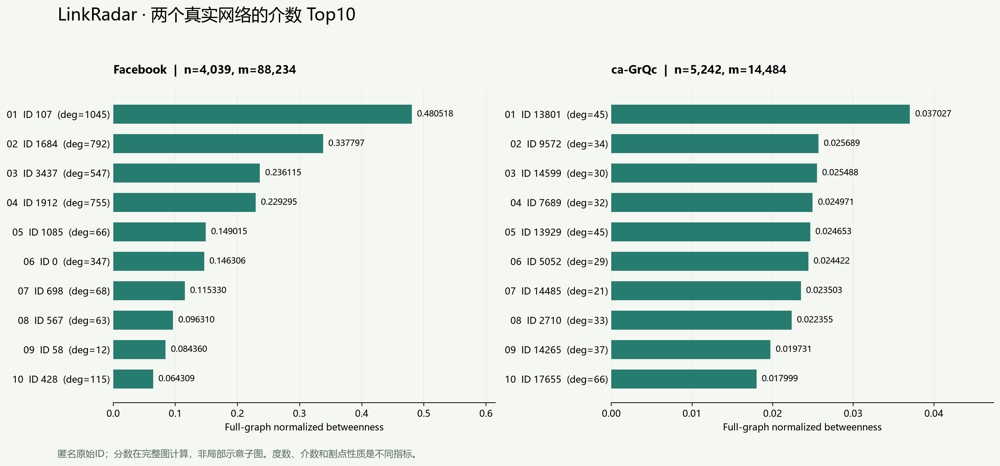

# LinkRadar 当前结果与证据

阅读入口：[文档导航](README.md)。更新基准：2026-10-23；当前报告聚焦Facebook与ca-GrQc，分别解释真实图初测、两张图各自的配对复测和节点展示。

## 1. 当前保留的研究结果

| 阶段 | 实际范围 | 已保存的正式案例 | 当前用途 |
|---|---|---:|---|
| 真实图初测 | ca-GrQc、Facebook全图，B=128，p=1/2/4，各3次 | 42 | 全节点参照、串并行核对、固定排名失效 |
| Facebook配对复测 | 固定4个逻辑CPU，serial/dynamic p=1/p=4，三个区组 | 9 | 诊断首轮异常基线；另1次热身不计统计 |
| ca-GrQc配对补测 | 同样的4逻辑CPU与3×3轮换协议，B=128 | 9 | 为任务03补充独立复测图；另1次热身不计统计 |

三次运行的状态均为complete。原始数据、清洗缓存、全节点分数、计时、验证和图表均保留；早期合成图试跑、冒烟测试输出及连接探测记录已清理。合成生成器、配置和测试代码仍可按需重跑，新运行会生成新的产物。

正确性证据来自两张真实图各自的validation.json与逐案例分数对照。ca-GrQc配对补测已实际执行，新增9个正式案例与1次热身；此前临时测试输出不再作为当前可读取证据。保留完整full配置不代表已执行其五次重复与最高8进程矩阵。

## 2. 数据与正确性

两图保留完整节点集合与所有分量；ca-GrQc移除12个自环、正反去重后14484条边。首轮两图均逐节点比较raw、normalized、有限值，NetworkX使用k=None、weight=None、endpoints=False。真实图参照容差为atol=1e-8、rtol=1e-7。

| 图 | 节点 | 边 | 分量 | 最大分量 | raw最大误差 | normalized最大误差 | 全节点通过 |
| --- | --- | --- | --- | --- | --- | --- | --- |
| facebook | 4039 | 88234 | 1 | 4039 | 2.91038e-11 | 5.55112e-17 | 通过 |
| ca_grqc | 5242 | 14484 | 355 | 4158 | 2.91038e-11 | 3.46945e-18 | 通过 |

[原文件审计](real_data_audit.json)保存SHA、行数、自环与重复统计。全节点对照通过表示结果在声明容差内一致，不表示浮点任意精度，也不只是在检查前十名相同。

## 3. 前十关键节点及具体解释

排名依据是各自完整原图的精确介数。表中“度排名”按度降序、原始整数ID升序打破并列；“割点”在完整原图求得。raw保留六位小数用于阅读，CSV保留更充分的浮点值。两图分数不作为跨网络的统一重要程度评分。

### Facebook

| 介数排名 | 匿名原始ID | 度 | 度排名 | raw | normalized | 分量大小 | 割点 |
| --- | --- | --- | --- | --- | --- | --- | --- |
| 1 | 107 | 1045 | 1 | 3916560.144441 | 0.480518079 | 4039 | 是 |
| 2 | 1684 | 792 | 2 | 2753286.686908 | 0.337797450 | 4039 | 是 |
| 3 | 3437 | 547 | 4 | 1924506.151571 | 0.236115357 | 4039 | 是 |
| 4 | 1912 | 755 | 3 | 1868918.212257 | 0.229295340 | 4039 | 是 |
| 5 | 1085 | 66 | 853 | 1214577.758360 | 0.149015092 | 4039 | 否 |
| 6 | 0 | 347 | 5 | 1192496.113079 | 0.146305921 | 4039 | 是 |
| 7 | 698 | 68 | 821 | 940024.246482 | 0.115330450 | 4039 | 是 |
| 8 | 567 | 63 | 904 | 784996.905594 | 0.096310331 | 4039 | 否 |
| 9 | 58 | 12 | 2918 | 687594.983375 | 0.084360206 | 4039 | 否 |
| 10 | 428 | 115 | 383 | 524164.067776 | 0.064309062 | 4039 | 否 |

### ca-GrQc

| 介数排名 | 匿名原始ID | 度 | 度排名 | raw | normalized | 分量大小 | 割点 |
| --- | --- | --- | --- | --- | --- | --- | --- |
| 1 | 13801 | 45 | 42 | 508435.354011 | 0.037027150 | 4158 | 是 |
| 2 | 9572 | 34 | 100 | 352746.524917 | 0.025689006 | 4158 | 是 |
| 3 | 14599 | 30 | 147 | 349992.173442 | 0.025488418 | 4158 | 是 |
| 4 | 7689 | 32 | 131 | 342881.133418 | 0.024970552 | 4158 | 是 |
| 5 | 13929 | 45 | 43 | 338516.368096 | 0.024652685 | 4158 | 是 |
| 6 | 5052 | 29 | 151 | 335351.919635 | 0.024422232 | 4158 | 是 |
| 7 | 14485 | 21 | 245 | 322725.945605 | 0.023502736 | 4158 | 否 |
| 8 | 2710 | 33 | 121 | 306964.800129 | 0.022354920 | 4158 | 是 |
| 9 | 14265 | 37 | 78 | 270935.454568 | 0.019731059 | 4158 | 是 |
| 10 | 17655 | 66 | 8 | 247145.822128 | 0.017998563 | 4158 | 否 |

Facebook的58号度数12、度排名2918，但介数排名第9；1085号介数第5、度排名853，却不是割点。ca-GrQc的13801号度排名42、介数第一。可以据此解释：直接连接数、中转作用、单点断裂性质是三个不同问题。

原始精度下载：[Facebook CSV](node_insights/facebook_top10.csv)、[ca-GrQc CSV](node_insights/ca_grqc_top10.csv)。[自动节点参数附件](node_insights/report.md)还保留散点图、局部结构图和详细来源。

局部展示只抽取前十及部分邻居，最多120节点；所有颜色、大小和排名来自全图分数，没有在局部图重算介数。布局距离不是地理距离，也不是实际最短路长度。

## 4. 并行性能：按协议分别解释

### 4.1 ca-GrQc真实图初测

同一张图、同一单源内核、B=128、每配置三次，total包含启动和清理。如下中位数取自原始汇总，不挑最好一次。

| 模式 | 实际p | 次数 | total中位数(s) | steady中位数(s) | S_total | S_steady |
| --- | --- | --- | --- | --- | --- | --- |
| dynamic_batches | 1 | 3 | 15.364321 | 15.183963 | 1.057805 | 1.070311 |
| dynamic_batches | 2 | 3 | 8.650206 | 8.340162 | 1.878852 | 1.948591 |
| dynamic_batches | 4 | 3 | 6.478889 | 5.887441 | 2.508525 | 2.760378 |
| serial | 1 | 3 | 16.252458 | 16.251564 | 1.000000 | 1.000000 |
| static_batches | 1 | 3 | 15.262085 | 15.083468 | 1.064891 | 1.077442 |
| static_batches | 2 | 3 | 9.248984 | 8.920964 | 1.757215 | 1.821727 |
| static_batches | 4 | 3 | 6.223733 | 5.601045 | 2.611368 | 2.901524 |

本轮四进程静态总加速观察值约2.61，四进程动态约2.51。static与dynamic差异不大，不能据三次样本宣称统计显著或动态调度必胜。p=1约1.06，也说明小差异可能来自运行波动。

### 4.2 Facebook首轮：作为异常诊断，不作主加速结论

首轮serial中位数约95.28s，dynamic(p=4)约28.38s，表面比值约3.36；但static(p=1)与dynamic(p=1)相对serial也分别出现约2.26与2.02。一个工作进程并没有多核算力，不能把这当成正常的多核收益。

原始记录保留，不删除快值或慢值。可确认运行时段的性能条件存在明显差异，但不能仅凭这些记录确定是温度、CPU频率、调度还是其他后台任务所致。因此首轮3.36不作为可靠多核加速结论，后续单独复测。

### 4.3 Facebook配对复测：当前应引用这一组

同一完整图、同一内核、B=128，固定逻辑CPU亲和性为[0,1,2,3]；这不是确认使用了四个物理核心。先执行一次全图串行热身，正式阶段用三个相邻区组轮换顺序，让三种条件各处于每个位置一次。

| 模式 | 实际p | 次数 | total中位数(s) | min–max(s) | 观察S_total |
| --- | --- | --- | --- | --- | --- |
| serial | 1 | 3 | 132.538355 | 106.061–154.807 | 1.000000 |
| dynamic_batches | 1 | 3 | 127.562846 | 126.671–139.722 | 1.039004 |
| dynamic_batches | 4 | 3 | 77.309161 | 40.325–95.576 | 1.714394 |

三个区组中serial_total / dynamic(p=1)_total比值都落在预先声明的[0.8,1.25]诊断范围内，筛查通过；它只是启发式检查，不是显著性检验或环境完全一致的证明。四进程观察比值约1.71；其单次范围40.33–95.58s仍较宽，需要连同波动一起报告。

首轮与复测的CPU亲和性、顺序协议不同，**不能混合中位数或用首轮串行当复测分母**。本机环境记录为Windows 11、Python3.12.6、16个逻辑CPU与12个物理核、约16.7GB内存；具体CPU拓扑映射和CPU quota未确认。包版本以各实验environment.json为准。

### 4.4 ca-GrQc配对补测：独立图表与基线诊断

使用与Facebook复测相同的3×3轮换顺序、B=128、4个逻辑CPU亲和性[0,1,2,3]；一次全起点串行热身不进入统计。计算预算600秒，本次测量阶段记录墙钟为432.983秒。不是把首轮结果重新画成配对实验。

| 模式 | 实际p | 次数 | total中位数(s) | min–max(s) | 观察S_total |
|---|---:|---:|---:|---:|---:|
| serial | 1 | 3 | 43.056132 | 40.113–58.923 | 1.000000 |
| dynamic_batches | 1 | 3 | 40.753431 | 39.503–42.095 | 1.056503 |
| dynamic_batches | 4 | 3 | 20.946103 | 20.896–26.099 | 2.055568 |

三个区组的serial / dynamic(p=1)比值依次为1.022823、1.491606、0.984297。其中第二个区组约1.492，超出预设[0.8,1.25]，所以**基线筛查未通过**。总体四进程比值约2.056仅为本轮描述，不作为可靠多核加速结论；不删除异常重复值，也不与首轮或Facebook合并统计。

全部9个正式案例及一次热身均完成全节点raw/normalized对照；与保存的参照分数比较，最大raw差异为3.40515e-09，最大normalized差异为2.48065e-16，通过atol=1e-8、rtol=1e-7的检查。计算正确性与计时基线可比性分别判断。

原始证据：[manifest](../results/20261023T090440_116909Z_ca_grqc_paired/manifest.json)、[逐次耗时](../results/20261023T090440_116909Z_ca_grqc_paired/timings_raw.csv)、[区组比值](../results/20261023T090440_116909Z_ca_grqc_paired/paired_ratios.csv)。网页任务03随当前网络切换标题、表格与图，并核对配对记录的数据集及图指纹。

### 4.5 当前性能结论的范围

本报告只引用现保留的两张真实图实验。启动、传图、通信和清理都计入total；steady单独报告。进程增加能否抵消这些成本，仍需按图和配置实测，当前没有通用盈亏平衡规模结论。

## 5. 节点移除：排名是否有结构意义

每个策略从原图重新开始，按原图固定介数、度数或随机排列逐步移除；不每删一个点重算排名。随机采用20个独立可复现排列，每条曲线是同一排列的嵌套前缀。主指标为剩余最大连通分量节点数 / 原始节点数，比例用floor(q*n)得到实际移除数。

ca-GrQc原本有355个分量，所以起点LCC/n=4158/5242≈0.7932，而Facebook起点为1。这种初始差异不能算作节点移除造成的损失。

| 图 | 实际移除k | 实际比例 | 介数策略LCC/n | 度数策略LCC/n | 随机均值LCC/n |
| --- | --- | --- | --- | --- | --- |
| facebook | 807 | 19.980% | 0.178262 | 0.658084 | 0.786321 |
| ca_grqc | 1048 | 19.992% | 0.007631 | 0.006677 | 0.565986 |

Facebook在约20%这一点上，介数策略后的最大分量明显小于度数和随机策略；ca-GrQc在这一末点上反而是度数略强。完整曲线还显示不同删除比例可能有不同差异。因此结论应限定到网络、策略和比例，不能说“介数任何时候都更有效”。随机阴影是10%–90%经验分位范围，不是置信区间。

## 6. 哪些东西还不能声称已完成

- 没有执行完整full的五次重复与最高8进程矩阵，也没有完成真实图B扫描。
- 没有独立实现P1粗粒度静态补充模式；已有P0静态round-robin批次与动态领取、P1时间线记录能力与起点顺序配置；旧合成时间线产物已清理。
- 没有CSR/Numba/共享内存、GPU、有权/有向图或近似介数后端。
- 网页展示已完成的结果；没有公开部署、从网页实时提交长计算的后端服务。
- 性能只对应本机本轮条件，未锁定温度或后台负载，不能跨机器承诺同样加速。
- 本地原文件有实际SHA并已验证缓存一致性，但没有独立核验官方发布文件的哈希；匿名编号不能还原现实人物身份。

## 7. 原始证据索引

| 证据 | 入口 |
|---|---|
| 两张真实图42案例、验证、失效、环境和配置 | [真实图manifest](../results/20261023T054258_364875Z/manifest.json) / [原始报告](../results/20261023T054258_364875Z/report.md) |
| Facebook相邻区组复测、九个正式案例与一次热身 | [manifest](../results/20261023T061912_984947Z_facebook_paired/manifest.json)、[原始计时](../results/20261023T061912_984947Z_facebook_paired/timings_raw.csv)、[区组比值](../results/20261023T061912_984947Z_facebook_paired/paired_ratios.csv) |
| ca-GrQc新增配对补测 | [manifest](../results/20261023T090440_116909Z_ca_grqc_paired/manifest.json) / [原始计时](../results/20261023T090440_116909Z_ca_grqc_paired/timings_raw.csv) |
| 实际工作进程与起点分工 | [workers_0_2.json](../results/20261023T061912_984947Z_facebook_paired/workers_0_2.json) |
| 全部参数与展示附件 | [node_insights/report.md](node_insights/report.md) |
| 原文件审计 | [real_data_audit.json](real_data_audit.json) |

每条性能结论都应能回到对应CSV，不能把本篇表格当作新一轮测量。需要重新生成阶段性表格时使用[展示讲稿中的命令](DEMO_GUIDE.md)，自动摘要放在results/summaries目录，当前主说明由人工按证据维护。
