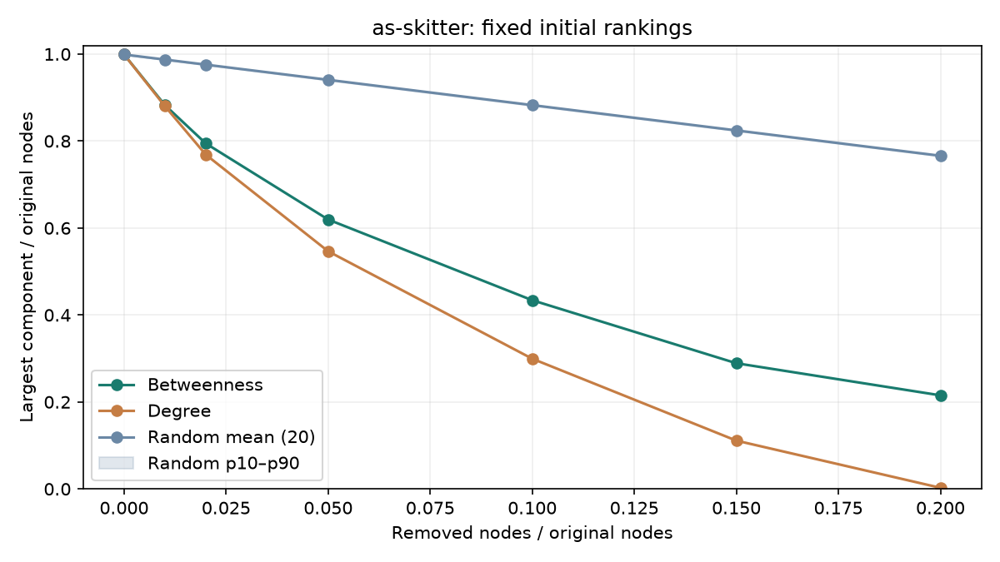

# as-skitter 全量介数中心性计算汇总报告

本报告针对 `results/as_skitter_full_12t_2048/` 中 2026-11-13 至 11-14 的全源任务，依据运行清单、现有会话记录、图缓存与最终数组整理。时间为北京时间；本次全量运行与此前的试算、优化实验分别说明。

## 1. 结果概览

任务已完成：清单记录 `status=complete`、`exact_all_sources=true`。全部 **1,464,020 个需要遍历的核心源组**已完成，结合无需核心遍历的纯树分量，覆盖全部 **1,696,415 个原始源点**，并恢复全部原图节点的介数中心性。

| 项目 | 本次记录 |
| --- | ---: |
| 原图节点数 / 无向边数 | 1,696,415 / 11,095,298 |
| 原图连通分量 / 最大分量节点数 | 756 / 1,694,616 |
| 商图核心节点数 / 边数 | 1,464,757 / 10,863,640 |
| 外围节点数 | 231,658 |
| 需要遍历的核心源组 | 1,464,020 / 1,464,020 |
| 遍历源组代表的原始源点 | 1,694,717 |
| 纯树分量解析处理的原始源点 | 1,698 |
| 检查点提交次数 | 715 次 |
| 线程数 / 每块核心源组 | 12 / 2,048 |
| 四份现有会话记录的监督墙钟之和 | **48,990.660 秒，约 13 小时 36 分 31 秒** |

核心中另有 **737 个无核心边的纯树分量锚点**，代表上表的 1,698 个原始源点，通过树结构解析恢复，不需要作为核心 BFS 源组。常规分块为 2,048 组，最后一块包含 **1,748 组**。

**耗时口径：** 13 小时 36 分 31 秒是运行目录中四份 `session_*.json` 的监督墙钟之和，包含这些会话的加载、检查点和未提交工作等开销，不包含会话之间的停顿。人工中断可能不会形成完整会话记录，因此仅凭现存会话文件无法证明它包含任务的每一次启动，也无法把该数值称为精确的全部运行时间或纯内核时间。

## 2. 数据、运行环境与处理链路

- 本次输入为手工下载的 `data/raw/as-skitter/as-skitter.txt.gz`，按 SNAP 格式读取，构造无权无向简单图；原始节点 ID 从 0 开始。文件头将数据描述为基于 skitter traceroute 的 Autonomous Systems 网络。
- 本地边表覆盖全部 1,696,415 个 ID，CSR 元数据记录无孤立节点。原文件头另有 22,622 个零度节点的注释，与本地边表不一致；本次计算以实际边表及缓存为准。当前解析器不会从 SNAP 头部自动补充未出现在边表中的节点。
- 系统为 Windows 11，处理器 Intel Core i5-13500H，12 个物理核心、16 个逻辑处理器，系统报告物理内存约 15.53 GiB。
- 清单记录 Python 3.12.6、NumPy 2.5.4、Numba 0.68.0、llvmlite 0.50.0，数值类型 `float64`，`fastmath=False`。
- 计算配置为 12 线程、调度批次大小 4、持久化分块大小 2,048、种子 45；允许的逻辑 CPU 为 `0, 2, 4, 6, 8, 9, 10, 11, 12, 13, 14, 15`。
- 链路为 CSR 图缓存 → 无损外围树商图及源点权重 → Numba 最短路径边记录内核与源组级线程 → 双累计快照 → 恢复原图全部节点 → 无向修正及归一化。
- 原图 CSR 指纹：`e8d3ed1d25bf8d0f92807a925f34038c49a881a0f361b4dde52c733bc19e8e63`；核心图指纹：`4832f105213c22e8191c43d3300fdf8f71c7cbc5f734f7f59e2066f2bbea30d5`。

原始压缩文件的 SHA-256 为 `743d4f91fbcbcace4a70d44d1190fe75869faa1398d3eb73bb2d7663c2417510`。此前一次独立准备中，CSR 和商图缓存的监督墙钟分别约 **30.74 秒**和 **20.99 秒**；这些准备时间不属于上表的四次全源会话合计。

## 3. 会话记录与中断恢复

运行目录现有四份会话记录：

| 会话结束时间 | 结束状态 | 监督墙钟 | 采样子进程私有内存峰值 | 系统最低可用内存 |
| --- | --- | ---: | ---: | ---: |
| 11-13 14:01:26 | `resource_limit` | 3,453.875 秒，约 57 分 34 秒 | 约 2,250.23 MiB | 约 1,016.57 MiB |
| 11-14 05:23:00 | `timeout`，8 小时预算 | 28,800.094 秒 | 约 2,250.30 MiB | 约 5,053.90 MiB |
| 11-14 07:22:50 | `timeout`，30 分钟预算 | 1,800.104 秒 | 约 2,249.41 MiB | 约 5,939.82 MiB |
| 11-14 23:30:22 | `ok`，全量完成 | 14,936.587 秒，约 4 小时 8 分 57 秒 | 约 2,249.79 MiB | 约 3,183.63 MiB |

结束时间取自会话文件名中的 UTC 时间并换算为北京时间；各次会话之间存在间隔。第一次因系统整体可用内存低于设置的 **1 GiB** 预留线受控中止。这不表示计算子进程独占了全部系统内存；仅凭记录无法确定其他程序的具体占用原因。后两次 `timeout` 分别由当次会话的硬墙钟预算触发，已提交进度保留。

最后一次会话记录新增 **170 块、347,860 个核心源组**，完成全量。由最终清单的 715 块减去最后会话新增的 170 块，可推得最后一次会话开始前已有 **545 块、1,116,160 组**被提交；现有前三份中止记录未分别保存各次结束时的进度，无法仅凭这些文件可靠拆分它们各自完成的组数。

最后一次会话的核心执行与归并累计 **14,908.213 秒**，监督墙钟为 **14,936.587 秒**。该次子进程 CPU 时间为 **169,495.375 秒**，除以该次监督墙钟约为 **11.35**；这只是整个会话的 CPU 时间与墙钟之比，不代表每个时刻都使用了 12 个核心。前三次会话没有保存完整的核心执行累计值，不能由此计算整个任务的精确纯内核时间。

## 4. 正确性与完整性核验

2026-11-15 对本次结果进行了只读检查：

1. **覆盖与指纹：** 使用 `scripts/audit_snapshot.py` 验证原图及核心图指纹、商图映射、源组计划、有效快照与三个最终数组的 SHA-256；核对 1,464,020 个遍历源组和 1,698 个解析处理源点的覆盖，均通过。当前数值代码指纹与运行清单一致。
2. **全节点数组：** `contributions.npy`、`bc_raw.npy`、`bc_normalized.npy` 均为长度 **1,696,415** 的 `float64` 数组，数值全部有限且非负；CSR 与商图的原始 ID 顺序一致。
3. **结果恢复：** 从最终核心快照再次调用项目的全源恢复实现，与保存的 `contributions.npy` 逐项比较，最大绝对差为 **0**。这检查保存结果与同一恢复实现的一致性。
4. **分数关系：** 全节点核对 `bc_raw = contributions / 2`，以及 `bc_normalized = bc_raw / ((n-1)(n-2)/2)`，两项最大绝对差均为 **0**；归一化使用原图总节点数 `n=1,696,415`。
5. **外围树独立核对：** 对全部 **231,658 个外围节点**，按移除节点后各分支的原始节点数计算跨分支无序端点对，并与其原始介数逐项比较，最大绝对差为 **0**。每个节点的分量大小单独取自其所在原图连通分量。
6. **叶节点性质：** 原图有 **218,399 个度为 1 的节点**，其原始介数全部为 0。

这些检查支持本次结果的覆盖完整性、一致性及外围节点数值正确性。**本次没有用另一套独立算法对 1,464,757 个核心节点的最终全源结果进行全图逐点重算。** 哈希校验、同一实现的重复恢复以及外围树核对也不能单独证明核心算法不存在系统性错误。全源精确表示源点覆盖完整，`float64` 运算仍可能产生舍入误差。

## 5. 结果观察

以下按原始介数降序排列，节点 ID 为数据文件中的原始编号；归一化介数按全图节点数计算。

| 排名 | 原始节点 ID | 度数 | 原始介数 | 归一化介数 |
| ---: | ---: | ---: | ---: | ---: |
| 1 | 5606 | 23,887 | 41,923,436,336.770 | 0.029136 |
| 2 | 6736 | 22,770 | 40,013,923,027.982 | 0.027809 |
| 3 | 6601 | 22,002 | 33,199,118,461.553 | 0.023072 |
| 4 | 7121 | 13,334 | 25,991,228,472.569 | 0.018063 |
| 5 | 5529 | 18,805 | 24,236,314,185.536 | 0.016844 |
| 6 | 8881 | 7,276 | 21,455,248,254.800 | 0.014911 |
| 7 | 628 | 13,696 | 21,054,341,928.917 | 0.014632 |
| 8 | 6600 | 17,780 | 20,766,026,669.834 | 0.014432 |
| 9 | 737 | 23,638 | 19,825,527,844.365 | 0.013778 |
| 10 | 5624 | 7,843 | 19,525,912,515.684 | 0.013570 |

节点 5606 的归一化介数约为 **0.02914**，表示对不包含该节点自身的无序端点对，经过它的最短路径份额之和约占全图可能端点对的 **2.91%**。存在多条等长最短路径时，每一对端点按路径份额计数，而非必然计为 1。

节点 8881 的度为 7,276，在表中低于多个节点，但介数排名第 6；节点 737 的度为 23,638，介数排名第 9。这说明本图中直接连接数量与最短路径中转作用并不完全相同。节点编号只能用于定位数据中的顶点，不能仅凭介数推断现实身份或因果作用。

全图有 **347,031 个节点原始介数为 0**，其中包含全部 218,399 个度为 1 的节点；其他零介数节点不应直接称作叶节点。

本地 Web 页面已接入 as-skitter 的节点筛选、固定排名失效实验和运行配置；线上页面需提交并部署更新后才会同步。失效实验详见[第 8 节](#8-节点移除实验与小连通分量验证)，全节点分数也可通过下一节的本地数组读取。

## 6. 结果文件与取用

运行目录 `results/as_skitter_full_12t_2048/` 下：

- `manifest.json`：运行配置、源组覆盖、最终状态与输出哈希。
- `bc_raw.npy`：按原图节点顺序保存的原始介数。
- `bc_normalized.npy`：相同顺序的归一化介数。
- `contributions.npy`：无向修正前的全源有序贡献。
- `snapshot_A.npy`、`snapshot_B.npy`：交替累计的核心贡献快照，有效槽以清单为准。
- `source_plan.npy` 和 `session_*.json`：源组计划和现有会话记录。

结果顺序与 `data/processed/as-skitter_csr_treeq/original_ids.npy` 一致。按原始介数降序、同分按原始 ID 升序取前十的示例：

```python
import numpy as np

ids = np.load('data/processed/as-skitter_csr_treeq/original_ids.npy')
raw = np.load('results/as_skitter_full_12t_2048/bc_raw.npy')
normalized = np.load('results/as_skitter_full_12t_2048/bc_normalized.npy')

top = np.lexsort((ids, -raw))[:10]
for index in top:
    print(int(ids[index]), float(raw[index]), float(normalized[index]))
```

运行目录和图缓存位于本地并被 Git 忽略。双快照只保留最新累计状态与最近一块摘要，没有逐块完整贡献向量，因此无法逐块复核全部历史提交或还原全部分块耗时分布。

## 7. 优化调研、试跑与采用结论

本次全量计算使用 **CSR → 树商图 → DAG 边记录 → 源组级线程并行 → 双累计快照 → 原图恢复**。此前还考虑了下列方法：

| 方向 | 当时的分析或试跑结果 | 采用判断与难度 |
| --- | --- | --- |
| 线程数 | 同一批 2,048 组、seed 46 的单次试算中，4、8、12 线程分别为 134.705、109.132、104.045 秒；12 线程相对 8 线程约快 4.9%，私有内存峰值更高。 | 本次实际使用 12 线程。单轮不能确定最优线程数；调配置难度低，需关注内存和系统状态。 |
| BFS 节点重排 | 同 1,024 组、8 线程、两轮交替比较中，核心工作加速比为 **1.057 / 1.348**，端到端墙钟比为 **0.919 / 1.228**；原图部分贡献通过容差对照。 | 两轮波动较大，未证明稳定端到端收益，未接入主链路；实现和映射兼容难度中等。 |
| 双源批量 Brandes | 同 64 组、4 个逻辑 CPU 的三轮 DAG/双源工作时间比分别为 **0.322 / 0.402 / 0.426**，中位数 **0.402×**；原图部分贡献通过容差对照。 | 当前双源原型更慢，未接入主链路。它没有实现位图 frontier、SIMD 或 DAG 边记录，不能由此否定所有批量方法；实现难度高。 |
| 双源重合诊断 | 同 64 组按分别扫描邻接项统计，约 **21.92%** 可在同层共享；双源线程阶段墙钟时间之和中，反向阶段约占 **53.04%**。 | 这不是相对生产 DAG 的总扫描减少率或加速比；诊断只支持继续关注反向阶段，不能证明唯一瓶颈。本轮进程内存峰值采样无效。 |
| BCC/BADIOS 分解 | 最大双连通块包含 **98.57% 核心节点、99.70% 核心边**；已有工作量代理约下降 **1.8%**。 | 代理不是实测加速比；核心高度集中，结合块间权重和恢复实现的复杂度，暂未实现完整 BCC 数值优化。 |
| degree-2 路径收缩 | 收缩需保持路径长度、多条最短路径、端点质量和原节点贡献。 | 原先约 4.2% 的“上界”未经严格推导，不作为确定结论；精确恢复难度高，未实现。 |
| 内核微调 | 可考虑工作区复用、调度粒度或数组类型。 | 尚无足够实测证明显著的端到端收益；需进行数值和内存对照。 |
| pull-based BFS | 可能减少部分大 frontier 的边扫描。 | 尚无本项目实测，仍需正确处理路径数与反向依赖，实现难度高。 |
| GPU 或源点采样 | GPU 需要对应硬件和新内核；采样需要单独定义和验证误差。 | 本项目没有这两条路线的 as-skitter 全量收益实测；采样结果的语义与全源结果不同。 |

选择保留原链路，是因为已测图重排收益不稳定，双源原型在约定样本下变慢，其他方法还缺少针对本图的可验证收益，或需要较大规模的精确恢复与验证工作。这个结论针对已有实现和实验范围，不排除后续方法在更多图、不同实现或充分复测下取得收益。

此前 8 线程、2,048 组的两次试算分别为 **109.132 秒（seed 46）**和 **142.858 秒（seed 47）**，对应全源核心时间的简单线性外推约 **21.7 / 28.4 小时**。本次 12 线程任务已有实际完成记录，但线程数、样本和运行条件不同，不能将外推与四份会话墙钟直接作为受控加速比。

本地原始实验记录包括 `results/as_skitter_pilot_2048_t8_20261110/`、`results/as_skitter_pilot_2048_t8_seed47_20261110/`、`results/20261110T044852Z_as_skitter_layout_dag_ab/`、`results/batch2_as_skitter_64_20261113T021855_163179Z/` 和 `results/batch2_diagnostic_64_20261113T023523_991773Z/`。这些目录被 Git 忽略；此前双源原型和诊断脚本已清理，现有记录及上面的摘要可用于查看已发生的实验，不能直接重新执行已删除的原型代码。

## 8. 节点移除实验与小连通分量验证

### 固定排名节点移除

2026-11-15，使用本次全源原始介数和原图 CSR，固定原图介数降序、度数降序及 20 次随机排列依次移除节点；介数或度数并列时按原始 ID 升序。随机种子为 42，移除比例为 0、1%、2%、5%、10%、15%、20%；每条随机曲线使用同一排列的嵌套前缀。纵轴为**剩余最大连通分量节点数 / 原图节点数**，随机范围为 10%–90% 经验分位，不是置信区间。

原图已有 756 个连通分量，初始最大分量为 1,694,616 个节点，LCC/n = **0.998940**，而不是 1。每个策略从同一张原图重新开始，移除后不重新计算介数或度数排名。



| 移除比例 | 介数排名 LCC/n | 度数排名 LCC/n | 20 次随机均值 LCC/n |
| ---: | ---: | ---: | ---: |
| 0% | 0.998940 | 0.998940 | 0.998940 |
| 1% | 0.882607 | 0.880237 | 0.987336 |
| 2% | 0.794609 | 0.768824 | 0.975695 |
| 5% | 0.619488 | 0.546474 | 0.940780 |
| 10% | 0.433942 | 0.299431 | 0.882596 |
| 15% | 0.289037 | 0.111092 | 0.824429 |
| 20% | 0.215219 | 0.002572 | 0.766131 |

20% 对应移除 339,283 个节点：按介数、度数排名移除后最大分量分别为 **365,100** 和 **4,363** 个节点，20 次随机移除的 LCC/n 均值为 **0.766131**，经验 p10–p90 为 **0.765531–0.766955**。在本图这些观测点上，固定度数排名的最大分量均小于固定介数排名；这只反映该数据、排名与指标下的结构模拟，不证明其他图、删除比例或现实故障也如此。

实验采用反向添加节点的并查集计算连通性：按固定删除顺序反向恢复节点，可在多个删除比例上复用连通状态。它先与 NetworkX 在路径、空图、非连通图及随机小图上比较；随后对完整 as-skitter 原图的三种策略在 **1% 和 20%** 的六个案例，另用前向 BFS 重新计算剩余图最大连通分量，六项全部一致。随机策略的独立 BFS 对照使用第 1 次随机排列，不代表 20 次均独立 BFS 重算。

[实验汇总 CSV](figures/as_skitter_robustness_summary.csv)随文档保存；本地 `results/as_skitter_robustness_20261115T153130/` 保存逐次结果、图、清单、哈希和 BFS 对照记录。此次实验脚本总墙钟 **48.282 秒**，包括快照审计、图加载、连通分量验证、三种失效策略、汇总和绘图；独立 BFS 检查另用 **2.348 秒**。这是本机单次记录，不是跨图性能对照。

### 非最大连通分量的介数独立核验

本次对全部 **755 个非最大连通分量、1,799 个节点**分别构建完整 NetworkX 图，每个分量全源重算原始介数，再与已保存的全图结果逐节点比较。提取时检查每个节点的全部原图邻居均在该分量内；归一化比较使用原图总节点数 1,696,415，而不是分量自身的节点数。

755 个分量中 **737 个为树、18 个含环**，最大分量仅 14 个节点；其中 237 个节点参考介数非零。采用原始介数 `atol=1e-8, rtol=1e-7`，归一化值 `atol=1e-12, rtol=1e-7`，全部 1,799 个节点通过；最大原始介数绝对差 **8.88e-16**，最大归一化绝对差 **8.08e-28**。逐分量和逐节点 CSV 保存在上述本地实验目录。

此核验直接检查了已保存的最终分数，但**不包含最大连通分量的 1,694,616 个节点**。因此，它增强了对非最大分量结果的信心，不能证明最大分量中的核心节点全源结果均正确。

运行入口为 `python -B scripts/analyze_as_skitter_robustness.py`，它创建新的时间戳结果目录，不改动原全量结果。独立 BFS 检查入口为 `python -B scripts/check_as_skitter_connectivity.py`，该脚本针对本次目录并拒绝覆盖已存在的检查结果。运行前需具备缓存、全源结果和已安装的 Numba；实验脚本在主要阶段及每次随机试验前检查系统剩余内存，低于 1 GiB 时停止，但这不是持续内存监控。
