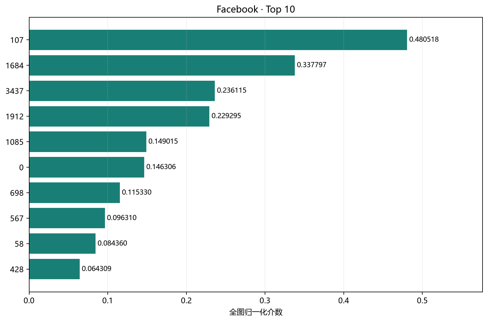
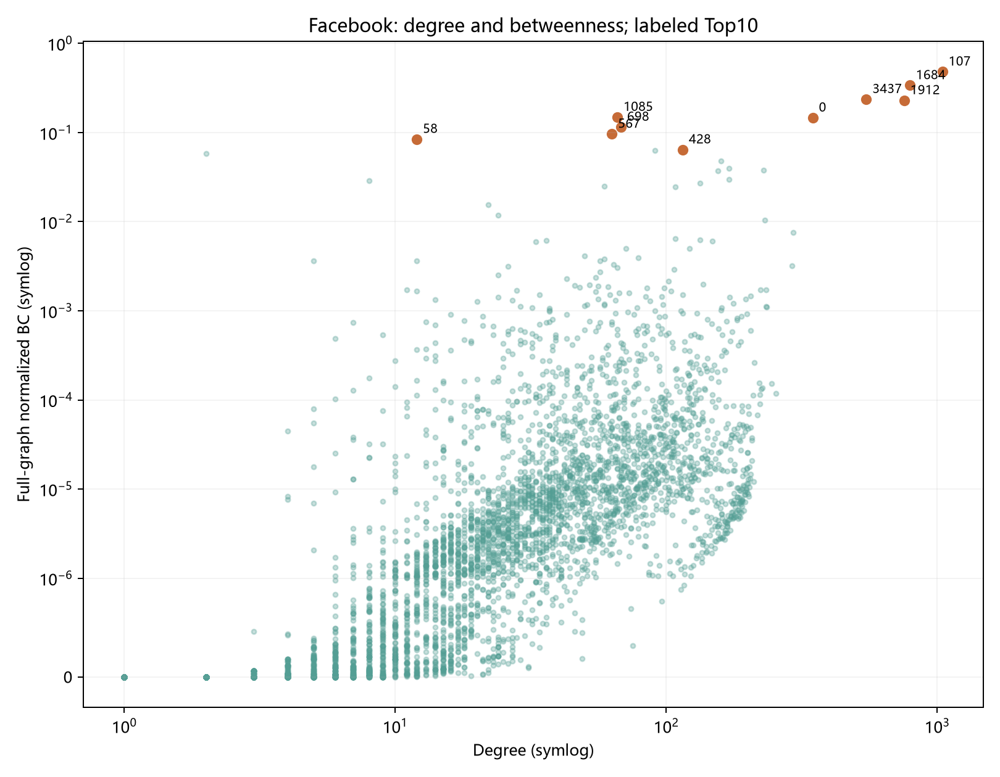
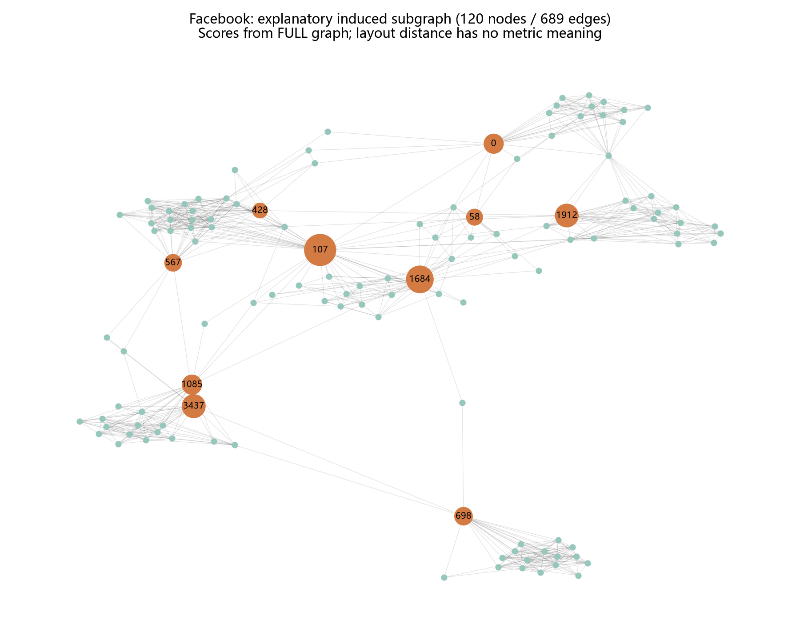
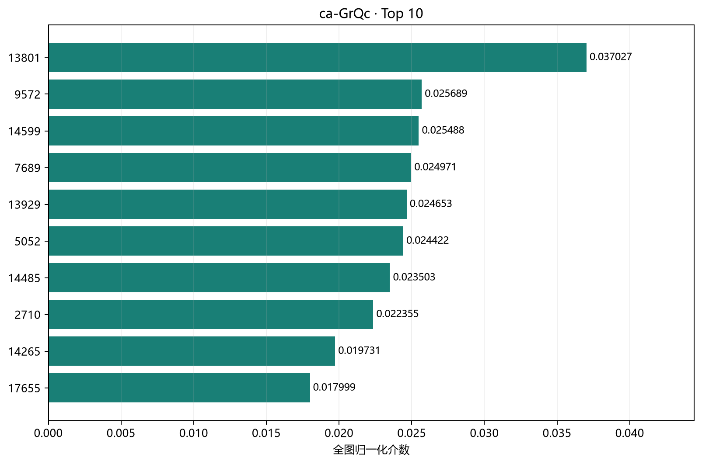
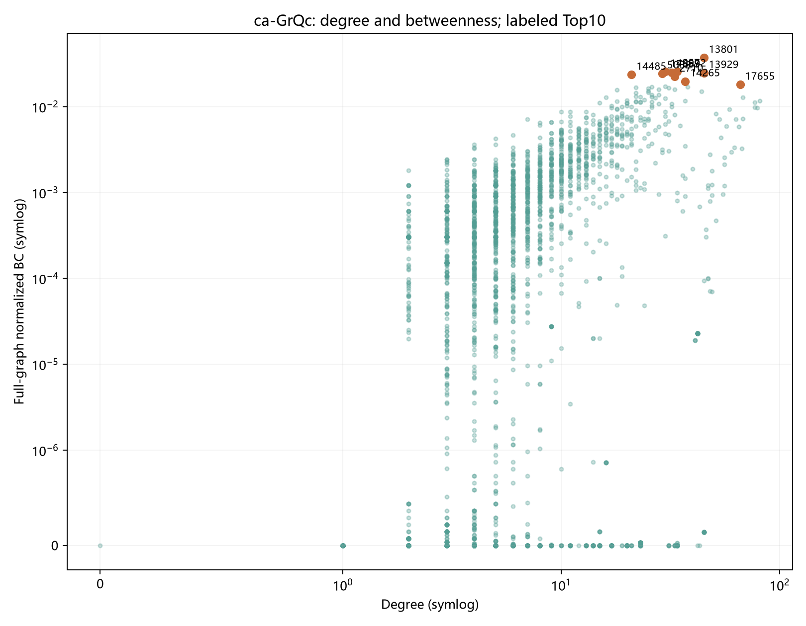
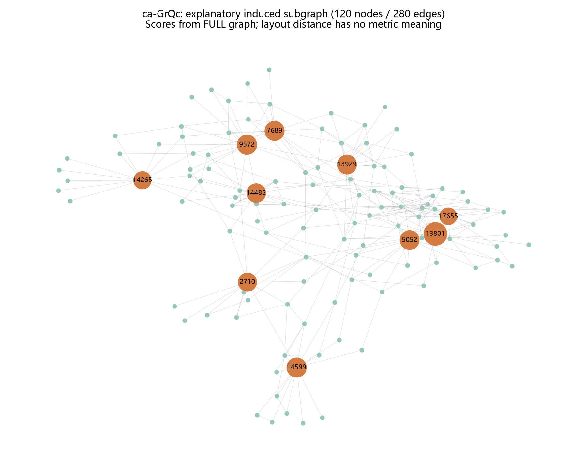
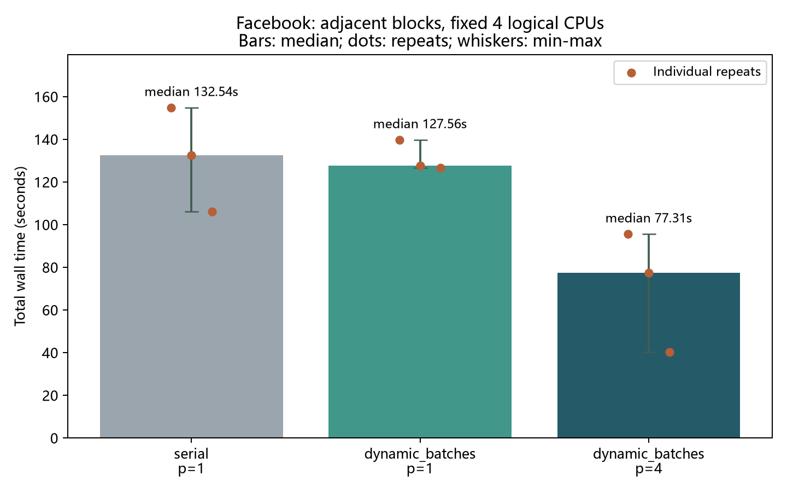
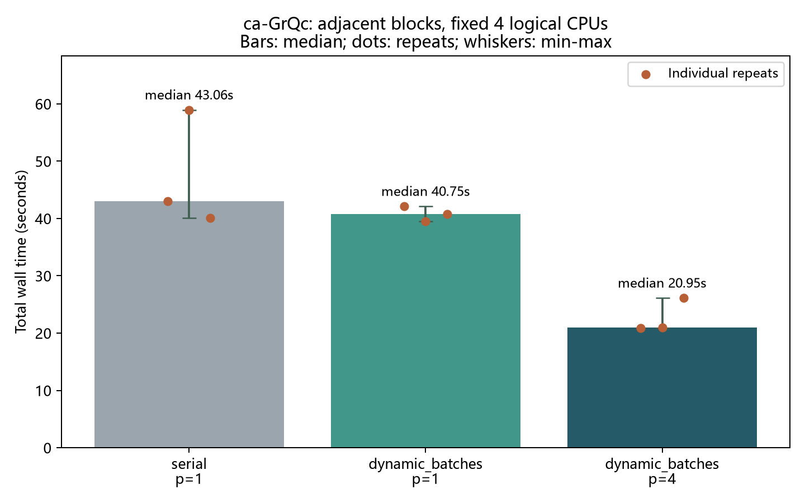

# LinkRadar 关键节点与参数报告

排名标准：全图精确介数中心性；Top10是这一指标的排序，不是适用于任何目标的统一重要性。度数衡量直接连接数，割点表示单独删除会增加连通分量数，三者含义不同。

数据均为匿名编号，不能据此还原人物身份或评价学术贡献。

## Facebook

节点=4039，边=88234，平均度=43.691013，连通分量=1，最大分量=4039。
图指纹：`08b9ab47b42c33de7fc51342d94771d116eca65aea905dd0fa8bf5a81fed8b83`。
原文件SHA256：`7cc432d08910b3a940ce90f7da94c13aaf048b04724eafcdf3050b28acc49daf`；原始自环行数=0，去重行数=0。
全节点NetworkX对照通过；raw最大绝对误差=2.91038e-11，normalized最大绝对误差=5.55112e-17；atol=1e-08，rtol=1e-07。

| 介数排名 | 原始ID | 度数 | 度排名 | raw介数 | 归一化介数 | 分量大小 | 割点 |
|---|---|---|---|---|---|---|---|
| 1 | 107 | 1045 | 1 | 3916560.144441 | 0.480518079 | 4039 | 是 |
| 2 | 1684 | 792 | 2 | 2753286.686908 | 0.337797450 | 4039 | 是 |
| 3 | 3437 | 547 | 4 | 1924506.151571 | 0.236115357 | 4039 | 是 |
| 4 | 1912 | 755 | 3 | 1868918.212257 | 0.229295340 | 4039 | 是 |
| 5 | 1085 | 66 | 853 | 1214577.758360 | 0.149015092 | 4039 | 否 |
| 6 | 0 | 347 | 5 | 1192496.113079 | 0.146305921 | 4039 | 是 |
| 7 | 698 | 68 | 821 | 940024.246482 | 0.115330450 | 4039 | 是 |
| 8 | 567 | 63 | 904 | 784996.905594 | 0.096310331 | 4039 | 否 |
| 9 | 58 | 12 | 2918 | 687594.983375 | 0.084360206 | 4039 | 否 |
| 10 | 428 | 115 | 383 | 524164.067776 | 0.064309062 | 4039 | 否 |

局部图最多120个节点，选择全图Top10及其邻居作确定性展示；未在局部子图重算排名，也不将示意布局解释为地理或最短路距离。

## ca-GrQc

节点=5242，边=14484，平均度=5.526135，连通分量=355，最大分量=4158。
图指纹：`c73075918cf45d64b4e4c8eeb9b550c5fa44abb63d83f111acceb02d03e68f26`。
原文件SHA256：`513efa8bb5c6d3d739797ca028d4a26a7df6bc20adcf3e722e18d1bcdb0e62d5`；原始自环行数=12，去重行数=14484。
全节点NetworkX对照通过；raw最大绝对误差=2.91038e-11，normalized最大绝对误差=3.46945e-18；atol=1e-08，rtol=1e-07。

| 介数排名 | 原始ID | 度数 | 度排名 | raw介数 | 归一化介数 | 分量大小 | 割点 |
|---|---|---|---|---|---|---|---|
| 1 | 13801 | 45 | 42 | 508435.354011 | 0.037027150 | 4158 | 是 |
| 2 | 9572 | 34 | 100 | 352746.524917 | 0.025689006 | 4158 | 是 |
| 3 | 14599 | 30 | 147 | 349992.173442 | 0.025488418 | 4158 | 是 |
| 4 | 7689 | 32 | 131 | 342881.133418 | 0.024970552 | 4158 | 是 |
| 5 | 13929 | 45 | 43 | 338516.368096 | 0.024652685 | 4158 | 是 |
| 6 | 5052 | 29 | 151 | 335351.919635 | 0.024422232 | 4158 | 是 |
| 7 | 14485 | 21 | 245 | 322725.945605 | 0.023502736 | 4158 | 否 |
| 8 | 2710 | 33 | 121 | 306964.800129 | 0.022354920 | 4158 | 是 |
| 9 | 14265 | 37 | 78 | 270935.454568 | 0.019731059 | 4158 | 是 |
| 10 | 17655 | 66 | 8 | 247145.822128 | 0.017998563 | 4158 | 否 |

局部图最多120个节点，选择全图Top10及其邻居作确定性展示；未在局部子图重算排名，也不将示意布局解释为地理或最短路距离。

## 首轮实验参数与证据

原始结果目录：`results/20261023T054258_364875Z`。全图无权无向、endpoints=False，全部起点，raw与normalized均对照；原图全部分量与孤立点保留。
首轮p=1/2/4，B=128，重复3次，seed=42；随机失效20次。具体原始参数以该目录config_resolved.yaml为准。首轮Facebook基线异常，网页明确保留警示。
归一化分母=(n−1)(n−2)/2；原始介数为无序端点对的最短路径比例之和。排名按raw降序、同分按整数原始ID升序；度排名也以原始ID打破并列。
本轮新增割点与分量大小在完整原图上求得，不使用局部示意图推断。

## Facebook相邻区组复测

复测状态：complete；基线可比性启发式检查：True。实际逻辑CPU亲和性=[0, 1, 2, 3]，不代表相同数量的物理核心。
原始运行：`results/20261023T061912_984947Z_facebook_paired`。

| 模式 | 实际p | 次数 | total中位数 | min–max | 观察加速比 |
|---|---|---|---|---|---|
| serial | 1 | 3 | 132.538355 | 106.061–154.807 | 1.000 |
| dynamic_batches | 1 | 3 | 127.562846 | 126.671–139.722 | 1.039 |
| dynamic_batches | 4 | 3 | 77.309161 | 40.325–95.576 | 1.714 |

p=1比值落在[0.8,1.25]仅作可比性筛查，不是显著性检验；若未通过，则四进程比值也仅作描述，不声称可靠多核加速。不同网络与不同协议分别统计。

## ca-GrQc相邻区组复测

复测状态：complete；基线可比性启发式检查：False。实际逻辑CPU亲和性=[0, 1, 2, 3]，不代表相同数量的物理核心。
原始运行：`results/20261023T090440_116909Z_ca_grqc_paired`。

| 模式 | 实际p | 次数 | total中位数 | min–max | 观察加速比 |
|---|---|---|---|---|---|
| serial | 1 | 3 | 43.056132 | 40.113–58.923 | 1.000 |
| dynamic_batches | 1 | 3 | 40.753431 | 39.503–42.095 | 1.057 |
| dynamic_batches | 4 | 3 | 20.946103 | 20.896–26.099 | 2.056 |

p=1比值落在[0.8,1.25]仅作可比性筛查，不是显著性检验；若未通过，则四进程比值也仅作描述，不声称可靠多核加速。不同网络与不同协议分别统计。

## 如何理解和展示

Python负责全图算法、验证和CSV导出；Web页面读取已经完成的真实结果，可筛选、排序、搜索匿名ID并查看局部连接。无需浏览器重算Brandes，也无需外网或云服务。
当前交付为静态HTML/JS页面，可用本地HTTP预览或GitHub Pages工作流发布；实际线上状态以部署记录为准。若需从网页提交计算任务，再加入后端API及任务管理。
度数高不一定介数高；高介数也不保证是割点，割点按完整原图验证。排名与失效实验结论只针对当前拓扑。
